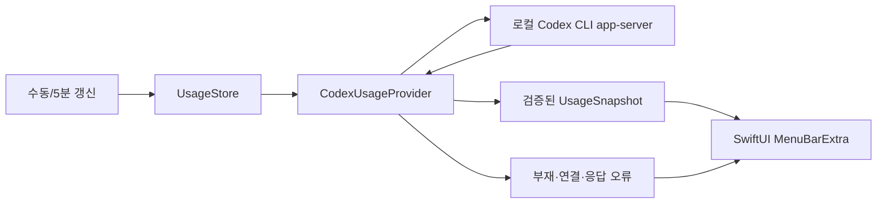

# Tokenly 구현 계획

## 80. AGY 격리 개발 앱의 자동 조회 프로세스 관찰 (2026-10-30)

- 기존 설치 앱과 다른 번들 ID `io.github.jbbdyee.tokenly.agyverify.20261030`의 Debug 앱을 임시 경로에 빌드했다. 개발 앱 도메인에서만 AGY 표시 ON, Codex·Claude 표시 OFF로 설정했다. 개발 앱만 실행했고 설치 앱은 계속 실행 중이었다. 공식 문서의 read-only print `/usage` 조건과 `disableSlashCommands`가 true가 아님을 확인했다.
- 개발 앱 자식 AGY CLI 시작 2회를 실행 후 약 1.21초·301.29초에 관찰했다(간격 약 300.08초). 관찰된 실행 시간은 약 6.15초·6.36초, 중첩 없음. 두 번째 종료 약 90초 뒤 개발 앱만 종료해 추가 자동 폴링을 막았다. 이는 5분 타이머가 실제 프로세스를 시작했다는 근거이며 종료 코드·JSON·스냅샷 성공 근거는 아니다.
- 사용자 팝오버 캡처에서 주간 버킷 2개의 잔여율·초기화 시각, `AGY 직접 조회` 출처와 `직접 조회 마지막 성공` 시각을 확인했다. 코드 흐름과 함께 첫 직접 조회의 성공 스냅샷 반영을 뒷받침한다. 약 5분 뒤 두 번째 자동 조회도 사용자 관찰과 프로세스 시작으로 확인했지만 두 번째 응답 성공은 별도 입증되지 않았다. statusLine 폴백·우선순위는 모의 XCTest 검증만 해당한다. 서버 신선도·인증 캐시 영향은 미검증이다. 화면 자동화 연결은 실패했고 이번 세션에는 Debug 앱 빌드만 했으며 XCTest·Release 빌드는 다시 실행하지 않았다. 코드 변경 없음, 실제 사용량·계정·원본 JSON 기록 없음.

## 79. AGY 공식 CLI 독립 갱신 구현 (2026-10-30, 기능 브랜치)

- `AGYDirectUsageProvider`가 공식 CLI print `/usage`를 비동기 유틸리티 작업에서 실행한다. stdout/stderr는 메모리에서 제한 크기로만 읽고 원문·계정·실제 수치를 로그에 남기지 않는다. 20초 타임아웃, CLI 없음·인증 오류·비정상 종료·JSON/필수 필드 오류를 구분한다. `disableSlashCommands == true`면 모델 프롬프트로 잘못 전송될 위험을 피하려 실행을 거부한다.
- `command.data`의 버킷 배열에서 기존 statusLine에서 관찰된 주간 ID 두 종류만 선택하고, 0~1 `remaining_fraction`을 퍼센트로 바꾼다. `reset_time`은 ISO-8601 형식을 검증하며 누락/오류 시 직접 조회를 실패 처리한다. 미확인 5시간 버킷은 만들지 않는다. 상태줄 Provider는 유지하며 직접 조회 실패 시 로컬 상태줄 수신을 시도한다. 더 오래된 폴백이 마지막 성공 스냅샷을 덮지 않도록 Store가 거부한다.
- AGY 표시가 켜졌을 때 300초 자동 조건과 수동 조회를 분리하고, 진행 중 요청 중복을 막는다. 팝오버는 표시 출처와 직접/상태줄의 마지막 성공 시각을 분리한다. Claude Provider와 Codex 조회 정책, 기존 설정 키는 바꾸지 않았다.
- **검증:** 최종 소스에서 모의 응답과 가짜 CLI만 사용한 전체 XCTest 403개 통과, Debug·Release 빌드 성공. 실제 AGY CLI 자동 폴링은 이번 단계에서 실행하지 않았다. 임시 DerivedData·결과 번들은 저장소 밖에 두었다. 실제 계정 값·인증 캐시 쓰기·다른 계정 구조·장시간 실행 비용은 미검증이다.

> **현재 앱 상태(2026-10-29):** 곰돌이형 관련 단계는 역사적 구현·시안 기록이다. Stage 6-6에서 제품 스타일은 숫자형·최소형만 남겼고, Stage 6-6B에서 승인된 전용 제품 파일을 삭제했다. 제작 시안은 `Preview/Heart3D/`에 보존했다. Stage 6-8B에서 배포 스크립트의 곰돌이 에셋 필수 검사를 제거하고 개발용 ZIP을 검증했다. 아래 과거 절의 곰돌이 리소스 검사는 당시 배포 구성이다. 최신 구현·검증·미검증 범위는 `HANDOFF.md`와 `SYSTEM-MONITOR.md`를 참조한다.

## 1. 범위와 검증 결과

Tokenly는 SwiftUI `MenuBarExtra`로 여러 AI 서비스의 사용량을 보여 줄 독립적인 macOS 앱이다. 사용자는 Codex와 AGY의 실제 한도 표시 성공을 보고했다. 이후 사용자가 아코디언 열림과 AGY 접기/펼치기를 확인했다. OpenAI API 연동은 보류한다. Claude 구독은 공식 Claude Code 상태줄 JSON 수신 코드를 구현했지만 실제 계정 수신·사용자 설정 연결·GUI가 미검증이다. Gemini는 조사 단계로 유지한다. AGY는 Gemini API·Gemini CLI와 별도로 검증한다. 토큰 수, 구독 한도, API 비용을 합산하지 않는다.

2026-10-22 일반 macOS 사용자 터미널에서 공식 Codex app-server의 `initialize` → `initialized` → `account/rateLimits/read`로 읽기 전용 실제 조회에 성공했다. 버킷은 1개였고, 당시 300분 창은 사용 35%·잔여 65%·초기화 2026-10-23 01:42 KST, 10080분 창은 사용 77%·잔여 23%·초기화 2026-10-27 15:47 KST였다. **이는 검증 당시 수치이며 앱에는 고정하지 않는다.** 작업 샌드박스에서는 app-server의 SQLite 상태 저장소 권한 문제로 같은 조회를 완료하지 못했다. 현재 CLI는 `codex-cli 0.163.0-alpha.10.2`다. 공식 프로토콜과 필드는 [Codex app-server 문서](https://learn.chatgpt.com/docs/app-server)를 따른다.

## 2. 구현 순서와 현황

| 순서 | 구현·검증 | 현황 |
| --- | --- | --- |
| 1. 기술 검증 | 공식 읽기 전용 경로, 실제 300분·10080분 창 확인 | 일반 사용자 터미널에서 완료 |
| 2. 프로젝트 초기화 | Routine Scout와 별도 Xcode macOS 프로젝트, `MenuBarExtra` | 기존 앱의 실제 메뉴 막대·Codex 조회 성공 (사용자 확인) |
| 3. 모델·Provider | JSONL stdio 통신, 한도 필드 검증, CLI 부재·오류 처리 | 유지; 현재 Xcode XCTest 총 16개 통과 |
| 4. 메뉴 UI | 사용·잔여 비율, 초기화 시각, 데이터 없음·조회 중·오류 | 캡슐형 표시 오류 확인; 현재 단일 텍스트에서 두 한도 표시를 실제 GUI 확인, 부분 글꼴 차이는 미미함; 예외 상태 GUI 확인 필요 |
| 5. 갱신 | 수동 및 5분 자동 새로고침, 중복 요청 방지, 이전 데이터 표시 | 연속 조회·실패 상태 단위 테스트 통과; 실제 버튼·타이머 확인 필요 |
| 6. 검증·배포 | 실제 계정 값 대조, XCTest, GUI 확인, README·서명 검토 | 미완료 |

## 3. 프로젝트 구조

```text
Tokenly/
├── Doc/
│   ├── SPEC.md
│   ├── TODO.md
│   └── IMP-PLAN.md
└── src/
    ├── Tokenly.xcodeproj
    ├── Tokenly/
    │   ├── TokenlyApp.swift            # 메뉴 막대 진입점
    │   ├── UsageStore.swift            # 화면 상태·새로고침
    │   ├── Models/UsageSnapshot.swift  # 창 길이·비율·시각
    │   ├── Models/ExternalUsage.swift   # AGY 쿼터·OpenAI API 토큰/비용
    │   ├── Models/HeartGauge.swift      # 하트 대표 잔여율·상태 계산, 팝오버 하트 대시보드
    │   ├── Providers/UsageProvider.swift
    │   ├── Providers/CodexUsageProvider.swift
    │   ├── Providers/OpenAIAPIUsageProvider.swift
    │   ├── Providers/AGYStatusLineProvider.swift
    │   ├── Providers/ClaudeSubscriptionProvider.swift
    │   ├── ExternalProviderStore.swift
    │   ├── KeychainAdminKeyStore.swift
    │   ├── ProviderDisplaySettings.swift
    │   ├── AGYStatusLineBridge.py
    │   └── Views/UsageMenuView.swift, TokenlySettingsView.swift, HeartGaugeView.swift  # 젤리 하트 컴포넌트
    └── TokenlyTests/TokenlyTests.swift
```

`UsageProvider`·`UsageSnapshot`은 검증된 Codex 300분·10080분 창 전용으로 유지한다. 다른 지표는 `ExternalUsageProvider`·`ExternalUsageSnapshot`·`ExternalMetrics`로 분리했다. OpenAI API에는 기간별 토큰·비용, AGY에는 버킷별 잔여 비율·초기화 시각을 사용하므로 모든 Provider에 5시간·7일 창을 강제하지 않는다. AGY 실제 표시 성공 이후에도 두 Provider의 지표 의미가 달라 공통화는 별도 검토한다. Routine Scout의 코드·아이콘·설정은 사용하지 않는다.

## 4. 데이터 흐름과 보호 경계



Provider는 `Process`로 설치된 CLI의 `app-server --listen stdio://`를 실행한다. JSONL로 `initialize` 응답을 받은 후 `initialized`를 보내고 `account/rateLimits/read`를 호출한다. `rateLimitsByLimitId.codex` 또는 기본 `rateLimits`에서 300분·10080분 창을 찾는다. 유효 범위 0~100의 `usedPercent`가 있을 때만 `100 − usedPercent`를 표시하고, `resetsAt` Unix 초를 현지 시각으로 변환한다. CLI가 없거나 실행되지 않으면 앱은 오류 상태를 표시한다. 타임아웃은 20초다.

앱은 인증정보 파일을 직접 읽거나 수정하지 않는다. 계정 식별자·토큰·원시 JSON·app-server 진단 출력을 기록하지 않는다. 마지막 성공 스냅샷은 메모리에만 두며 후속 요청이 실패하면 `이전 데이터`로 표시한다.

## 5. 테스트 계획

- 비밀 없는 고정 JSON으로 300분·10080분 창, 잔여 계산, 부분·빈·잘못된 응답, 읽기 오류를 확인한다.
- CLI 부재와 탐색 경로를 테스트한다. 타임아웃·반복 갱신은 실제 앱에서 별도 확인한다.
- 일반 사용자 환경에서 앱의 표시값을 공식 Codex 표시값과 비교한다. 원시 응답과 계정 식별정보는 기록하지 않는다.
- Xcode에서 메뉴 막대 표시, 수동 갱신, 5분 자동 갱신, 조회 실패, 앱 재실행을 확인한다.
- 앱 빌드와 XCTest 실행, 실제 GUI 실행 결과를 구분해 기록한다. 작업 샌드박스의 `xcodebuild test`는 테스트 서비스 접근 제한으로 실행되지 않았지만, Xcode GUI에서 현재 XCTest 16개가 통과했다.

## 6. 위험과 대응

| 위험 | 대응 |
| --- | --- |
| CLI 미설치·인증 없음·샌드박스의 상태 저장소 접근 제한 | 앱은 종료하지 않고 실패 안내; 일반 사용자 환경에서 재검증 |
| CLI 버전이나 JSON 계약 변경 | 선택 필드·부분 창을 안전하게 처리하고 실제 계약을 다시 확인 |
| 창이 없거나 다른 길이로 제공됨 | 수치를 추정하지 않고 데이터 없음으로 표시 |
| 과도한 호출·중복 요청 | 5분 간격, 진행 중 재호출 차단, 20초 제한 |
| 오래된 값 또는 조회 실패 | 마지막 성공 시각과 `이전 데이터` 명시 |
| 다른 서비스 지표와 혼동 | Provider별 조회 경계와 지표 단위 분리; 후속 서비스 지원 확정 금지 |
| 인증정보 노출 | 공식 로컬 CLI만 호출하고 인증 파일·원시 응답을 취급하지 않음 |

## 7. 다음 확인

사용자는 캡슐 변경 이전 앱에서 실제 Codex app-server 조회와 macOS 메뉴 막대 표시 성공을 확인했다. 현재는 그때 동작한 **단일 텍스트 라벨**로 복구해 실제 응답 기반 잔여 비율을 `5h 29% · 7d 17%` 형식으로 만든다. 한 창만 있으면 다른 창은 `—`, 응답이 비어 있으면 `데이터 없음`, 첫 조회 중이면 `조회 중`, 실패 시 성공값이 없으면 `조회 실패`, 이전 성공값이 있으면 `이전 · …`로 표시한다. 팝오버의 진행 막대는 잔여 비율이며 초록(50% 초과)·주황(20% 초과~50%)·빨강(20% 이하)으로 구분한다. 팝오버 대비 개선과 수동·5분 자동 갱신 코드는 유지했다.

Xcode에서 현재 앱·테스트 타깃 빌드와 XCTest 16개 통과를 확인했다. 테스트는 디코딩된 두 한도 값과 스타일 적용 후 원문 보존을 확인한다. 사용자는 현재 메뉴 막대에서 **두 한도 수치가 정상 표시됨**을 실제 GUI에서 확인했으며, 부분 글꼴의 시각적 차이는 거의 없었다. 누락·이전 데이터 표시, 수동 버튼 클릭과 5분 타이머, 현지 시간대 표시와 실제 계정 값 대조는 별도 확인이 필요하다. 배포 서명·공증은 별도 검토가 필요하다.

## 8. 메뉴 막대 라벨과 팝오버의 현재 방식

[Apple의 `MenuBarExtra` 문서](https://developer.apple.com/documentation/swiftui/menubarextra)는 `init(content:label:)`로 사용자 지정 SwiftUI `View`를 라벨로 제공하고 `.window` 스타일로 팝오버형 내용을 표시할 수 있음을 명시한다. 이전 시도에서 라벨 안에 `ForEach`로 만든 두 캡슐 그룹과 개별 숫자 색상을 넣었지만, 사용자의 실제 GUI에서는 **아이콘과 `5h`만 표시**됐다. `UsageStore.menuBarText`는 두 값을 이미 단일 문자열로 만들고 기존 GUI에서도 표시됐으므로 데이터 계산·바인딩보다는 새 라벨 구성에서 표시가 끊긴 것으로 판단한다. 다만 메뉴 막대 가용 폭에 따른 잘림인지 SwiftUI 라벨 레이아웃·색상·배경 처리 중 무엇이 직접 원인인지는 확정할 근거가 없다.

**당시 방식(17절에서 변경):** 시스템 아이콘 옆에 한 개의 `Text`를 둔다. `UsageStore.menuBarText` 문자열을 `AttributedString`으로 감싸고 `5h`·`7d` 범위만 10pt 보통 굵기, 나머지 비율은 12pt 굵기로 지정한다. [Apple의 `Text(AttributedString)` 문서](https://developer.apple.com/documentation/swiftui/text/init%28_%3A%29)는 문자열 범위별 스타일을 한 `Text`에 전달하는 방식을 지원한다. 기존처럼 두 값, 누락값 `—`, 이전 데이터 `이전`을 동일한 문자열로 전달하며 캡슐·개별 색상·별도 그룹은 사용하지 않는다. 빌드와 XCTest 13개가 통과했고 사용자는 실제 메뉴 막대에서 두 비율이 모두 표시됨을 확인했다. **부분 글꼴 스타일은 실제 GUI에서 눈에 띄는 차이가 없었다.** 수치가 정상 표시되는 현재 텍스트 라벨을 안정적인 기본 방식으로 유지하고 추가 SwiftUI 라벨 실험은 중단한다. 캡슐형은 실제 GUI에서 표시 오류가 발생했다. 그룹형·색상형 디자인은 향후 테마 기술 검증으로 보류한다.

팝오버의 불투명한 `NSColor.windowBackgroundColor` 배경은 다크 모드에서 검게 무거워 보인다는 실제 GUI 피드백이 있었다. 현재는 [SwiftUI `regularMaterial`](https://developer.apple.com/documentation/swiftui/material)을 루트 배경으로 사용한다. Apple 문서상 일반 재질은 배경을 흐리면서 일부 투과시키고 외관에 따라 반응한다. [AppKit `NSVisualEffectView`](https://developer.apple.com/documentation/appkit/nsvisualeffectview)는 팝오버에서 시스템이 이미 생성하는 시각 효과이므로 별도 뷰·커스텀 윈도우를 추가하지 않았다. 일반 재질은 더 얇은 재질보다 불투명해 지나친 배경 비침을 줄이려는 선택이다. 다만 실제 투명도와 가독성은 두 외관에서 GUI 확인이 필요하다.

제목과 잔여 수치는 기존 강조를 유지하고 보조 정보는 기본 전경색과 작은 글꼴로 위계를 둔다. 초기화 시각은 사용 비율과 같은 `HStack`에서 분리해 별도 줄에 놓고 세로 방향 줄바꿈을 허용한다. 마지막 성공 시각도 줄바꿈을 허용한다. 폭 300pt와 14pt 안쪽 여백은 유지해 팝오버가 불필요하게 커지지 않게 했다. 메뉴 막대 단일 텍스트 라벨, Provider, 잔여 막대의 색상 기준, 5분 갱신은 변경하지 않았다. 변경 후 앱 빌드와 XCTest 12개가 통과했으며 실제 GUI의 라이트·다크 모드 결과는 미검증이다.

## 9. 장기 확장과 문서 관리

당시 메뉴 막대 테마 계획은 숫자형 하나였고, 17절에서 숫자형·최소형·아이콘형을 구현했다. 후속 테마 개발에서는 AppKit `NSStatusItem`·`NSStatusBarButton`에 속성 문자열을 적용하거나 사용자 지정 뷰를 사용하는 방식을 **기술 검증 후보**로 비교한다. 메뉴 막대 렌더링·폭·접근성을 실제 GUI에서 확인한 뒤에만 채택하고, 테마별 라벨을 조회 모델과 분리한 다음 사용자 설정 저장을 설계한다. 추가 Provider의 실제 계정 계약을 검증한 뒤 서비스별 로고·메뉴 막대 표시 대상 선택과 시간 단위·잔여 비율 구분을 설계한다. Tokenly 전용 앱 아이콘은 Routine Scout와 독립적인 콘셉트를 나중에 결정한다. Claude 구독·Gemini는 자동 조회 후보 검증 단계이고 OpenAI API는 연결 보류 중이다. AGY는 사용자 보고로 실제 한도 표시가 확인됐다.

새 요구사항이나 사용자 동작·설계 변경이 생기면 관련 문서를 갱신한다. 미래 아이디어는 현재 구현과 분리하고 구현·테스트·실제 GUI 검증을 각각 기록한다. 무효가 된 계획은 정리하며 문서 사이의 모순을 확인한다. 사용자 기능이나 설계를 바꾸지 않는 내부 코드 수정에는 불필요한 문서 변경을 하지 않는다.

## 10. 독립 실행과 로그인 항목

Release 구성으로 `Tokenly.app`을 빌드해 `dist/Tokenly.app`에 복사했다. 번들 식별자는 `com.tokenly.app`이고 기존 `Info.plist`의 `LSUIElement=true`가 메뉴 막대 전용 실행을 담당한다. 앱은 개발용 DerivedData 경로를 참조하지 않으며 Codex CLI·인증정보를 내장하지 않는다. 이번 번들은 로컬 임시 사용을 위한 ad-hoc 서명이며 일반 배포를 위한 Developer ID 서명·공증은 아직 하지 않았다.

Finder에서 시작한 앱은 터미널의 `PATH`를 그대로 받지 않을 수 있다. Provider는 전달받은 `PATH`를 먼저 살핀 뒤 `/opt/homebrew/bin`, `/usr/local/bin`, `~/.local/bin`, `~/.npm-global/bin`의 실행 가능한 `codex`를 찾는다. 찾지 못하거나 실행할 수 없으면 기존 오류 상태를 사용한다. 사용자는 `/Applications` 설치 후 Xcode 없이 실행해 실제 Codex 사용량 조회 성공을 확인했다. 이 결과는 설치 환경에서 CLI 탐색과 app-server 조회가 함께 동작했음을 보여 주지만, 선택된 CLI 경로는 별도로 기록하지 않았다. 사용자별 버전 관리자 등의 다른 경로는 현재 자동 탐색 범위 밖이다.

[Apple `SMAppService` 문서](https://developer.apple.com/documentation/servicemanagement/smappservice)에 따라 메인 앱의 로그인 항목에 `SMAppService.mainApp`을 사용한다. 사용자가 토글을 조작할 때만 `register()`/`unregister()`를 호출하고, 시작 시에는 `status`만 읽는다. `enabled`·`notRegistered`·`requiresApproval`·`notFound`를 구분해 안내한다. Xcode/임시 폴더 실행에서는 설치 위치를 확인해 토글을 비활성화하고, `/Applications` 또는 `~/Applications`의 앱에서만 변경한다. 번들 식별자와 안정된 설치 위치가 필요하며 서명·시스템 승인 조건은 실제 설치 환경에서 확인해야 한다. 테스트는 가짜 컨트롤러로 등록·해제·실패를 검증했으며 사용자 로그인 항목은 변경하지 않았다.

앱·테스트 타깃 빌드, ad-hoc 서명 번들 검증, XCTest 16개 통과를 확인했다. 사용자는 `/Applications`에 설치한 앱을 Xcode 없이 실행해 실제 Codex 사용량 조회 성공을 확인했다. 최초에는 앱이 로그인 시 자동 실행 상태를 확인하지 못했으나 **정확한 원인은 미확정**이다. 이후 사용자가 macOS 시스템 설정에서 Tokenly를 로그인 항목에 직접 추가하자 앱에 `켜짐 · 다음 로그인부터 실행됩니다.`가 표시됐다. 이는 시스템 설정을 통한 등록과 앱의 활성 상태 조회가 동작한 검증 결과다. 앱 내부 토글만으로 신규 등록·해제하는 동작과 재로그인 후 자동 실행, 독립 앱 종료 후 재실행은 아직 검증하지 않았다.

## 11. 추가 Provider 기술 조사 (2026-10-23)

이번 조사는 공식 문서·공개 스키마와 설치된 CLI의 **버전·도움말만** 확인했다. 계정별 API 호출, 모델 요청, 로그인, 키 열람, 설정 변경은 하지 않았다. `claude` 2.1.292와 `agy` 1.4.5는 `PATH`에서 확인됐고 `gemini`는 발견되지 않았다. `claude --help`와 `agy --help`에는 독립적인 비대화형 사용량 조회 명령이 보이지 않았다. 이는 기능 부재의 증명이 아니며, 특히 AGY는 대화형 `/usage`와 공식 상태줄 계약이 따로 있다. OpenAI API용 관리자 자격이나 과금 상태는 확인하지 않았다.

| 서비스 | 공식 조회 경로·가능 지표 | 잔여 비율·초기화 | 인증·제약 | 현재 상태 |
| --- | --- | --- | --- | --- |
| **Codex** | 공식 app-server `account/rateLimits/read`: 구독 300분·10080분 창의 사용률·초기화. API 토큰·비용과 별개 | `100 − usedPercent`, `resetsAt` 확인 | 기존 로컬 Codex CLI 인증; 5분 새로고침 | **실제 조회 검증 완료** (설치 앱 포함) |
| **Claude** | [Claude Usage and Cost Admin API](https://platform.claude.com/docs/en/manage-claude/usage-cost-api): 조직 API 토큰·USD 비용. [Rate Limits API](https://platform.claude.com/docs/en/manage-claude/rate-limits-api): 설정된 API 한도. 개인 구독은 [Settings → Usage](https://claude.com/pricing)에서 확인 | Admin 보고 API가 개인 구독 잔여 비율·초기화 시각을 준다는 근거 **미확인**; API 보고 버킷 시각은 있음 | Admin API 자격 또는 `org:admin` 등 조직 권한 필요; 개인 계정에 Admin API 미적용. 보고 데이터 보통 5분 지연, 지속 폴링 권장 1분 이상 | **공식 API 보고 지원 확인, 실제 조회 미검증**. 개인 구독의 공식 기계 조회 방법 미확인 |
| **Gemini** | [Gemini API AI Studio Usage·Billing](https://ai.google.dev/gemini-api/docs/billing/) 및 [Rate limits](https://ai.google.dev/gemini-api/docs/rate-limits): 프로젝트별 API 사용·비용·RPM/TPM/RPD. 별도 [Gemini CLI `/stats model`](https://geminicli.com/docs/resources/quota-and-pricing/)은 세션 토큰·적용 한도 표시 | API 대시보드의 구독형 잔여 비율·재설정 시각 필드 **미확인**; RPD는 태평양 시간 자정 재설정 | API 키·프로젝트/청구 권한 또는 CLI 로그인 필요; 과금·호출 제한은 프로젝트·모델별. 현지 `gemini` 실행 파일 미발견 | **공식 대시보드·CLI 표시 확인, 실제 조회 미검증**. 안전한 프로그램 조회 계약은 추가 확인 필요 |
| **OpenAI API** | [조직 Usage GET](https://developers.openai.com/api/reference/resources/admin/subresources/organization/subresources/usage/methods/completions): 토큰·요청 수; [Costs GET](https://developers.openai.com/api/reference/resources/admin/subresources/organization/subresources/usage/methods/costs): USD 비용 | 보고 버킷 시작·종료 시각은 있음. Codex 구독 잔여 비율·초기화 아님. [API 응답 rate-limit 헤더](https://developers.openai.com/api/docs/guides/rate-limits)는 요청 단위 잔여·재설정이나 조회를 위해 모델 호출을 새로 만들지 않음 | 조직 Admin API 키·권한 필요; 보고 조회도 접근 권한과 호출 제한 확인 필요 | **공식 읽기 전용 API 확인, 실제 조회 미검증·관리자 설정 필요** |
| **Google Antigravity(AGY)** | [AGY CLI `/usage`/`/quota`](https://antigravity.google/docs/cli/commands/usage): 모델별 쿼터 TUI. [공식 상태줄 입력 계약](https://antigravity.google/docs/cli/statusline): 모델/버킷별 `quota.remaining_fraction`, `reset_time`, 선택적 `reset_in_seconds` | 실제 수신 파일에서 `3p-weekly`·`gemini-weekly` 키 확인. `context_window.remaining_percentage`는 대화 문맥 용량이므로 구독 쿼터로 사용하지 않음 | 기존 AGY 로그인 세션 필요. 상태줄은 CLI 설정과 명령 실행이 필요하고 입력에 이메일·경로·세션 식별자도 포함되므로 선별 추출·비저장 필요. TUI는 자동 조회 계약이 아님 | **사용자가 실제 한도 표시 성공을 보고; 이번 UI는 별도 검증 필요** |

### 서비스별 구현 판단

- **Claude:** 현재 `claude` 설치 확인만 완료했다. 구독 5시간·주간 한도는 [Claude 요금·사용량 안내](https://claude.com/pricing)에 있으나, `claude --help`나 검토한 공식 자료에서 Tokenly가 기존 로그인으로 안전하게 반복 호출할 개인 구독 읽기 전용 API를 확인하지 못했다. 조직 API 지표는 별도 상품의 토큰·비용이므로 구독 한도 대용으로 표시하지 않는다. 조직 관리자 권한이 있다면 별도 승인 후 최소 범위의 Usage/Cost GET만 검증한다.
- **Gemini:** Gemini API, Gemini CLI, Gemini 웹 구독은 동일 지표가 아니다. 현지 Gemini CLI가 없으므로 설치 없이 CLI 실제 조회는 불가하다. AI Studio의 프로젝트별 대시보드는 공식이지만 현재 Tokenly용 안전한 계정별 읽기 전용 사용량 API 계약은 확인하지 못했다. API 키로 모델 생성 요청을 보내 헤더나 사용량을 얻는 방식은 이번 검증에서 제외한다.
- **OpenAI API:** 관리자 조회는 Codex 구독과 인증·계정·단위가 다르다. 조직·프로젝트 범위, 관리자 권한, 보고 지연과 비용 권한을 먼저 확인한다. 표준 모델 요청의 rate-limit 헤더를 구독 잔여량으로 오인하지 않는다. 관리자 키를 앱 번들에 넣지 않고 사용자가 명시적으로 연결할 안전한 자격 관리 방식을 추후 설계한다.
- **AGY:** `agy` 설치를 확인했다. 대화형 `/usage`는 백엔드에서 새 쿼터를 확인하지만 TUI 파싱을 안정적인 앱 계약으로 확정하지 않는다. 공식 상태줄은 AGY가 JSON을 **푸시**하는 계약으로, Tokenly가 임의 시점에 조회하는 API가 아니다. 문서 예제에 있는 `email`·`session_id`·`cwd` 등은 저장·표시하지 않고 `quota`의 검증된 필드만 취급하는 설계를 먼저 검토한다. 이를 사용하려면 사용자 CLI 설정 변경이 필요하므로 이번에는 실행하지 않았다. AGY 버킷을 Gemini API 프로젝트 쿼터와 합치지 않는다.

### 우선순위와 다음 안전 검증

1. **AGY 데이터 계약 검증:** 이 환경에 CLI가 있고 공식 상태줄 쿼터 필드가 있다. 먼저 사용자에게 현재 AGY 사용 여부와 상태줄 설정 변경 허용 여부를 확인한다. 승인 전에는 설정·세션을 수정하지 않는다. 실제 필드가 확인되어도 푸시 방식의 갱신 빈도와 종료 시 데이터 부재를 처리해야 한다.
2. **OpenAI API 또는 Claude 조직 API:** 해당 조직의 관리자 권한과 읽기 전용 사용 목적이 확인되면 보고 GET만 검증한다. 두 서비스 모두 API 토큰·비용 Provider이며 구독 잔여율 Provider가 아니다. 권한이 없다면 보류한다.
3. **Gemini API/CLI:** 사용 중인 제품·인증 형태를 먼저 확인하고 공식 프로그램 조회 계약 또는 사용자가 직접 확인 가능한 대시보드 범위를 좁힌다. CLI 설치나 유료 모델 요청은 승인 전 수행하지 않는다.
4. **Claude 개인 구독:** 공식 기계 조회 계약을 확인할 때까지 구현 보류. 웹 표시나 로컬 인증 파일을 파싱하지 않는다.

구현 시 공통 화면 모델은 `subscriptionQuota`, `apiTokens`, `apiCost`를 다른 지표로 유지한다. 각 Provider는 공식 데이터 원천·권한·기간·단위·조회 시각·오류를 자체적으로 보고한다. **문서상 공식 지원과 현재 계정 실제 조회는 다르며, 현재 추가 후보 네 서비스 중 실제 계정 조회 검증 완료는 없다.**

## 12. 팝오버·설정 창 분리: 현재 구현과 후속 계획

**현재 구현:** 팝오버에서 로그인 토글·상태 안내를 제거하고 사용량·새로고침·설정 열기·종료를 둔다. 별도 설정 창에 일반, AI 서비스, 메뉴 막대, 테마 탭을 구성했다. 로그인 토글은 일반 탭에서 기존 `LoginItemManager`와 `SMAppService.mainApp`을 그대로 사용한다. AGY는 이후 사용자 보고로 실제 한도 표시가 확인됐고 OpenAI API 연결은 보류했다. 메뉴 막대 라벨과 `.regularMaterial` 팝오버, Codex 조회·5분 갱신은 바꾸지 않았다.

### macOS 구현 후보와 제약

- [Apple SwiftUI `Settings` scene](https://developer.apple.com/documentation/swiftui/settings)과 [SwiftUI `OpenSettingsAction`](https://developer.apple.com/documentation/swiftui/opensettingsaction)을 채택했다. 팝오버 버튼은 `openSettings()`를 호출하고 `NSApp.activate`로 메뉴 막대 전용 앱을 활성화한다. 설정 창에 넣은 작은 `NSViewRepresentable`이 실제 `NSWindow`를 약하게 참조하여 이미 보이는 경우 같은 창을 `makeKeyAndOrderFront`로 앞으로 가져온다. 닫힌 창은 다시 `openSettings()`로 연다. 별도 커스텀 창은 만들지 않았다. `LSUIElement=true`에서 창 표시·키보드 포커스·재열기·중복 방지·닫힌 뒤 앱 유지 동작은 **Xcode와 설치 앱의 실제 GUI에서 검증 필요**하다.
- Codex 팝오버 표시 여부는 `ProviderDisplaySettings`가 앱 `UserDefaults`의 `provider.codex.visibleInPopover` 키로 저장한다. `@Published` 값을 설정 창과 팝오버가 공유하며 기본값은 `true`다. `UserDefaults`를 주입할 수 있어 별도 테스트 저장소에서 저장·재로드를 검증하도록 했다. 인증정보나 사용량 응답은 저장하지 않는다. 로그인 항목은 저장된 Boolean 대신 `SMAppService`의 실제 상태를 표시하고 최초 실행에 등록하지 않는다. 이후 17절에서 메뉴 막대 표시 스타일과 앱 외관 설정을 저장하도록 확장했다.
- 서비스 표시 설정은 Provider의 **구현·계정 조회 가능 상태**와 분리한다. Codex는 기본 표시이며 숨겨도 기존 조회와 메뉴 막대 수치를 유지한다. AGY는 상태줄 수신 파일이 있을 때만 표시를 선택할 수 있으며 숨기면 자동 조회 대상에서 제외한다. OpenAI API는 연동 보류 중이므로 Provider 코드와 저장된 선택값은 보존하되 설정 조작·조회·팝오버 표시를 중단한다. 연결 조건이 없어지거나 조회가 실패하면 0으로 대체하지 않고 상태를 표시한다. Claude·Gemini는 선택할 수 없다. AGY 푸시 데이터와 Codex의 5분 조회 주기를 동일시하지 않는다. 구독 한도·API 토큰·API 비용을 한 지표로 합치지 않는다.
- 메뉴 막대 표시 설정에는 앞쪽 시스템 아이콘 표시/숨김, Provider·지표 선택, 숫자형·아이콘형·캐릭터형·미니멀형을 둔다. 모두 숨겨 메뉴 막대에서 앱 접근이 끊기지 않도록 기본 표시 또는 안전한 대체 라벨을 설계한다. 현재 `MenuBarExtra` 캡슐형은 실제 GUI에서 일부만 표시됐고 단일 `Text`의 부분 글꼴 스타일은 차이가 거의 없었다. 따라서 [Apple `MenuBarExtra`](https://developer.apple.com/documentation/swiftui/menubarextra)의 라벨 표현을 더 확장하기 전에 AppKit `NSStatusItem`·`NSStatusBarButton`의 속성 문자열/사용자 지정 뷰를 기술 검증하고 폭·접근성·라이트/다크 모드에서 비교한다. 17절에서 숫자형·최소형은 단일 텍스트 방식을 유지하고 아이콘형은 작은 SF Symbol 조합으로 구현했다.

### 단계별 작업과 검증 순서

1. **구현:** 초기에는 Codex만 선택 가능한 설정과 기본 표시 `true`, 숨김은 팝오버에만 적용하고 조회는 유지하는 정책을 정했다. 이후 13절의 OpenAI API·AGY 연결 조건부 선택을 추가했다. 위 11절의 Provider 조사 기록은 유지한다.
2. **구현, GUI 미검증:** `Settings` scene과 저장 모델, 팝오버 열기와 기존 창 재사용을 구성했다. 설치 앱에서 열기·닫기·재열기·포커스·메뉴 막대 앱 계속 실행을 확인해야 한다.
3. **구현, GUI 미검증:** 로그인 시 자동 실행 설정을 일반 탭으로 옮겼다. 기존 로그인 항목 모의 테스트는 남겨 두었지만 이번 환경에서 XCTest 실행은 중단됐다. 앱 내부 신규 등록·해제 및 재로그인 자동 실행은 별도 실기 검증으로 남긴다.
4. **구현, GUI 미검증:** Codex 표시 선택의 저장·재로드, 숨긴 상태의 빈 안내, 미지원 후보의 읽기 전용 안내를 구성했다. 뒤이어 OpenAI API·AGY의 연결 조건부 선택과 별도 지표 모델을 추가했다. 테스트 코드는 컴파일됐으나 전체 실행 통과는 확인하지 못했다. 두 서비스의 실제 계정 계약은 사용자 연결 후 검증한다.
5. 메뉴 막대 아이콘 숨김·표시 대상 선택의 안전한 기본 표시를 검증하고, AppKit 상태 막대 방식의 기술 시험 후 테마 구현 여부를 결정한다. 화면별 실제 GUI 결과와 빌드·단위 테스트를 구분해 기록한다.

기능·기술 판단 또는 실제 검증 상태가 바뀌면 SPEC·TODO·이 계획과 사용자 사용법 문서를 함께 맞추되, 미구현 후보를 현재 지원 기능처럼 기록하지 않는다.

이번 변경은 Debug 앱과 테스트 타깃 `build-for-testing`, Release 앱 빌드가 성공했다. 새 Release 앱은 `/private/tmp/tokenly-settings-release/Build/Products/Release/Tokenly.app`에 있으며 `/Applications` 설치본과 기존 `dist`는 변경하지 않았다. XCTest 18개는 컴파일됐지만 `xcodebuild test`가 샌드박스의 `IDETestProgressNotification` 게시 제한으로 종료되어 **통과로 기록하지 않는다**. `xcrun xctest` 직접 실행은 앱 호스트 심볼을 찾지 못해 대체 검증으로 사용하지 않았다. 설정 창 활성화와 포커스는 실제 GUI 확인 전까지 미검증이다.

## 13. 추가 Provider 연동 구현과 남은 검증 (2026-10-23)

11절은 **연동 전 기술 조사 기록**이다. 이번 작업에서는 설치된 `claude` 2.1.292·`agy` 1.4.5의 도움말을 다시 확인했다. 두 CLI의 `--print`는 모델 턴 실행용이며 한도 조회로 호출하지 않았다. Codex의 `UsageProvider`와 메뉴 막대 표시를 그대로 두고, 다른 지표를 `ExternalUsageProvider` → `ExternalProviderStore` → 팝오버 카드로 분리했다. 각 서비스는 자체 조회 중·성공·설정 필요·인증 필요·권한 오류·연결 실패·타임아웃 상태를 갖는다. 이전 정상 데이터가 있으면 실패와 마지막 성공 시각을 함께 표시한다.

| Provider | 구현 방식과 경계 | 실제 계정 확인 |
| --- | --- | --- |
| Claude 구독 | 당시에는 공식 상태줄 한도 필드를 확인하지 못해 `ClaudeSubscriptionProvider`가 `unsupported`를 반환하도록 구현했다. 이후 [공식 상태줄 계약](https://code.claude.com/docs/en/statusline)을 확인했으나 실제 계정 수신과 앱 연동은 여전히 미검증이다. 조직 API 토큰 보고는 별도 데이터 유형이다. | 실제 수신 미실시; 현재 앱 구독 한도 연동 불가 |
| AGY CLI | [공식 상태줄 JSON](https://antigravity.google/docs/cli/statusline)의 `quota.*.remaining_fraction`·`reset_time`만 브리지가 `$HOME/Library/Application Support/Tokenly/agy-quota.json`으로 추출한다. 이메일·세션 ID·경로는 버린다. 수신 파일이 없거나 15분 넘으면 설정 필요/오래된 데이터로 표시한다. 앱은 AGY 설정을 수정하거나 `/usage` TUI를 파싱하지 않는다. IDE 사용량·Gemini API와 합치지 않는다. [대화형 `/usage`](https://antigravity.google/docs/cli/commands/usage). | 이후 사용자 보고로 실제 한도와 아코디언·세 메뉴 막대 스타일의 팝오버 열기 확인; AGY stale 실기 검증은 별도 |
| OpenAI API | [Organization Usage Completions GET](https://developers.openai.com/api/reference/resources/admin/subresources/organization/subresources/usage/methods/completions)과 [Costs GET](https://developers.openai.com/api/reference/resources/admin/subresources/organization/subresources/usage/methods/costs)을 UTC 오늘·이번 달로 페이지 조회한다. Completions 입력/출력 토큰과 조직 전체 USD 비용을 **다른 범위**로 표시한다. 모델 생성 요청은 없다. `sk-admin-` [조직 관리자 키](https://platform.openai.com/docs/api-reference/admin-api-keys)만 Keychain에 보관·전송하고 일반 키는 차단한다. 401·403·408·타임아웃·응답 오류를 구분하며 서버 본문·키는 기록하지 않는다. | 미실시; 관리자 키·조직 권한 필요 |
| Gemini | 기존 API 대시보드·CLI 자료 조사 상태를 유지한다. AGY와 별도 Provider이며 이번 구현 대상이 아니다. | 미실시 |

**AGY 연결 순서:** 사용자가 새 앱을 안정된 위치에 설치한 후 설정 창의 `상태줄 명령 복사`로 앱 번들 안의 `AGYStatusLineBridge.py` 실행 명령을 받는다. 사용자가 AGY CLI의 `/statusline`에서 직접 지정해야 한다. 이는 기존 상태줄 명령을 대체할 수 있어 앱은 자동 변경하지 않는다. CLI가 실행되어 상태가 바뀔 때만 새 JSON이 푸시되며, Tokenly의 새로고침은 로컬 수신 파일을 다시 읽을 뿐 백엔드 쿼터를 강제 갱신하지 않는다. 브리지는 `/usr/bin/python3`을 사용하고 파일·폴더 권한을 사용자 전용으로 제한한다. 앱은 개인정보가 포함된 원본 JSON을 보관하지 않는다. 브리지의 가짜 입력으로 `quota`만 남는 것을 확인했지만 실제 AGY 계정 필드는 아직 확인하지 못했다.

**설정과 갱신:** `ProviderDisplaySettings`는 Codex·AGY·OpenAI API의 팝오버 표시 Boolean만 `UserDefaults`에 저장한다. 기본값은 Codex 표시, 나머지 숨김이다. OpenAI 관리자 키는 별도 Keychain 항목이며 설정 저장소·문서·로그에 넣지 않는다. AGY·OpenAI API를 선택하면 `ExternalProviderStore`가 서비스별 5분 갱신과 수동 재조회로 상태를 관리한다. Codex를 숨겨도 기존 Codex 조회와 메뉴 막대 수치는 유지한다. 숨겨진 AGY·OpenAI API는 자동 호출하지 않는다. 팝오버 카드의 실제 렌더링과 설정 재시작 복원은 사용자 GUI 검증이 필요하다.

**검증과 남은 위험:** Debug 앱·테스트 타깃 컴파일, Release 앱 빌드, AGY 브리지의 가짜 입력 필터링이 성공했다. 기존 XCTest에 AGY 파싱·신선도, OpenAI API 집계·인증 누락·일반 키 차단·403·타임아웃, 설정 저장 테스트를 추가했다. 이번 작업 샌드박스에서 `xcodebuild test`는 `IDETestProgressNotification` 제한으로 종료되어 전체 XCTest 통과는 **미검증**이다. 실제 API 요청, Keychain 실제 저장·재실행, AGY 상태줄 연결, 라이트·다크 GUI, 새 설정 창 포커스도 미검증이다. Release 앱은 `/private/tmp/tokenly-provider-release/Build/Products/Release/Tokenly.app`에 있으며 `/Applications`와 기존 `dist`는 변경하지 않았다. 관리자 키의 저장·삭제와 실제 조회는 사용자가 설치 앱에서 진행해야 한다. 일반 배포 서명·공증은 별도 과제다.

## 14. 팝오버 회귀 수정과 AGY 설정 연결 상태 (2026-10-23)

**팝오버:** 사용자는 Xcode 재실행 후 메뉴 막대 수치는 정상이나 클릭 시 상세 창이 나타나지 않는다고 확인했다. `TokenlyApp`의 `MenuBarExtra(.window)` 라벨·스토어는 그대로이며, `SettingsWindowManager`는 톱니바퀴를 눌렀을 때만 동작한다. 최근 추가된 팝오버 최상위 `ScrollView`는 명시적 높이 없이 최대 높이만 560pt여서 메뉴 막대 창의 고유 크기 결정에 영향을 줄 가능성이 있다. 직접 원인 확정은 실제 GUI 전후 비교가 필요하다. 루트만 이전의 `VStack`·300pt 폭으로 되돌리고 `.regularMaterial`, 카드, 설정 버튼, Codex 조회는 유지했다. 설치 앱과 Xcode 앱의 중복 실행 여부, 화면 밖·뒤쪽 창 표시 여부는 프로세스/GUI 접근 제한으로 확인하지 못했다. 새 빌드에서 클릭 → 상세 정보 → 설정 창 포커스 → 닫기 → 재실행을 확인해야 한다. 복수 AGY 버킷으로 높이가 커지는 경우에는 실제 창 크기를 확인한 다음 내부 카드 영역만 제한된 스크롤로 설계한다.

**AGY:** 사용자 승인 뒤 설정 변경 직전에 `~/.gemini/antigravity-cli/settings.json`이 유효한 JSON·0600·`statusLine` 없음임을 재확인했다. 샌드박스가 같은 폴더의 0600 백업 생성부터 `Operation not permitted`로 거부하여 원본은 변경되지 않았다. `enable_agy_statusline.py`는 일반 사용자 터미널 실행용으로, 현 상태를 다시 검사하고 0600 백업을 검증한 뒤 기존 최상위 JSON을 보존하면서 공식 `statusLine`의 `type=command`, Tokenly 브리지 명령, `stack_with_default=true`만 추가한다. 임시 가짜 설정에서 기존 값 보존·백업 권한·JSON 유효성을 확인했다. 실제 설정 차이와 복원 경로는 스크립트 출력으로 확인하며, 복원은 출력된 백업을 `cp -p`로 원본에 복사한다. [공식 상태줄 계약](https://antigravity.google/docs/cli/statusline)은 CLI 상태 변화 시 JSON을 stdin으로 보내며 `quota.*.remaining_fraction`·`reset_time`을 제공할 수 있다고 설명한다. 그러나 실제 계정에서 이 필드가 왔는지, CLI가 이벤트를 보냈는지는 아직 확인되지 않았다. 설치된 `/Applications` 앱에는 새 브리지가 없으므로 기존 앱을 덮어쓰지 않는 범위에서 개발 빌드 또는 별도 위치의 Release 앱으로 GUI를 검증한다.

**보류 범위와 검증:** Claude 구독 연결 불가 및 Gemini 조사 상태는 유지한다. OpenAI API 구현·Keychain 코드는 삭제하지 않았지만 이번 단계에서는 설정 입력·API 요청·팝오버 표시를 중단했다. Codex 메뉴 막대 표시는 변경하지 않았다. Debug·Release 빌드는 성공했으며 XCTest 실행은 샌드박스의 Xcode 분산 알림 제한으로 종료돼 통과로 표시하지 않는다. Release 앱은 `/private/tmp/tokenly-popover-release/Build/Products/Release/Tokenly.app`에 생성했으며 기존 설치본과 `dist`는 변경하지 않았다.

## 15. Provider 아코디언과 팝오버 레이아웃 (2026-10-23)

11~14절의 미검증·백업 실패 문구는 각 작업 당시의 기록이다. 이후 사용자가 AGY 실제 한도 표시 성공을 보고했고 로컬 수신 파일에서 두 버킷 키를 확인했다. 아래 상태를 현재 기준으로 사용한다.

**상태:** `ProviderDisplaySettings`에 Codex/AGY 펼침 Boolean을 독립적으로 두고 각각 `UserDefaults`에 기록한다. 기본값은 Codex 펼침·AGY 접힘이다. 기존 Provider 표시 설정과는 별개다. 접어도 `UsageStore`·`ExternalProviderStore`의 5분 타이머와 새로고침은 그대로 동작한다. 설정에서 숨긴 Provider만 팝오버에서 제외한다.

**요약 계약:** Codex는 기존 `UsageSnapshot.menuBarSummary`와 오류·이전 데이터·소진 상태를 사용한다. AGY는 하나의 버킷을 전체의 대표로 선택하지 않는다. `AGYQuotaSummary`는 한 버킷이면 ID와 해당 비율, 복수면 `N개 버킷 · 최저–최고%`를 반환한다. 따라서 `3p-weekly` 100%와 `gemini-weekly` 0%는 전체 AGY가 0%라는 단정 없이 `2개 버킷 · 0–100%` 및 `일부 버킷 소진`으로 표시한다. `AGYQuotaLabel`이 원본 ID와 UI 이름 매핑을 분리하지만 공식 의미가 확인된 이름이 없어 지금은 원문을 그대로 반환한다. [공식 상태줄 문서](https://antigravity.google/docs/cli/statusline)는 `quota` 키를 모델/버킷 ID로 설명하지만 `3p-weekly`의 사용자용 뜻은 확정하지 않는다.

**뷰와 높이:** 루트는 폭 340pt의 `VStack`과 `.regularMaterial`이다. 상단에 전역 새로고침·설정, 가운데 독립 아코디언, 하단에 갱신 주기·종료를 배치했다. 접힌 행은 이름·요약·chevron과 필요한 상태만 보이고 상세 문구를 숨긴다. 펼친 Codex 행은 남은 비율 막대와 제공된 사용 비율·초기화, AGY 행은 버킷별 막대·초기화·마지막 수신을 표시한다. 이전에 팝오버 전체를 최대 높이만 가진 `ScrollView`로 감쌌을 때 메뉴 막대 클릭 후 창이 보이지 않는 회귀 보고가 있어 루트 스크롤은 사용하지 않는다. AGY 버킷이 3개 이상이면 **그 목록만** 명시적 높이의 `ScrollView`로 감싸고 화면의 가시 높이를 기준으로 상한을 둔다. 실제 다중 버킷·긴 현지화 문구·작은 화면에서 잘림이 없는지는 GUI 확인 전까지 미검증이다.

**검증:** 아코디언 기본값·저장 복원, 숨김과 독립성, 복수 버킷 범위/0%·100%, 접힌 AGY의 조회 지속 테스트 코드를 추가했다. Debug 앱과 테스트 타깃 컴파일, Release 앱 빌드가 성공했다. `test-without-building`은 샌드박스가 `IDETestProgressNotification` 게시를 막아 종료됐으므로 XCTest 통과로 기록하지 않는다. 새 Release 앱은 `/private/tmp/tokenly-accordion-release/Build/Products/Release/Tokenly.app`이며 `/Applications`와 기존 `dist`는 수정하지 않았다. 이후 사용자가 메뉴 막대 클릭 후 팝오버 열림, AGY 접기/펼치기와 접힌 높이 축소, Codex 표시를 GUI에서 확인했다. 두 Provider 동시 펼침의 화면 내 표시, 설정 창 왕복, 재실행 상태 복원, 라이트·다크 모드 대비는 추가 확인이 필요하다.

## 16. AGY 상태줄 만료 조사와 최소 수정 (2026-10-23)

사용자는 이번 아코디언 GUI에서 팝오버 열림·AGY 토글·높이 축소·Codex 표시를 확인했다. AGY의 이전 실제 쿼터 표시와 현재 `조회 불가` 상태 사이를 읽기 전용으로 조사했다. `~/.gemini/antigravity-cli/settings.json`은 유효한 JSON·0600이고 `statusLine`은 활성화되어 있으며 Tokenly 브리지 명령 파일도 존재한다. 브리지는 공식 JSON에서 유효한 `quota`만 `$HOME/Library/Application Support/Tokenly/agy-quota.json`에 0600으로 저장한다. 확인 시 파일에는 `3p-weekly`·`gemini-weekly` 두 유효 버킷과 초기화 시각이 있었고, 한 버킷은 0%, 다른 버킷은 양수였다. 마지막 수신은 2026-10-23 01:41 KST였으며 점검 시 약 7시간 20분이 지났다.

`AGYQuotaParser`는 `captured_at`이 현재 시각보다 최대 60초 미래이거나 15분보다 오래되면 `.staleData`를 반환한다. 첫 표시는 파일이 유효하고 15분 이내였을 때 가능했다. 이후 새 이벤트가 없어서 만료된 것으로 판단한다. 다만 CLI가 실제 종료됐는지, 실행 중이나 상태 변화가 없었는지, 새 이벤트의 `quota`가 비어 브리지가 저장을 건너뛰었는지는 현재 증거로 구분할 수 없다. 브리지는 원본 JSON과 인증정보를 저장하지 않고 쿼터가 없으면 기존 파일을 유지한다. 무료 계정의 한 버킷 0%는 유효한 한도 소진값이며 연결 실패의 증거가 아니다.

`ExternalProviderStore`의 300초 타이머는 AGY 표시가 켜져 있을 때 `AGYStatusLineProvider.fetch()`를 호출해 **같은 로컬 파일을 다시 읽는다**. 공식 상태줄은 CLI 상태 변화 시 JSON을 푸시한다. 공식 [`/usage`](https://antigravity.google/docs/cli/commands/usage)는 백엔드를 갱신하지만 대화형 TUI이고, [상태줄 계약](https://antigravity.google/docs/cli/statusline)은 Tokenly가 호출할 비대화형 쿼터 조회 API를 제공하지 않는다. 조사한 공식 자료·설치 CLI 도움말에서 무료·무과금 읽기 전용 최신 조회 인터페이스는 확인되지 않았다. 모델 요청용 headless `agy -p`를 쿼터 조회로 사용하지 않는다.

이번 코드는 만료값 표시 정책을 유지하고, 이전 성공값이 메모리에 없는 재실행 직후 stale 상태의 접힌 요약을 `조회 불가` 대신 `최신 데이터 없음`으로, 상태를 `상태줄 갱신 대기`로 바꿨다. 상세 오류는 15분 기준과 CLI 종료 또는 이벤트 부재 가능성을 설명한다. 같은 앱 실행 중 정상 값이 만료되면 기존 동작대로 `이전 데이터`와 마지막 성공 시각을 붙여 보여 준다. 재실행 뒤에도 오래된 파일의 비율을 복원해 표시하면 참고에는 유용하지만 현재 잔여량으로 오해할 수 있고, 오래된 값이 여러 날 남을 수 있다. 이 정책 변경은 별도 결정 전까지 보류한다. 수신 시각만 오류 상태에 표시하는 방안도 후속 GUI 확인과 함께 검토한다.

검증은 유효한 0%/100%와 15분 전후 만료를 분리하는 XCTest를 추가했다. Debug·Release 앱과 테스트 타깃 빌드는 성공했다. `test-without-building`은 샌드박스의 Xcode 테스트 서비스 제한으로 종료되어 통과로 기록하지 않는다. 새 stale 안내 문구와 AGY CLI 재실행 후 갱신은 실제 GUI 미검증이다. 새 Release 앱은 `/private/tmp/tokenly-agy-stale-release/Build/Products/Release/Tokenly.app`에 있으며 설치본과 기존 `dist`는 변경하지 않았다. AGY 사용자 설정·인증·브리지·기존 쿼터 파일도 변경하지 않았다.

## 17. 통합 UI 간결화와 표시 설정 (2026-10-23)

**메뉴 막대:** 이전 캡슐 `HStack`은 실제 GUI에서 일부가 사라졌고 단일 `Text`의 부분 글꼴은 눈에 띄지 않았다. 따라서 숫자형(기본)·최소형은 각각 단일 `Text` 라벨을 쓴다. 아이콘형에만 단순한 SF Symbol `bolt.fill`과 한 `Text`를 배치한다. `MenuBarPresentation`은 `UsageSnapshot`의 실제 잔여 비율, 누락 창, 조회 중, 실패, 이전 데이터 문자열을 스타일별로 만든다. 숫자형은 `5h … · 7d …`, 최소형은 두 비율만, 아이콘형은 5시간 비율 하나(없을 때 `7d` 명시)다. 복잡한 그룹·색상·커스텀 AppKit 뷰는 넣지 않았다. `ProviderDisplaySettings.menuBarStyle`을 기존 주입 가능한 `UserDefaults`에 저장하고 `@Published`로 설정 창과 `MenuBarExtra`를 갱신한다. 실제 렌더링·클릭·잘림은 GUI 확인이 필요하다. 캐릭터형, Provider/지표 선택, `NSStatusItem` 검증은 후속이다.

**팝오버:** 루트 `VStack`·`.regularMaterial`을 유지해 과거 무제한 루트 `ScrollView` 회귀를 피한다. 보통 화면은 AGY 쿼터 목록에만 제한 스크롤을 적용하고, 가용 높이가 650pt 미만이며 두 Provider가 모두 펼쳐진 경우에는 Provider 영역에 명시적 높이의 스크롤을 둔다. 상단 새로고침 하나가 `UsageStore.refresh()`와 `ExternalProviderStore.refreshSelected()`를 호출한다. Codex는 공식 app-server에 새로 요청하고 AGY는 최신 이벤트를 만들지 않고 기존 로컬 상태줄 파일을 다시 읽는다. 이를 버튼 툴팁과 하단 문구에 표시한다. Provider별 반복 설명·새로고침 버튼은 없앴다. 접힌 요약·오류·stale 표시는 유지하고 상세에만 막대, 사용률, 초기화, 마지막 수신을 둔다. AGY 여러 버킷을 합치거나 대표 버킷으로 오인시키지 않는 기존 `AGYQuotaSummary`를 유지한다.

**날짜:** `CompactDateTime`은 현재 Calendar와 TimeZone으로 날짜 경계를 판단한다. 오늘·내일은 로케일의 `RelativeDateTimeFormatter`, 그 외 같은 해는 월/일, 다른 해는 연도/월/일 템플릿을 사용하고 현지 짧은 시각을 붙인다. 주입된 `now`로 경계를 판단해 연말 테스트가 가능하다. 전체 날짜·시간은 보조 텍스트의 툴팁으로 제공한다. 자정이 지난 뒤 열린 팝오버가 즉시 재표시되는지까지는 GUI 확인이 필요하다.

**설정과 외관:** 네 탭을 유지하며 440×300pt 창 안에서 AI 서비스 목록만 스크롤한다. 일반은 `SMAppService` 상태와 개발 빌드/Applications 설치본 차이를 설명한다. AI 서비스에는 Codex의 조회 상태·마지막 성공과 AGY의 마지막 수신 시각을 간결하게 표시한다. 메뉴 막대 탭은 세 스타일 라디오 선택과 현재 `UsageStore` 값의 미리보기를 둔다. `ProviderDisplaySettings.appearance`는 `system`(기본)·`light`·`dark`를 `UserDefaults`에 저장하고 `preferredColorScheme`으로 팝오버·설정 창에 적용한다. 메뉴 막대 자체는 macOS 외관을 따른다. 로그인 항목 로직과 Codex/AGY Provider, 인증, 수신 경로는 바꾸지 않았다.

**당시 검증:** 세 스타일의 0%·100%·누락·이전 상태, 스타일/외관 저장 복원, 연도 경계 날짜 테스트를 추가했다. Debug 앱·테스트 타깃과 Release 앱 컴파일은 성공했다. `test-without-building`은 이 샌드박스에서 `testmanagerd` 연결 제한으로 종료됐으므로 XCTest 통과로 기록하지 않는다. 이후 사용자 GUI 결과는 18절에 반영했다. 당시 새 앱은 `/private/tmp/tokenly-ui-release/Build/Products/Release/Tokenly.app`에 생성했고 설치 앱과 기존 `dist`는 유지했다.

## 18. v1 안정화 및 테스트 실행 환경 (2026-10-23)

**검증 증거:** 사용자는 숫자형·최소형·아이콘형 메뉴 막대 표시와 세 스타일의 팝오버 열기, 팝오버 간결화·통합 새로고침 버튼, 설정 창 네 탭, 스타일·테마의 즉시 반영, 앱 재실행 후 설정 복원을 실제 GUI에서 확인했다. 이 결과로 UI 관련 17절의 미검증 표시를 갱신한다. 작은 화면·긴 오류 문구의 잘림, 두 Provider 동시 펼침, 각 테마의 보조 텍스트 대비, Codex 인증 만료·AGY 새 이벤트, 로그인 항목 등록·해제와 재로그인은 별도 검증 대상이다.

**테스트 경계:** `xcodebuild -list -json`에서 `Tokenly` Scheme과 `Tokenly`·`TokenlyTests` 타깃을 확인했다. 테스트 타깃은 `Tokenly.app`을 `TEST_HOST`/`BUNDLE_LOADER`로 사용한다. 별도 `/private/tmp` DerivedData에서 `build-for-testing`은 성공했고 테스트 번들까지 생성됐다. `xcodebuild test`는 빌드 완료 뒤, `test-without-building`은 시작 직후 각각 exit 133으로 끝났다. 로그에는 분산 알림 `IDETestProgressNotification` 게시가 샌드박스에 차단되고 `com.apple.testmanagerd.control` 연결이 `Sandbox restriction`으로 거부됐다고 명시된다. `Test Case` 실행 행이 없고 정상 결과 번들도 만들어지지 않았다. 실행 로그는 `/private/tmp/tokenly-v1-xctest.log`와 `/private/tmp/tokenly-v1-final-xctest.log`에 있다. 따라서 **테스트 타깃 컴파일 성공**, **XCTest 실행 실패**, **테스트 통과 미확인**을 구분한다. 이 로그만으로 테스트 코드의 성공·실패를 판정할 수 없다. 시스템 보안 설정 변경이나 우회는 하지 않는다.

**코드 점검:** Codex CLI 부재는 명시적 오류, app-server 요청·연결·타임아웃은 메시지와 재시도 버튼으로 처리하고 이전 성공값은 실패 표시와 함께 보존한다. AGY는 파일 없음, 유효한 0%, 15분 만료를 구분하며 수동·5분 갱신은 로컬 파일 재읽기다. `UsageStore`는 Codex 조회를 utility 작업으로 실행해 UI 대기를 줄인다. 설정 창 매니저는 보이는 기존 창을 앞으로 가져오고, UserDefaults의 알 수 없는 스타일·외관 값은 안전한 기본값으로 돌아간다. 기존 테스트에 손상 설정값과 AGY 만료 후 새 수신 복구 케이스를 추가했다. 실제 인증 만료, 타이머 중 사용자 조작, 반복 팝오버, 다중 앱 실행, 로그인 항목 시스템 동작은 실행 환경에서 확인해야 한다. 이번 점검에서 앱 코드의 재현 가능한 결함은 확인되지 않아 기능 코드는 수정하지 않았다.

| 안정성 항목 | 확인된 근거 | 남은 검증 |
| --- | --- | --- |
| Codex 미로그인·만료·재시도 | app-server 오류를 민감 정보 없이 안내하고 이전 값은 `이전`으로 표시; 실패 후 재시도 테스트 코드 존재 | 실제 계정의 인증 만료와 재로그인 뒤 회복 |
| AGY 없음·0%·만료·새 수신 | 파서가 상태를 구분하고 새 수신 복구 테스트 코드 추가 | 실제 CLI 이벤트와 파일 갱신, 15분 경과 GUI |
| 5분 자동 갱신·반응성 | Codex는 utility 작업, AGY는 작은 로컬 파일 읽기; 중복 Codex 요청 방지 | 타이머 실행 중 클릭·설정 조작 |
| 팝오버·설정 창 | 사용자가 세 스타일 팝오버와 네 탭 확인; 창 매니저의 기존 창 재사용 테스트 코드 존재 | 반복 열기·닫기, 중복 생성·재열기 |
| 로그인 항목 | `SMAppService` 상태 조회·등록/해제 분리, 가짜 컨트롤러 테스트 코드 존재 | 설치 앱의 토글과 재로그인 |
| 개발본·설치본 중복 | 두 앱 번들이 존재하고 같은 Bundle ID를 사용함 | 현재 프로세스 열람은 샌드박스가 차단; 동시 실행 GUI 확인 |
| 설정 손상·누락 | 알 수 없는 스타일·외관은 숫자형·시스템 외관 기본값; 테스트 코드 추가 | 실제 설정 파일 손상 상황은 재현하지 않음 |
| 외관·작은 화면 | 사용자가 테마 즉시 반영과 복원을 확인 | 각 외관의 대비 및 작은 화면 잘림 |

**일반 사용자 Xcode 절차:** [프로젝트](../src/Tokenly.xcodeproj)를 Xcode에서 열고 Scheme `Tokenly`, 목적지 `My Mac`을 선택한 뒤 `Product > Test`(⌘U)를 실행한다. Test navigator의 `TokenlyTests` 전체 결과와 실패한 케이스 이름·메시지를 확인한다. 앱 메뉴 막대가 중복되면 기존 설치 앱과 개발 앱 중 어느 쪽이 실행 중인지 먼저 확인하고, 테스트를 위해 시스템 로그인 항목을 임의 변경하지 않는다.

**빌드:** 최종 Debug 앱·테스트 타깃 빌드와 Release 앱 빌드가 성공했다. 새 Release 번들은 `/private/tmp/tokenly-v1-release/Build/Products/Release/Tokenly.app`이다. `/Applications/Tokenly.app`과 기존 `dist`는 변경하지 않았다. 배포용 서명·공증, Xcode에서 실제 전체 XCTest 통과, 로그인 항목 등록·해제 및 재로그인, 작은 화면·대비·중복 실행 확인은 배포 전 남은 항목이다.

## 19. Claude 구독 상태줄 사전 조사 (2026-10-23)

**검증 상태 갱신:** 위 18절의 XCTest 실행 실패는 작업 샌드박스에서 발생한 과거 결과다. 이후 사용자가 **일반 사용자 Xcode에서 당시 XCTest 33개 실제 실행·전부 통과, 코드 커버리지 54%**를 확인했다. 이는 Claude 구현 전 결과다. 새 Claude 테스트의 컴파일과 실제 통과 여부는 20절에서 구분한다.

**읽기 전용 로컬 확인:** `/opt/homebrew/bin/claude` 버전 `2.1.292`가 설치되어 있고 공식 `claude auth status --json` 명령이 있다. 이 작업 샌드박스에서 민감 필드를 버리고 `loggedIn`·`authMethod`만 확인한 결과는 종료 코드 1, `loggedIn=false`, `authMethod=none`이었다. 일반 macOS 사용자 터미널의 구독 로그인 상태까지 뜻하지 않는다. `CLAUDE_CONFIG_DIR`가 설정되지 않은 이 환경에서 `~/.claude/settings.json`과 확인한 프로젝트 범위 `.claude/settings.json`·`.local`은 없으므로 확인 가능한 기존 `statusLine` 명령도 없다. 인증 파일은 열지 않았다. 일반 사용자 환경·상위 프로젝트·관리형 설정의 유효값은 별도 확인이 필요하다. [Claude Code 인증 방식](https://code.claude.com/docs/en/authentication), [설정 범위와 우선순위](https://code.claude.com/docs/en/settings).

**공식 계약과 실수신의 경계:** [Claude Code 상태줄 공식 문서](https://code.claude.com/docs/en/statusline)는 설정의 `statusLine` 명령에 세션 JSON을 stdin으로 전달하며 `rate_limits.five_hour.used_percentage`·`seven_day.used_percentage`(0–100), 각각의 `resets_at`(Unix 초)을 설명한다. Pro/Max 구독 또는 별도 gateway 조건에서 첫 API 응답 후에만 `rate_limits`가 올 수 있고, 창은 독립적으로 누락되거나 초기화 시각 이후 사라질 수 있다. 설치 버전이 문서의 계약과 실제로 일치하는지는 **사용자 계정의 상태줄 이벤트를 수신하기 전까지 미검증**이다. 이번 조사에서는 상태줄 설정·세션·모델 요청을 생성하지 않았고 실제 구독 수치를 받지 않았다. `/usage` 대화형 출력 파싱, 비공식 OAuth 호출, 인증 파일·키체인 열람은 사용하지 않는다. Anthropic [조직 Usage/Cost Admin API](https://platform.claude.com/docs/en/manage-claude/usage-cost-api)는 API 토큰·비용으로 구독 한도와 별개다.

**승인 후 연동안:** 일반 사용자 터미널에서 공식 인증 상태를 안전한 필드만 표시해 재확인하고, Claude Code 세션의 첫 응답 뒤 실제 상태줄 JSON에 필요한 필드가 있는지 개인정보를 버리는 수신기로 검증한다. 기존 `statusLine`이 있으면 원본 명령을 덮어쓰지 않고 한 번 받은 stdin을 메모리에서 기존 명령과 Tokenly 브리지에 전달하는 보존안을 검토한다. 실제 명령의 안전성·호환성을 검토한 후 정확한 변경안을 다시 제시한다. 브리지는 5시간/7일의 검증된 사용률·초기화 Unix 초·수신 시각만 권한 0600의 별도 로컬 파일에 저장하고 세션 ID, 경로, 이메일, 인증정보와 전체 JSON은 저장하지 않는다. `ClaudeSubscriptionProvider`는 현재 `unsupported`이므로 추후 별도 Provider로 수신 파일을 읽도록 하고, 기존 `ExternalUsageSnapshot`의 쿼터/시각/오류 표현과 팝오버의 잔여 막대·간결한 날짜 행을 재사용한다. `UsageSnapshot`의 Codex 전용 300/10080분 모델이나 AGY 버킷 이름을 Claude에 강제하지 않는다. 현재 Codex·AGY 조회·인증과 메뉴 막대 수치는 변경하지 않는다.

**신선도 정책 초안:** 각 창의 `used_percentage`가 0–100인 경우에만 `100 − 사용률`을 잔여율로 계산한다. 제공되지 않은 창은 `0%` 대신 미제공으로 표시한다. 마지막 **수신 시각**을 별도로 보이고, 이벤트가 끊기면 실제 수신 간격을 관찰해 정한 만료 기준 이후 `오래된 데이터`로 표시한다. 초기화 시각을 지난 창은 과거 비율을 최신 값으로 유지하지 않는다. CLI 종료 시 로컬 재읽기는 서버 갱신이 아니며 5분 앱 타이머 역시 새 상태줄 이벤트를 만들지 않는다. AGY의 15분 기준을 검증 없이 Claude에 복사하지 않는다.

**변경 전 보호 절차:** 실제 사용자 설정 파일과 우선순위를 변경 직전에 다시 검사한다. 기존 `~/.claude/settings.json`이 있다면 같은 내용을 권한 0600의 별도 백업으로 보관하고 변경 전후 JSON 키 차이를 확인한다. 파일이 없으면 새 파일 생성 전 그 사실을 기록하고, 복원 시 새로 추가한 `statusLine`만 제거하거나 당시 새 파일만 제거한다. 기존 명령이 있다면 래퍼의 기존 출력·종료 동작을 확인해야 하며 덮어쓰지 않는다. 설정 변경은 사용자 승인 후에만 수행한다. 예상 변경 대상은 Claude 사용자 설정의 `statusLine`, 새 Tokenly Claude 브리지/Provider·표시/테스트 파일이다. 이번 단계에서는 이 파일들을 만들거나 수정하지 않았다.

## 20. Claude 구독 앱 측 구현과 승인 대기 (2026-10-23)

**설정 재확인:** 이번 점검에서는 `~/.claude/settings.json`이 유효한 JSON으로 존재하며 `statusLine` 키가 없고 파일 권한이 0644였다. 확인한 Tokenly·상위 프로젝트 `.claude/settings.json`·`.local`에는 해당 설정이 없었다. 앞선 조사에서 파일 부재로 보인 것과 차이가 있으므로 변경 직전에 다시 검사해야 한다. 샌드박스의 공식 `claude auth status --json`은 종료 1, `loggedIn=false`, `authMethod=none`을 반환했다. 이 결과로 일반 사용자 터미널의 로그인 여부를 확정하지 않는다. 설정 내용·인증정보는 문서나 로그에 옮기지 않았다.

**구현:** `ClaudeStatusLineBridge.py`는 공식 상태줄 stdin에서 `rate_limits.five_hour`·`seven_day`의 유효한 `used_percentage`와 `resets_at`만 추출한다. 원본의 세션·계정·경로는 버리고 로컬 수신 시각과 선택 필드만 `claude-quota.json`에 원자적으로 0600 저장한다. 두 창이 모두 빠진 이벤트도 빈 한도 수신으로 기록해 오래된 수치를 최신처럼 재표시하지 않는다. `ClaudeSubscriptionProvider`는 이 파일만 읽으며 0–100 사용률을 잔여율로 바꾸고, 지난 초기화 창은 제외한다. 수신 후 15분 경과는 별도 stale 상태로 표시한다. 이 임시 기준은 실제 상태줄 이벤트 간격 확인 후 조정한다. Codex는 app-server 능동 조회, AGY와 Claude는 CLI가 푸시한 상태줄 파일을 Tokenly가 재읽는 방식이다. Claude의 상태줄을 설치하거나 서비스에 직접 요청하는 코드는 없다.

**UI·설정:** Claude는 자체 표시·아코디언 설정을 `UserDefaults`에 저장하며 기본값은 숨김·접힘이다. 설정 창에서 Claude를 표시 대상으로 선택하고 로컬 수신을 확인할 수 있다. 팝오버의 상단 새로고침과 5분 타이머는 표시 중인 Claude 파일을 다시 읽는다. 메뉴 막대 숫자형·최소형·아이콘형은 Codex 전용 그대로이며 AGY 조회 경로와 OpenAI API 보류 상태도 유지했다. 데이터 없음·설정 필요·오래된 데이터·이전 성공값을 구분하며 수치를 만들어내지 않는다.

**검증 경계:** 가짜 상태줄 입력을 임시 HOME으로 보내 비밀 필드가 결과에서 빠지고 0600 파일이 생성되는 것을 확인했다. Debug `build-for-testing`과 Release `build`가 성공해 앱·테스트 타깃은 컴파일됐다. 새 XCTest는 `test-without-building`이 `testmanagerd` 샌드박스 제한으로 케이스 실행 전에 exit 133으로 끝났으므로 **통과 미확인**이다. 사용자 Xcode의 기존 33개 통과·커버리지 54%는 이번 변경 전 결과다. 실제 Claude 구독 `rate_limits` 수신, 설치된 CLI의 런타임 계약, 사용자 GUI는 확인하지 못했다. 새 Release 앱은 `/private/tmp/tokenly-claude-release/Build/Products/Release/Tokenly.app`이며 설치본과 기존 dist는 그대로다.

**설정 변경 승인 단계:** 현재 사용자 설정에는 기존 `statusLine`이 없으므로, 승인 후 재확인 결과도 같다면 `~/.claude/settings.json`의 기존 모든 키를 보존하고 `statusLine: {"type":"command","command":"/usr/bin/python3 '<프로젝트 경로>/src/Tokenly/ClaudeStatusLineBridge.py'"}` 하나만 추가한다. 이는 개발 프로젝트 경로를 참조하므로 프로젝트를 이동하면 명령 경로를 갱신해야 한다. 변경 전 원본과 권한을 확인해 권한 0600의 별도 백업을 만들고, 새 JSON 유효성·설정 차이·CLI 이벤트 수신을 확인한다. 복원은 백업 파일을 원위치에 복사하고 당시 권한 0644를 복구하는 방식이다. **현재 파일 권한 0644와 명령의 경로 의존성을 승인 전에 함께 검토해야 한다.** 기존 `statusLine`이 새로 발견되면 이 변경안을 적용하지 않고 보존·체인 방안을 다시 제시한다. 실제 사용자 설정은 이번 단계에서 변경하지 않았다.

## 21. 승인 후 설정 연결 시도와 환경 제한 (2026-10-23)

사용자가 위 설정 변경을 승인했다. 변경 직전 읽기 전용 재확인에서 `~/.claude/settings.json`은 유효한 JSON·`statusLine` 없음·권한 0644였다. 그러나 같은 경로에 권한 0600 백업을 생성하는 첫 쓰기부터 샌드박스가 `Operation not permitted`를 반환했다. **실제 백업은 생성되지 않았고 원본 설정도 바뀌지 않았다.** 여기서 홈 디렉터리 변경을 중단했다.

`scripts/enable_claude_statusline.py`를 일반 사용자 터미널용으로 준비했다. 실행 시 기존 `statusLine`이 있으면 중단하고, 기존 JSON 전체를 별도 0600 백업에 저장·대조한 다음 기존 키를 보존해 공식 `statusLine` 명령 하나만 추가한다. 원본 설정은 원자적으로 교체하고 권한을 0600으로 강화하며, 성공 시 실제 백업 경로·복원 명령을 출력한다. 임시 HOME의 가짜 설정으로 키 보존, 0600 백업/설정, 중복 실행 중단을 확인했다. `scripts/check_claude_statusline.py`는 공식 인증 상태의 안전한 필드와 로컬 수신 파일의 존재·권한·시각·한도 필드 유무만 출력한다. 현재 샌드박스에서는 로그인 `false`, 파일 없음이었다. 일반 사용자 환경의 로그인과 공식 CLI의 실제 상태줄 이벤트는 아직 확인되지 않았다.

작업을 이어가려면 사용자가 일반 macOS 터미널에서 `python3 scripts/enable_claude_statusline.py`를 실행하고, 기존 Claude Code 세션에서 첫 응답 이후 상태줄 이벤트가 발생할 때 `python3 scripts/check_claude_statusline.py`를 실행해야 한다. 앱의 5분 타이머는 파일 재읽기일 뿐 새 Claude 이벤트를 만들지 않는다. 개인정보가 있는 전체 상태줄 JSON이나 인증 출력은 공유하지 않는다. 실수신이 성공하면 파일 필드·시각과 사용자 GUI를 확인하고 15분 임시 만료 기준을 재검토한다. 현재 실제 계정 수신·GUI·새 XCTest는 미검증이며 설치 앱·dist는 그대로다.

## 22. 팝오버 Provider 표시 순서 변경 (2026-10-23)

`UsageMenuView.providerSections`의 섹션 배치를 Codex → Claude → Google Antigravity로 바꾸고 구분선 조건도 그에 맞췄다. `ProviderDisplaySettings.visibleSupportedProviders`도 같은 순서로 반환한다. 저장 키·아코디언 바인딩·조회 로직·메뉴 막대 라벨은 변경하지 않았다. 세 Provider를 모두 켠 상태의 순서를 확인하는 XCTest `testPopoverProviderOrderIsCodexClaudeAGY`를 추가했다. Debug·Release 빌드는 성공했다. 작업 환경에서 Debug XCTest 38개가 실제로 실행되어 전부 통과했다(이전 33개와 Claude 테스트 포함). 빌드 산출물은 작업용 임시 DerivedData에만 만들었고 `dist`와 설치 앱은 덮어쓰지 않았다. 새 순서의 GUI 확인은 남아 있다.

## 23. 하트 게이지 UI 1차 시제품 (2026-10-23, GUI 피드백 반영)

**변경 경위:** 1차 시제품은 메뉴 막대에 숫자 없는 하트, 팝오버 상단에 큰 하트 대시보드를 두었다. 사용자가 실제 GUI를 확인한 뒤 요청한 내용은 다음과 같다. 하트 디자인은 유지하고, 대시보드를 제거하고, 메뉴 막대 하트 안에 잔여율·아래에 이름을 넣는다. `UsageMenuView`는 하트 작업 이전(순서 변경 직후)과 동일한 코드로 되돌렸고 `HeartDashboard`를 삭제했다.

**구조:** `Views/HeartGaugeView.swift`는 데이터 모델에 의존하지 않는 렌더링 계층이다.
- `HeartShape`·`HeartPalette`·`JellyHeart`는 1차 시제품 그대로다. 미확인 팔레트 이름만 `stale`로 바꿨다.
- `MenuBarHeart`: 하트 + 내부 숫자 + 하단 이름. 크기·글꼴·겹침 상수가 한곳에 있다.
- `MenuBarHeartRow`·`MenuBarHeartImage`: 하트 행과 메뉴 막대용 이미지 생성.

`Models/HeartGauge.swift`는 `fresh`/`stale` 판독과 숨김(`nil`) 판정, 표시 설정 필터, 팔레트 선택을 담는다.

**메뉴 막대 렌더링:**
- `MenuBarExtra` 라벨은 일반 `Text`·`Image`만 안정적으로 그린다. 그래서 `ImageRenderer`로 최소 2배율 비트맵을 만들고 `isTemplate = false`로 색을 유지한다.
- 이름 글자는 비템플릿 이미지라 메뉴 막대 외관에 맞춰 색이 바뀌지 않는다. 그래서 라이트·다크 양쪽에서 보이는 서비스 진한 색(`rim`)을 쓴다.
- `ImageRenderer` 경로에서는 `minimumScaleFactor`가 적용되지 않아 `100%`가 `10…`으로 잘렸다. 네 글자일 때만 글꼴 크기를 명시적으로 줄였다.
- 첫 배치는 높이가 22.34pt로 상태 항목 높이를 넘었다. 이름 겹침을 1.5pt에서 2pt로 늘려 21.84pt로 맞췄다.
- 사용자 GUI 확인 뒤 간격만 넓혔다. 하트 사이 간격은 4pt에서 8pt로 늘렸다. 이름은 하트 끝이 글자 윗부분을 약 0.4pt 덮던 배치에서, 테두리 아래로 약 0.85pt 떨어진 배치로 바꿨다(약 1.75pt 개선). 6pt 이름의 SwiftUI 줄 상자는 8pt이며 글자 위 1.6pt, 아래 1.9pt가 비어 있다(픽셀 측정). `Codex`·`Claude`·`AGY`에는 아래로 내려가는 글자가 없으므로 아래 1.6pt를 음수 패딩으로 잘랐다. 그만큼 겹침을 2pt에서 0.25pt로 줄여도 높이는 21.99pt로 22pt 안에 남는다. 하트·숫자·이름 크기는 바꾸지 않았다. 앞으로 아래로 내려가는 글자(g·p·y)가 있는 이름을 쓰면 `nameBottomTrim`을 줄여야 한다.
- 이미지 가장자리 점검에서 하트 윗부분 테두리의 절반(약 0.5pt)이 이미지 위쪽 끝에서 잘리는 것을 확인했다. 이는 2차 수정에서 세로 여백을 없앤 뒤부터 있던 상태이며, 이번 간격 조정과는 무관하다. 고치려면 22pt 안에서 이름 간격 0.5pt를 다시 써야 하므로 사용자 확인 전까지 바꾸지 않는다.
- 이미지 생성이 실패하면 `Codex 30% Claude 94%` 텍스트로 대체한다.
- 하트형 라벨에서는 `externalStore.start()`도 호출해 팝오버를 열기 전에도 Claude·AGY 값을 읽는다.

**높이 제약:** 이 장비의 `NSStatusBar.system.thickness`는 22pt다. 노치 화면이라 메뉴 막대 자체는 약 33pt다. 22pt 안에서 하트·숫자·이름을 모두 배치할 수 있음을 오프라인 렌더링으로 확인했다. 숫자는 6.5pt(`100%` 5.4pt), 이름은 6pt로 작다. 실제 화면에서 읽기 어렵다면 다음 대안을 검토한다.
1. 이름을 빼고 하트를 22pt 가까이 키우기
2. 이름 대신 서비스 색만으로 구분하고 이름은 접근성 설명·도움말로 두기
3. 노치 화면처럼 메뉴 막대가 높은 환경에서만 더 큰 배치를 쓰기

**수신 이력:** `ExternalProviderStore`에 `settledStates`와 `lastValidQuotas`를 추가했다. 기존 `states`·조회·stale 정책은 그대로다.
- `settledStates`는 `.loading`을 거치지 않으므로 5분 갱신 중에도 하트가 숨거나 깜박이지 않는다.
- `lastValidQuotas`는 성공 시의 쿼터로 갱신한다. 그 전 실패 시에는 Provider의 `storedQuotaRecord()`를 쓴다. 이 함수는 수신 파일을 나이·초기화와 무관하게 다시 읽어 유효 값만 반환한다. Codex·OpenAI는 기본 구현(`nil`)이다.
- 판정 규칙은 다음과 같다.
  - 성공 → 최신
  - `setupRequired` → 숨김
  - 그 외 실패 → 마지막 유효 값이 있으면 회색, 없으면 숨김
  - 조회 전 → 숨김

**검증:** Debug·Release 빌드에 성공했다. Debug XCTest는 **45개를 실제 실행해 전부 통과**했다(xcresult 기준). 하트 관련 7개는 다음을 다룬다: 대표값, Codex 상태, 외부 상태, 저장 기록 파싱, 오래된 AGY 파일 → 회색과 파일 없음 → 숨김의 저장소 통합, 스타일 저장·전환, 기존 저장값 유지. 하트 1·2·3개와 중립 아이콘은 오프라인 PNG(2배·6배, 라이트·다크 배경)로 확인했다. 작업용 빌드는 실행 인자로 하트형을 지정해 6초간 실행했고 종료되지 않았다. 이 인자는 설정에 저장되지 않으며 저장된 스타일 값이 그대로임을 확인했다. 화면 녹화·손쉬운 사용 권한이 없어 **실제 메뉴 막대 표시와 클릭은 확인하지 못했다.** `dist`·설치 앱은 바꾸지 않았다.

## 24. 메뉴 막대 하트 글자 가독성 시안 (2026-10-23, 비교 중·앱 미적용)

`Preview/HeartLegibility/render.swift`는 앱의 `HeartGaugeView.swift`를 읽기 전용으로 함께 컴파일해 A/B/C 시안을 렌더링한다. 실행은 `./run.sh`이며 Xcode 프로젝트에 포함하지 않는다. 각 행은 앱과 같은 방식의 비트맵으로 만들어 같은 경계에서 잘린다. 확대본은 실제 1배율·2배율 픽셀을 보간 없이 키운 것이다.

- **A 현재:** 숫자 6.5pt(`100%` 5.4pt) heavy, 흰 흐림 그림자. 숫자가 `JellyHeart` 라벨 슬롯 안에 있어 하트 전체 그림자가 글자에도 적용된다. 이름은 6pt bold, 서비스 진한 색(`rim`).
- **B 대비 강화:** 크기는 같고 한 단계 두꺼운 black이다. 숫자를 하트 위 overlay로 옮겨 하트 그림자가 글자를 흐리지 않게 했다. 흐림 그림자 대신 0.35pt 흰 외곽선을 쓴다. 이름은 heavy이고 라이트 막대에서는 더 진한 색, 다크 막대에서는 밝은 색이다.
- **C 숫자 우선:** B를 바탕으로 숫자 7.3pt(세 자리 6.1pt)에 `%`를 4.8pt(4.3pt)로 줄였다. 숫자 뒤에 옅은 흰 빛(투명도 0.42, 흐림 1.2pt)을 깔아 하이라이트·수면선 간섭을 줄였다.

**관찰:**
- 앱 코드 경로에서는 `100%`가 5.4pt에서도 하트 폭을 거의 다 쓴다. 그래서 전체 글자를 키우는 대신 `%`를 줄이는 방식(C)을 택했다.
- B·C의 heavy 이름은 행 너비를 79pt에서 80.5pt로 늘린다.
- 위쪽 테두리 약 0.5pt 잘림은 세 시안이 같다(하트를 바꾸지 않음). 2배율 픽셀 기준으로 한 줄 정도라 실제 크기에서는 거의 보이지 않는다. 22pt 안에서 없애려면 이름 간격 0.5pt를 쓰거나 테두리를 안쪽으로 그려야 한다. 따라서 적용하지 않고 대안만 정리했다.
- 이미지 크기가 정수가 아니라(높이 21.99pt, B·C 너비 80.5pt) 메뉴 막대에서 재표본화돼 흐려질 수 있다. 이 가설은 GUI 확인이 필요하다.

**검증:** 비교 이미지 렌더링만 했다. 앱 코드는 바뀌지 않았으므로 이번 단계에서 빌드·XCTest는 다시 실행하지 않았다. 실제 메뉴 막대 GUI 비교도 하지 않았다.

## 25. 하트 스타일 시안: 소프트 3D·글래스 젤리 (2026-10-23, 비교 중·앱 미적용)

`Preview/HeartStyles/render.swift`는 앱의 `HeartShape`·`JellyHeart`·`MenuBarHeart`와 간격 상수를 읽기 전용으로 재사용한다. 실행은 `./run.sh`이며 Xcode 프로젝트 밖에 있다.

- **B `SoftHeart`:** 두꺼운 테두리·큰 반짝임을 없앴다. 거의 흰 빈 영역 위에 채도 있는 채움, 왼쪽 위에서 빛을 받는 흐린 안쪽 그림자, 넓게 퍼진 윗빛, 0.5pt 안쪽 실선, 약한 그림자를 쓴다.
- **C `GlassHeart`:** 반투명 색 유리 몸체(옅은 서리 포함), 반투명 젤리 채움, 0.5pt 수면선, 유리 가장자리 안쪽 빛, 끝부분 집광, 왼쪽 위 가는 반사선, 0.6pt 안쪽 윤곽을 쓴다. 숫자 뒤에만 서리를 한 겹 더 깔아 중앙 대비를 확보한다.
- **공통:** 채움은 `fraction`으로 그리는 SwiftUI 뷰라 실제 잔여율에 따라 바뀐다(`gauge-steps.png`). 숫자·이름은 하트 그림자 밖 별도 레이어다. 윤곽은 경로를 안쪽으로 줄여 그리므로 위쪽 테두리가 잘리지 않는다(위 가장자리 투명도 A 0.90, B·C 0.02–0.06). 비트맵은 정수 크기 81×22pt(162×44px)로 맞췄다.
- **관찰:**
  - B는 라이트·다크 모두 채움 높이와 숫자가 가장 잘 읽힌다.
  - C는 라이트 막대에서 가장 세련됐다. 다크 막대에서는 반투명 몸체가 막대 색을 받아 빈 영역이 탁한 회색이 되고, 채움 경계와 숫자 대비가 약해진다.
  - 실제 메뉴 막대가 바탕화면 색을 비추면 C의 색이 배경에 따라 달라질 수 있다. GUI 확인이 필요하다.
- **검증:** 비교 이미지만 렌더링했다. 앱 코드는 바뀌지 않았으므로 빌드·XCTest는 다시 실행하지 않았다. 실제 메뉴 막대 GUI 비교도 하지 않았다.

## 26. 3D 렌더 에셋 시안: 하트 → 작은 귀 글래스 젤리 곰돌이 (2026-10-23, 시안·앱 미적용)

**도구와 한계:** Blender와 Python 이미지 라이브러리는 이 Mac에 없다. 사용자 승인 없는 대용량 설치는 하지 않았다. macOS 기본 **SceneKit(Metal, PBR 재질)**으로 렌더링했다. SceneKit에는 실제 굴절과 서브서피스 산란이 없다. 그래서 젤리감은 다음의 조합으로 근사했다.
- 투명 유리 껍질(dual-layer 투명, clear coat)
- 안쪽 젤리 코어(약한 자체 발광)
- 정수리 림 조명

레퍼런스는 생성 이미지라 실제 18pt(36px) 픽셀이 담을 수 없는 디테일을 보여 준다. 재질감은 원본 렌더에서만 가깝다.

**3D 형태:**
- 앱 하트·곰돌이 2D 윤곽 안에서 Poisson 방정식(∇²h = −1)을 풀어 풍선처럼 부풀린 높이를 만든다. 테두리에서 0, 중앙에서 최대다.
- z = T·h^p로 앞·뒤 면을 만든다. 하트는 p=0.5, 곰돌이는 p=0.4로 작은 귀도 둥글게 부풀렸다.
- 곰돌이는 귀 사이 오목부 때문에 중심 방사형 메시가 접혔다. 그래서 격자 메시를 쓰고, 윤곽 정점을 이분법으로 실제 곡선에 붙였다.
- 정투영 카메라라 실루엣이 2D 윤곽과 같다.

**게이지 구조(앱 이식 가능):**
- 같은 기하·조명으로 **빈 레이어**(옅은 젤리 코어)와 **채움 레이어**(채도 있는 코어)를 렌더링한다. 각 레이어는 8배 슈퍼샘플링 후 Lanczos로 축소했다.
- `assets/`에 서비스 4종(codex·claude·antigravity·stale) × 2레이어 × @1x/@2x/@3x PNG 24개와 `bear-assets.json`을 둔다. JSON에는 실루엣 채움 행 범위, 숫자 중심 8.87pt, 흰 숫자 전환점 0.70이 들어 있다.
- `BearGauge.swift`(SceneKit 미사용, CoreGraphics만 사용)는 다음 순서로 합성한다.
  1. 빈 레이어
  2. 잔여율 높이까지 채움 레이어(경계 행은 부분 알파)
  3. `sourceAtop` 수면선
- 비교 시트의 메뉴 막대 이미지는 모두 내보낸 PNG를 이 코드로 합성했다.

**적용 방법(승인 시):**
1. `assets/`의 PNG를 `src/Tokenly/Resources/BearGauge/`로 복사하고 리소스 빌드 단계에 등록한다(또는 Asset Catalog 이미지 세트 1x/2x/3x로 등록한다).
2. `BearGauge.swift`를 앱 대상에 추가하고, 번들 경로에서 `load`한다.
3. `MenuBarHeart`의 `JellyHeart` 대신 합성 이미지 `Image(decorative:scale:)`를 쓴다. 숫자(`NumberLabel`)·이름 레이어와 22pt 정수 크기 스냅을 유지한다. 높이 예산상 이름 트림은 1.6pt에서 1.75pt가 된다.
4. `HeartGaugeReading`·숨김 정책·`MenuBarHeartImage`(ImageRenderer) 경로는 그대로 쓴다.
5. 숫자 색 규칙: Claude만 채움이 숫자를 덮으면(0.70 이상) 흰 숫자로 바꾸고, 노랑·하늘색은 진한 잉크를 유지한다. 18pt에서 흰 숫자는 대비가 부족했다.
6. 화면 배율에 맞는 @2x/@3x를 고른다. 렌더링 비용은 이미지 2장 그리기라 기존 SwiftUI 경로보다 가볍다.

**검증:**
- 원본·단계·메뉴 막대 실제 Retina 픽셀과 확대 이미지를 렌더링해 눈으로 확인했다.
- 메뉴 막대 행은 정수 크기다(3개 81×22pt, 7개 197×22pt).
- 앱 코드는 바뀌지 않았으므로 빌드·XCTest는 다시 실행하지 않았다. 실제 메뉴 막대 GUI 확인도 하지 않았다.

## 27. 곰돌이형 앱 적용 (2026-10-23)

**구성:**
- `Preview/Heart3D/assets`의 PNG 24장과 `bear-assets.json`을 `src/Tokenly/Resources/BearGauge/`에 복사했다. 폴더 참조로 리소스 단계에 등록해 번들 `Contents/Resources/BearGauge/`에 들어간다.
- `Views/BearGaugeView.swift`는 다음을 담는다.
  - `BearGaugeCompositor`: CoreGraphics 합성
  - `BearAssets`: 번들 로드·캐시
  - `MenuBarBear`, `MenuBarBearRow`
  - `MenuBarBearImage`: 22pt 정수 비트맵, `isTemplate = false`
- `TokenlyApp`의 `MenuBarBearLabel`은 하트형과 같은 `HeartGauge.readings`를 쓰고, stale이면 `stale` 에셋을 고른다. 조회·stale 정책 코드는 바꾸지 않았다.

**합성 방식:**
1. 빈 레이어를 그린다.
2. 잔여율 높이 아래에 채움 레이어를 덮는다. 경계 행은 부분 알파로 그린다.
3. `sourceAtop` 수면선을 그린다.

채움 영역은 "채움 위 빈 레이어"다. 유리가 반투명해 아래의 옅은 젤리가 조금 비친다. 시안·100%와 같은 방식이며 어두운 막대의 비침을 줄인다. 테스트도 이 방식에 맞췄다.

**숫자 크기 점검:** 시안의 `100%`(6.1pt black)는 2배율 36px 중 35px를 차지해 실루엣 밖으로 1–2px 나갔다. 숫자 크기를 두 자리 7.0pt, `%` 4.6pt, 세 자리 5.3pt, `%` 3.8pt로 바꾸고 weight를 heavy로 낮췄다. 그 결과 모든 경우 밖으로 나가는 픽셀이 0이고, 좌우 여백은 최소 2px가 됐다. XCTest로 회귀를 막는다.

**이름 색:** 비템플릿 이미지라 시스템이 색을 바꿔 주지 않는다. 그래서 라벨의 `colorScheme`으로 검은색/흰색을 고른다. 앱 테마의 `preferredColorScheme`은 팝오버·설정 창에만 걸려 있어 라벨에는 영향이 없다. 바탕화면에 따라 메뉴 막대 외관이 바뀌는 환경에서 라벨 `colorScheme`이 그대로 따라가는지는 실제 화면 확인이 필요하다.

**테스트(추가 5개, 기존 1개 수정):**
- 스타일 저장·전환
- 4종 × 3배율 에셋 번들
- 합성(0%·없음 = 빈, 아래/위 행)
- 81×22pt 정수 이미지
- 숫자 실루엣 이탈 0
- 스타일 목록에 `.bear` 추가

**검증:** Debug·Release 빌드 성공, XCTest 50개 실행·전부 통과(xcresult 기준), 곰돌이형 실행 8초 유지와 저장 스타일 값 불변을 확인했다. 앱 렌더 경로로 만든 라이트·다크 행 이미지를 눈으로 확인했다. 실제 메뉴 막대 GUI·클릭·팝오버는 화면 녹화·손쉬운 사용 권한이 없어 확인하지 못했다. `dist`·설치 앱은 바꾸지 않았다.

## 28. 곰돌이 외곽선 강도 시안 (2026-10-23, 시안·앱 미적용)

`Preview/Heart3D/BearOutline.swift`(`./run-outline.sh`)는 앱 코드(`MenuBarBearImage`)가 만든 실제 행 비트맵에 외곽선을 후처리한다. 앱 소스는 읽기 전용으로 컴파일하고, 에셋은 임시 실행 파일 옆에 복사한다.

**방식:**
- 곰돌이 띠(위 16pt)만 대상으로 알파에서 부드러운 실루엣 마스크를 만든다. 마스크는 (α−0.06)/0.4이며 이름은 제외한다.
- 약 1px 원판 팽창에서 원래 마스크를 뺀 바깥 링에, 곰돌이 색조의 어두운 색을 기존 픽셀 **뒤에**(destination-over) 칠한다.
- 중간·강함은 1px 침식 경계에 옅은 흰 선을 더해 유리 림과 이중선을 만든다.
- 사각형 경계가 아니라 실루엣을 따른다. 링이 18pt 프레임 밖 간격으로 나갈 수 있도록 곰돌이 단위가 아니라 행 이미지 단위로 처리한다. 2배율에서 프레임 안 여유가 좌우·아래 1px, 1배율에서는 0px이기 때문이다.

**강도:**
- 약함: 바깥 0.30
- 중간: 바깥 0.45, 안쪽 0.12
- 강함: 바깥 0.62, 안쪽 0.20

이미지 크기(81×22pt)는 그대로다.

**적용안(선택 시):** 바깥 링은 빈/채움 레이어에서 같으므로, 24장 에셋에 미리 굽는 방식이 가장 단순하다. 단 2배율 좌우 1px, 1배율 0px 여유 때문에 프레임 가장자리 링이 잘린다. 따라서 `MenuBarBearImage`가 만든 행 이미지에 런타임 후처리하는 방식(이 시안과 동일)을 권장한다. 비용은 162×44px 한 번의 순회다.

**검증:** 비교 이미지 렌더링만 했다. 앱 코드는 바뀌지 않아 빌드·XCTest는 다시 실행하지 않았다. 실제 메뉴 막대 GUI 비교도 하지 않았다.

## 29. 곰돌이 외곽선 "강함" 앱 적용 (2026-10-23)

`BearGaugeView.swift`에 `BearOutline`을 추가했다. `MenuBarBearImage.make`가 행 비트맵을 만든 뒤 외곽선을 후처리한다. 에셋 PNG는 바꾸지 않았다(굽는 방식은 2배율 1px·1배율 0px 여유 때문에 링이 잘림).

**알고리즘:** 28절 시안과 같다.
- 곰돌이 띠(위 16pt) 마스크 (α−0.06)/0.4
- 2배율에서 원판 팽창·침식(가장자리 1, 대각 0.75). 3배율은 약 1.5px 커널로 같은 pt 두께를 맞춘다.
- 바깥 링 0.62를 기존 픽셀 뒤에 칠한다.
- 안쪽 빛 0.20

곰돌이별 색조는 점유 열 구간(8pt 간격으로 분리)으로 정한다.

**시안 오류 수정:** 시안 스크립트는 26pt 칸 추정으로 색조를 정해 Claude 오른쪽 가장자리 37px를 AGY 색으로 칠했다(최대 채널 차 24). 시안도 앱과 같은 구간 방식으로 고쳐 다시 렌더링했다. 그 결과 라이트·다크·밝은 하늘색 × 2행에서 **앱 출력과 시안 픽셀이 완전히 같다**(차이 0).

**테스트(추가 2개):**
- 실루엣 밖 링 존재(>150px)
- 좌우 끝 열·맨 위 행 알파 0(잘림 없음)
- 이름 행 불변
- `MenuBarBearImage` 출력에 외곽선 포함

**검증:** Debug·Release 빌드 성공, XCTest 52개 실행·전부 통과(xcresult 기준), 곰돌이형 실행 8초 유지를 확인했다. 실제 메뉴 막대 GUI는 권한이 없어 확인하지 못했다. `dist`·설치 앱은 바꾸지 않았다.

## 30. 곰돌이 숫자 % 제거·시각 중앙·간격 12pt (2026-10-23)

**변경:** `BearGaugeView.swift`의 SwiftUI `Text` 오버레이를 `BearNumber`로 바꿨다. `BearNumber`는 Core Text로 합성 게이지 비트맵에 숫자를 그린다.
- `CTLineGetBoundsWithOptions(.useGlyphPathBounds)`로 글리프 잉크 상자를 구한다. 그 중심을 manifest의 얼굴 중심(9, 8.87pt)에 맞추고, 원점을 2배율 픽셀 격자에 스냅한다.
- SwiftUI `Text` 상자는 어센더·행간과 좌우 여백을 포함해 시각 중심과 어긋나므로 쓰지 않았다.
- 외곽 헤어라인(8방향 0.35pt)과 색 규칙(Claude가 덮이면 흰 숫자)은 그대로다.
- `MenuBarBearRow.spacing`은 8에서 12pt로 바꿨다. 하트형 `MenuBarHeartRow.heartSpacing`은 8pt 그대로다.
- `BearOutline`의 곰돌이 구분은 점유 열 구간 방식이라 간격 변경에 영향이 없다.

**측정(`Preview/Heart3D/run-numbers.sh`, 숫자를 투명 레이어에 그려 잉크만 측정):** 4종 × 0/9/54/89/100과 `?` 모두에서 중심 오차가 가로 ≤0.25pt, 세로 ≤0.38pt(`100`)이고, 실루엣 가장자리까지 ≥2px다. 처음 6.8pt였던 `100`은 1px라 6.2pt로 줄였다. 배경과의 차이로 잉크를 찾던 첫 측정은 Claude 흰 숫자의 일부를 놓쳐 오차를 0.63pt로 과대 계산했고, 투명 레이어 측정으로 바로잡았다.

**테스트:**
- 숫자 문자열(`%` 없음)
- 4종 × 5값의 중심(±0.5pt)과 가장자리 2px 여유
- 합성 곰돌이에서 실루엣 이탈 0
- 간격 12/하트 8
- 행 폭 89pt
- 외곽선 테스트 폭 갱신

**검증:** Debug·Release 빌드 성공, XCTest 54개 실행·전부 통과, 곰돌이형 실행 8초 유지를 확인했다. 실제 크기 비교 이미지는 `Preview/Heart3D/40`–`41`이다. 실제 메뉴 막대 GUI는 확인하지 못했다. `dist`·설치 앱은 바꾸지 않았다.

## 31. 곰돌이 B안 시안: 이름-윤곽 통합·확대·귀 1.05배 (2026-10-23, 시안·앱 미적용)

**가능성 계산:**
- 이름 잉크 폭(6pt heavy): Codex 20.0, Claude 22.3, AGY 13.2pt
- 현재 실루엣: 17.0×13.5pt, 턱(하단 윤곽) 폭 5–13pt
- 이름이 턱보다 2–4배 넓어 "윤곽선 일부만 대신"할 수 없고, 곰돌이 아랫부분을 가로지른다.
- 확대 상한은 높이가 아니라 **폭**이다. 89pt 행 = 1 + 3×W + 2×12 + 1이므로 W ≤ 21pt(+16.7%)다.

**B 렌더:**
- `BearModel.bearOutline(earScale:)`(기본 1 → 기존 에셋 재현성 유지)로 귀 타원 반지름만 1.05배 키웠다.
- SceneKit 8배 슈퍼샘플 후 42×37px(21×18.5pt)로 줄였다.
- 동적 채움은 앱 `BearGaugeCompositor`, 숫자는 앱과 같은 Core Text 잉크 중심 방식(9.3 / 3자리 7.2pt)이다.
- 행 전체에 앱과 같은 강함 외곽선을 그린 뒤, 이름 글리프 1.5px 주변을 지우고(녹아웃) 이름을 그린다.

**측정:**
- 실루엣 ×1.176 폭, ×1.185 높이
- 숫자 잉크 높이 5.9에서 6.9pt(×1.167)
- 귀 폭: 얼굴 대비 ×1.050, 절대 3.81에서 4.66pt(곰돌이 확대 포함 ×1.225)
- 숫자 아래 끝과 이름 녹아웃 사이 약 2.6pt
- 라이트·다크·하늘색 × 2행 모두 이미지 가장자리 알파 0(잘림 없음)

**평가:**
- B는 실제 크기에서 숫자가 분명히 더 잘 읽힌다.
- 이름은 턱을 가로질러 곰돌이 아랫부분이 이름 모양으로 비고, 실루엣의 아래 곡선이 사라진다. 의도한 "윤곽선 일부를 대신하는 타이포그래피"보다는 "곰돌이 하단에 겹친 이름"에 가깝다.
- 사용자 선택 전까지 앱 적용은 하지 않는다. 앱 코드가 바뀌지 않아 빌드·XCTest는 다시 실행하지 않았다.

## 32. 곰돌이형 B안·하트형 개선 앱 적용 (2026-10-23)

**에셋:**
- `Preview/Heart3D/run-bear-b.sh`(`BearExportB.swift`)가 `BearRenderer(earScale: 1.05)`로 21pt 프레임 에셋을 내보낸다. 구성은 @2x 42×37px, @3x 63×56px, 서비스 4종 × 빈/채움 16장과 manifest v2다.
- manifest v2에는 배율별 프레임 크기, 실루엣 행, 숫자 중심 8.98pt, 흰 숫자 전환점 0.78이 들어 있다.
- 앱 `Resources/BearGauge`를 교체했다. 기존 A 에셋은 `Preview/Heart3D/assets`에 바이트 동일하게 보존돼 있다(교체 전 diff 확인).

**공통 행 렌더러 `Views/MenuBarGaugeRow.swift`:**
- `GaugeIcon`: 채움이 끝난 몸체 이미지, 몸체 프레임, 숫자 중심, 이름 중심 y, 숫자 크기·색, 이름, 외곽선 색조
- `GaugeDigits`: 숫자 문자열(`%` 없음), Core Text 글리프 잉크 상자
- 그리기 순서:
  1. 몸체를 그린다.
  2. 숫자를 그린다. 8방향 0.35pt 헤어라인을 쓰고, 잉크 상자 왼쪽·아래 가장자리를 픽셀 격자에 스냅한다(원점 스냅보다 선명하고 중심 오차 ≤¼pt).
  3. (곰돌이만) `BearOutline` 강함을 적용한다. `rows` 인자를 추가해 행 전체를 대상으로 한다.
  4. 이름 글리프 마스크를 0.75pt 원판으로 넓혀 그 영역을 지운다.
  5. 이름을 검정/흰색으로 그린다.
- 순서가 중요하다. 외곽선 뒤에 지워야 외곽선이 이름 둘레를 다시 따라가지 않는다.

**곰돌이:** `MenuBarBearImage.icons`가 manifest의 귀 위·턱 행으로 "귀 링(−0.5pt)–이름 아래끝"을 22pt 안에 세로 중앙 정렬한다(프레임 위 0pt). 이름 중심은 턱(18pt)이다.

**하트:** `MenuBarHeartImage.icons`가 `JellyHeart(width: 20)`를 1pt 여백과 함께 `ImageRenderer`로 그린다. 하트 위 1pt, 끝 18.6pt에 이름 중심을 두고, 숫자 중심은 하트 위와 이름 지움 위 경계의 중간이다. 처음 21pt 폭은 테두리·그림자가 좌우 경계 알파 53–61, `Codex`가 아래 행에 닿아 20pt로 줄였다.

**라벨:** `MenuBarHeartLabel`도 `colorScheme`으로 이름 색을 정한다. 이전 하트 SwiftUI 행(`MenuBarHeart`·`MenuBarHeartRow`·이름 아래 줄·8pt)은 앱에서 빠졌다. 옛 시안 스크립트용으로 `Preview/Shared/LegacyMenuBarHeart.swift`에 옮기고 해당 run.sh 3개에 추가했다.

**시안 스크립트 상태:** `Preview/Heart3D`의 `run-outline.sh`·`run-numbers.sh`·`run-name-outline.sh`는 그 시점의 앱 API(`MenuBarBearRow`·`BearNumber`)와 A 에셋에 맞춰져 있어 이제 다시 실행되지 않는다. 결과 PNG(30–52)는 그대로 남아 있다.

**측정(`run-gauge-rows.sh`, 앱 코드 출력):** 곰돌이·하트 × 4종 × 0/9/54/89/100 결과는 다음과 같다.
- 숫자 중심 오차 ≤0.42pt
- 실루엣까지 ≥2px
- 숫자–이름 간격: 곰돌이 ≥2.0pt, 하트 ≥3.0pt
- 이름 잉크 높이 4.5–5.0pt(수평·무곡선), 이름 중심 오차 ±0.25pt
- 라이트·다크·하늘색 행 가장자리 알파 0(하트 위쪽 2/255)

**테스트(XCTest 53개 전부 통과):**
- B 에셋·manifest v2
- 합성 채움
- `%` 없음
- 두 스타일 89×22·23×22 정수 크기·간격 12
- 이미지 경계 잘림 없음
- 두 스타일 × 4종 × 5값의 숫자 중심·가장자리 2px·숫자–이름 간격, 이름 수평(잉크 높이·폭)·중앙·검정/흰색
- 곰돌이 강함 외곽선 유지

옛 곰돌이 테스트 일부는 새 구조 테스트로 통합돼 총수가 54에서 53이 됐다.

**검증:** Debug·Release 빌드 성공, XCTest 53개 실제 실행·전부 통과(xcresult). 곰돌이형·하트형·숫자형을 인자로 각 6초 실행해 유지를 확인했다(저장 스타일 불변). 실제 메뉴 막대 GUI는 권한이 없어 확인하지 못했다. `dist`·설치 앱은 바꾸지 않았다.

## 33. 숫자형 위계 디자인 (2026-10-23)

**발견:** 요청의 "40/70·이름" 숫자형은 코드에 없었다. 기존 숫자형은 Codex 한 줄 텍스트다. 사용자 확인 후 새로 만들었다.

**구조:**
- `Models/NumericGauge.swift`(`NumericGaugeItem`, `NumericGauge.items`): `HeartGauge.visibleProviders`·`codexReading`·`externalReading`으로 보일 서비스와 stale을 정한다. 값은 Codex 창 / Claude `5시간 한도`·`7일 한도` / AGY 버킷 최저를 쓴다.
- `Views/MenuBarNumericRow.swift`(`MenuBarNumericImage`, `Layout`): Core Text로 그린다. 가로는 글리프 잉크 상자를 나란히 놓아 `100/100`과 `0/0`이 같은 간격이 되게 한다.
- `MenuBarNumericLabel`: 표시할 서비스가 없으면 기존 `MenuBarPresentation.text` 텍스트로 대체한다. 이 함수와 최소형·아이콘형은 그대로다.

**시안 비교(`Preview/Numeric/70`–`71`, 앱 코드 출력):** 7일을 15·20·25% 작게, 높이 차를 1.0·1.5·2.0pt로 비교했다.
- 15%는 위계가 약하다.
- 25%는 `100/100`의 7일이 작다.
- 1pt는 차이가 거의 안 보인다.
- 2pt는 7일이 아래첨자처럼 떨어져 보인다.
- **20%·1.5pt를 채택했다.**

**트러블슈팅:**
1. 열마다 잉크로 세로 중앙을 잡으니 숫자가 하나뿐인 AGY 열의 이름이 1pt 높아졌다. 그래서 세로 배치를 값과 무관한 글꼴 측정값으로 정해 모든 열이 같은 이름 기준선을 쓰게 했다.
2. 대문자 높이로 계산하니 숫자–이름 간격이 1.05pt로 줄었다. 이름의 `d`·`l`이 대문자보다 높고 둥근 숫자가 기준선 아래로 내려오기 때문이다. 그래서 실제 글리프("0", "Cdl")로 쟀다.
3. `/`는 기준선 아래로 내려와 가장 낮은 잉크가 됐다. 그래서 `/` 잉크를 숫자 영역 세로 중앙에 맞춰 간격을 1.75pt로 회복했다.

**측정:** 3개 행은 117×22pt(40/70·100/100·9), 94×22pt(9/100·0/0·54)다. 숫자 영역 2.8–13.1pt, 이름 14.9–19.3pt, 숫자–이름 1.75pt(AGY 2.46pt)이고, 가장자리 알파는 0이다.

**테스트(2개 추가):**
- 매핑(Codex·Claude 5h/7d, AGY 한 숫자, stale, 숨김, `—`)
- 비율 0.8·높이 차 1.5pt·이름 기준선 공유·숫자–이름 ≥1.5pt·상하 잘림 없음·가장자리 알파 0(100/100, 9/100, 0/0 포함)

XCTest 55개 실제 실행·전부 통과. 실제 메뉴 막대 GUI는 확인하지 못했다.

## 34. 숫자형 타이포그래피 조정 (2026-10-23)

**변경:** `MenuBarNumericImage.Layout`에 숫자·`/`·이름 굵기 필드를 추가했다. 이전 값은 `Layout.first`로 보존하고, `Layout.standard`를 다음으로 바꿨다: drop 2.0, separatorGap 1.2, 5h Semibold, 7d Medium, `/` Medium, 이름 Semibold. 세로 배치 계산(`vertical`)과 `/` 세로 중앙도 굵기별 글리프로 측정한다.

**비교(`Preview/Numeric/72`–`75`, `run-typography.sh`, 앱 코드 출력, 메뉴 막대 기본 13pt Regular 참고 글씨 포함):**
- 현재 Heavy는 참고 글씨보다 확연히 굵다.
- A(전부 Semibold)도 다소 굵다.
- B(전부 Medium)는 6pt 이름이 가늘다.
- C(5h Semibold·7d Medium)는 굵기와 크기 모두로 위계가 남고 균형이 가장 좋다.
- D(간격 1.5)는 너무 성기다.
- E(높이 차 2.5pt)는 계단·아래첨자처럼 보인다.
- 최종은 C에 이름만 Semibold로 바꾼 조합이다.

**측정(97/89·28/91·100/100·9/100·0/0, AGY 54·0 포함):**
- `/` 양옆 잉크 간격 1.20pt
- 숫자 잉크 2.6–13.4pt, 이름 15.1–19.5pt(모든 열 동일 기준선)
- 숫자–이름 1.75pt(AGY 2.70pt)
- 가장자리 알파 0
- 행 폭: 103에서 100pt, 115에서 110pt, 23에서 21pt

**테스트:** 숫자형 레이아웃 테스트를 새 값(drop 2.0·간격 1.2·굵기)과 `/` 양옆 잉크 간격 ≥1pt, 97/89·28/91·40/70 등 값 확대로 갱신했다. XCTest 55개 실제 실행·전부 통과했고, 숫자형 실행 6초 유지를 확인했다. 실제 메뉴 막대 GUI는 확인하지 못했다.

## 35. 숫자형 `/` 간격 1.7pt (2026-10-23)

`MenuBarNumericImage.Layout.standard.separatorGap`을 1.2에서 1.7로 바꿨다. 나머지 값과 다른 스타일은 그대로다. `Preview/Numeric/76`–`77`(앱 코드 출력, 1.2 대 1.7)에서 97/89·28/91·100/100·9/100·0/0의 `/` 양옆 잉크 간격이 1.70/1.70pt이고, 숫자 2.6–13.4pt·이름 15.1–19.5pt는 그대로이며, 숫자–이름 1.75pt와 가장자리 알파 0을 확인했다. 테스트는 간격이 정확히 1.7pt(±0.01)인지로 바꿨다. Debug·Release 빌드, XCTest 55개 실제 실행·전부 통과.

## 36. 숫자형 서비스 간격 16pt, `/` 1.2pt 복원 (2026-10-23)

**배경:** 35절의 `/` 간격 1.7pt는 요청을 잘못 해석한 결과였다. 사용자 정정에 따라 되돌렸다.

**변경:**
- `MenuBarNumericImage`의 고정 `spacing` 상수를 `Layout.columnSpacing`으로 옮겼다. 기본값은 12이고 `standard`는 16이다. 비교 시안이 같은 코드로 전후를 그릴 수 있게 하기 위해서다.
- `standard.separatorGap`은 1.2로 되돌렸다.
- 곰돌이·하트는 별도 상수 `MenuBarGaugeRow.spacing`(12)을 써서 영향이 없다. 테스트로 고정했다.

**측정(`Preview/Numeric/78`–`79`):** `/` 양옆 1.20/1.20pt, 숫자 2.6–13.4pt, 이름 15.1–19.5pt, 숫자–이름 1.75pt, 가장자리 알파 0. 행 폭은 102에서 108pt, 112에서 118pt이고, 0/0 한 개는 21pt다.

**테스트:** 간격 1.2pt·서비스 간격 16pt·곰돌이/하트 12pt를 확인한다. Debug·Release 빌드, XCTest 55개 실제 실행·전부 통과.

## 37. Codex 사용 한도 재설정 권한 (2026-10-23, 읽기 전용)

**조사:**
- `codex app-server generate-json-schema --out <임시>`로 받은 v2 스키마에서 다음을 확인했다.
  - `GetAccountRateLimitsResponse.rateLimitResetCredits`
  - `RateLimitResetCreditsSummary{availableCount, credits?}`
  - `RateLimitResetCredit{id, grantedAt, expiresAt?, status, resetType, title?, description?}`
  - 요청 인자 `GetAccountRateLimitsParams.excludeResetCreditDetails`: 백그라운드 조회에서 상세 생략 가능, 생략 시 상세 포함
  - 소모 요청 `account/rateLimitResetCredit/consume`(`idempotencyKey` 필요)
- 같은 `account/rateLimits/read`를 한 번 실제로 호출해 응답 키와 `rateLimitResetCredits` 구조만 출력했다(`availableCount` 2, 상세 2건 available·codexRateLimits·만료 6.6일/14.7일 후). 계정 ID·권한 ID는 출력하지 않았다.
- app-server는 CLI에서 "experimental"로 표시되며, 필드는 선택이다.

**구현:**
- `UsageSnapshot.resetCredits`(`RateLimitResetCredits`·`RateLimitResetCredit`)
  - `usableCount` = `availableCount` − (목록상 available이지만 이미 만료된 수), 최소 0
  - `usableCredits` = available이고 만료 전인 권한, 만료 이른 순(만료 없음은 마지막)
- `CodexRateLimitParser`가 `rateLimitResetCredits`를 디코딩한다. resetType이 `codexRateLimits`나 미지정이 아닌 행은 제외한다.
- 요청은 기존 그대로 인자 없는 `account/rateLimits/read`(상세 포함)다. 5분 주기에서도 상세를 받는다. 스키마는 백그라운드 조회에 `excludeResetCreditDetails`를 제안하지만, 만료 일시가 필요해 기존 동작을 유지했다.
- 소모 요청은 코드에 없다.
- `UsageMenuView.codexDetails`에 `resetCreditsSection`을 추가했다. 아코디언 `details()`는 펼침일 때만 그려지므로 접으면 숨는다. 문구는 `ResetCreditText`, 날짜는 ko_KR `yyyy년 M월 d일 (E) a h:mm`.

**테스트(3개 추가):**
- 파싱·만료 이른 순 정렬·한국어 날짜(서울 시간대)
- 만료·redeeming·비 Codex 행 제외와 목록 밖 남은 횟수 안내
- 0회·횟수만(상세 null)·필드 없음/null

XCTest 58개 실제 실행·전부 통과, Debug·Release 빌드 성공.

**오프라인 렌더(`Preview/CodexResetCredits`):** 앱 `UsageMenuView`에 가짜 응답(권한 2개)을 넣었다. 펼침은 340×316pt(재설정 영역 약 +45pt), 접힘은 340×110pt이고 재설정 정보가 보이지 않는다. 버튼·진행 막대는 `ImageRenderer`가 그리지 못해 노란 자리표시로 나온다. 실제 메뉴 막대 팝오버·작은 화면 스크롤은 확인하지 못했다.

## 38. Codex 재설정 권한 문구 (2026-10-23)

`ResetCreditText.detailLines`의 문구만 바꿨다. 정렬은 기존 `usableCredits`(기한 이른 순, 기한 없음 마지막)를 그대로 쓴다.
- 문구: "N회차 사용 기한: …", "N회차 사용 기한 없음", 목록 밖 "나머지 N회는 사용 기한 정보가 제공되지 않았습니다.", 상세 null "사용 기한 정보는 제공되지 않았습니다."
- 날짜는 `deadline`(ko_KR `M월 d일 a h:mm`, 다른 해는 `yyyy년 M월 d일 a h:mm`)으로 바꿨다. 기존 `expiry`(연도·요일 포함)는 제거했다.
- 파싱, `usableCount`, 조회, 메뉴 막대는 그대로다.

테스트 기대값을 새 문구로 갱신하고 다른 해 연도 표기 검사를 추가했다. 오프라인 렌더(`Preview/CodexResetCredits`)에서 "1회차/2회차 사용 기한"이 펼침에서만 보이는 것을 확인했다. Debug·Release 빌드, XCTest 58개 실제 실행·전부 통과.

## 39. 스타일 3종 정리와 v1.0.0 배포 준비 조사 (2026-10-23)

**스타일 정리:** `MenuBarDisplayStyle` = numeric, compact, bear. 아이콘형 분기·하트 라벨·`MenuBarHeartImage`·`HeartPalette.of` 제거. 저장값 "icon"/"heart"는 숫자형으로 읽고 한 번 되써서 정리(다른 키 불변, 테스트). `HeartGauge` 모델(표시·stale·숨김 규칙)은 숫자형·곰돌이형이 공유하므로 유지. `HeartGaugeView.swift`는 곰돌이 에셋 렌더러(`Render3D.HeartShape`)가 필요로 해 `Preview/Shared`로 이동, Preview 스크립트 경로 갱신, 에셋 파이프라인 컴파일 확인. 이전 README는 `Preview/README.before-v1.md`로 보존.

**배포 조사 결과:**
- 번들 ID `com.tokenly.app`(소유 도메인 아님 — 변경 권장), 버전 0.1(1), macOS 14.0, `LSUIElement`. ARCHS는 arm64·x86_64지만 일반 `build`는 활성 아키텍처만 → `-destination 'generic/platform=macOS'`로 universal 확인.
- `CODE_SIGNING_ALLOWED=NO`, Hardened Runtime 꺼짐 → 산출물은 링커 ad-hoc 서명뿐, `codesign --verify --strict` 실패. 키체인 코드 서명 인증서 0개 → 현재 환경에서 Developer ID 서명·공증 불가(notarytool 1.1.3은 있음). Apple Developer Program 가입 필요.
- 다른 Mac 위험: ① 미서명 다운로드 앱 Gatekeeper 차단 ② 로그인 항목(SMAppService)은 /Applications 설치 앱만 허용, 서명 안 된 앱에서 승인 요구 가능 ③ `/usr/bin/python3` 브리지는 Command Line Tools 없으면 실행 실패 ④ 설정 스크립트가 저장소 경로의 브리지를 가리킴(앱만 설치한 사용자 불가) ⑤ AGY 스크립트는 설정 권한 0600이 아니면 중단 ⑥ Codex CLI가 아는 경로 밖에 있으면 미검출 ⑦ app-server는 experimental.
- 보안 스캔: 키·토큰 패턴은 테스트용 가짜 값뿐, 이메일은 example.com. 개인 경로는 README·IMP-PLAN(정리 완료), `dist` 바이너리, `xcuserdata`. 저장소는 상위 `$HOME/vibe` Git 저장소에 포함되어 있고 `.gitignore`·LICENSE 없음 → 별도 저장소와 `.gitignore`(dist, xcuserdata, .DS_Store, DerivedData) 필요. 곰돌이 에셋은 자체 렌더링이라 외부 라이선스 문제 없음.

## 40. GitHub 소스 공개 준비 (2026-10-23, Git 작업은 승인 대기)

**저장소 현황(읽기 전용 확인):** Git 루트는 `$HOME/vibe`이지만 커밋이 없고, 추적 파일·원격 저장소도 없다. `myapp/`는 untracked다. Tokenly에는 옮겨야 할 Git 기록이 없으므로 분리는 "새 저장소 생성"이다.

**분리 방법 후보(승인 전 미실행):**
- A. `myapp/Tokenly`에서 `git init`: 경로를 바꾸지 않고 상위 저장소 파일도 바꾸지 않는다. 다만 상위에서 나중에 `git add myapp`을 하면 중첩 저장소(gitlink)가 된다.
- B. `$HOME/vibe` 밖의 새 위치로 복사한 뒤 `git init`: 중첩 위험이 없지만 작업 위치가 바뀐다.

**공개 범위:** `.gitignore`(신규)를 반영한 공개 후보는 179개 파일, 약 8.2MB(`src`·`scripts`·`Doc`·`Preview`·README·설정 스크립트)다. `dist/`·`xcuserdata`·`.DS_Store`·`*.profraw`는 제외된다.

**보안 점검:**
- 키 형태 문자열은 테스트용 가짜 값, 이메일은 example.com, 테스트 경로는 `/Users/example`이다.
- 실제 개인 경로는 공개 후보에서 제거했다(`README.md`·`IMP-PLAN`·`Preview/README.before-v1.md`). 제외 대상(`dist` 바이너리, `xcuserdata`)에는 남아 있다.
- 비밀키·토큰·쿠키·계정 ID는 발견되지 않았다.

**문서:**
- `README.md`: 채용·개발자용으로 재작성. 동기, 기능, 렌더 이미지(캡처 아님 명시), 기술·구조, 연동 비교, 테스트, 제약, 계획을 담았다.
- `Doc/BLOG-NOTES.md`: 근거 파일·절 링크를 포함한 블로그 자료.
- `Preview/README.md`: 시안 목록과 스크립트 실행 가능 여부. 직접 컴파일로 확인했고, Heart3D의 4개 스크립트만 현재 API로 컴파일되지 않는다.

**검증:** Debug·Release 빌드 성공, XCTest 58개 실제 실행·전부 통과(앱 코드 변경 없음).

## 41. 지인 테스트 전달 조사 (2026-10-23, 조사만·파일 미작성)

**기존 산출물:** `dist/Tokenly.app`은 이른 시각의 오래된 빌드라 전달용으로 부적합하다(arm64 전용, `Resources` 없음 → 곰돌이 에셋·브리지 누락, 바이너리에 개인 경로 문자열 185개).

**일반 `build`의 문제:** `DEPLOYMENT_POSTPROCESSING=NO`라 심볼이 제거되지 않는다. universal Release 바이너리의 심볼 테이블에 개발자 사용자 경로 약 1,900개가 남고, 링커 ad-hoc 서명이라 `codesign --verify --deep --strict`가 실패한다.

**스크래치 검증:**
- `-destination 'generic/platform=macOS' DEPLOYMENT_POSTPROCESSING=YES STRIP_INSTALLED_PRODUCT=YES DEBUG_INFORMATION_FORMAT=dwarf-with-dsym`로 빌드하면 universal(x86_64·arm64), 개인 경로·사용자명 0, 1.6MB다.
- 번들 전체를 `codesign --force --deep --sign -`으로 다시 서명하면 strict 검증을 통과한다.
- `spctl`은 rejected(미공증)다. dSYM은 앱 밖에 생기므로 전달하지 않는다.

**동작 조건:** Tokenly 자체 로그인은 없다. 각 서비스는 지인 본인의 CLI 로그인을 쓴다.
- Codex: 지정 경로에 `codex`가 있고 로그인돼 있어야 한다.
- Claude: Claude Code 구독 사용자가 `statusLine`을 직접 편집해야 한다(앱에 명령 복사 버튼 없음).
- AGY: 앱의 "상태줄 명령 복사"를 쓴다.
- Claude·AGY 브리지는 `/usr/bin/python3`(Command Line Tools)가 필요하다.
- 재설정 권한 필드는 codex-cli 0.163.0-alpha 기준으로만 확인했다.

## 42. 독립 저장소 `$HOME/Developer/Tokenly` (2026-10-23)

승인에 따라 원본 `$HOME/vibe/myapp/Tokenly`를 `rsync`로 복사했다. `dist/`·`.DS_Store`·`xcuserdata/`·`*.profraw`는 제외했고 원본은 변경하지 않았다. 복사본은 원본과 181개 파일이 동일하고, Xcode 프로젝트에 절대 경로가 없다. 복사본에서 `git init -b main`을 했고, 상위 `$HOME/vibe` 저장소는 변경 없음을 확인했다. 이후 변경은 복사본에서만 한다: MIT LICENSE(© 2026 jbbdyee), `CFBundleShortVersionString` 0.1 → 0.1.0, README 라이선스·Preview 안내, Preview 실행 불가 스크립트 목록 명시.

## 43. 개발자 Mac `/Applications` 설치 (2026-10-23)

**설치 전 상태:**
- 공개본: `$HOME/Developer/Tokenly`는 `origin/main`(`5c0ddb4`)과 일치하고 변경이 없었다.
- 기존 `/Applications/Tokenly.app`: `dist`와 같은 바이너리(0.1, arm64, `Resources` 없음, ad-hoc)이고, BTM 로그인 항목에 `enabled, allowed`로 등록돼 있었다.
- Xcode Debug 실행본 6개가 떠 있었다.
- Claude·AGY `statusLine`은 원본 저장소 경로의 브리지(`$HOME/vibe/myapp/Tokenly/src/Tokenly/*Bridge.py`)를 가리킨다. 앱 교체와 무관하다.

**빌드:** `-destination 'generic/platform=macOS' DEPLOYMENT_POSTPROCESSING=YES STRIP_INSTALLED_PRODUCT=YES DEBUG_INFORMATION_FORMAT=dwarf-with-dsym`(스크래치 경로)로 빌드한 뒤 `codesign --force --deep --sign -`로 서명했다. 결과는 0.1.0 universal, strict 검증 통과, 브리지 2개·곰돌이 PNG 16·manifest 포함, 개인 경로 0이다. 공증하지 않아 `spctl`은 rejected지만, 로컬 빌드라 격리 속성이 없어 실행된다.

**설치(사용자 승인):**
- Debug 실행본 6개를 종료했다. 1개(82185)는 Xcode 디버거에 붙어 있어 SIGTERM·SIGKILL로 종료되지 않았고, Xcode에서 정지해야 한다.
- 기존 앱은 `$HOME/Developer/Tokenly-backup/Tokenly-0.1-old.app`으로 이동하고, `ditto`로 새 앱을 설치했다.
- `open`으로 실행해 `/Applications/Tokenly.app` 프로세스 1개와 BTM 등록 유지를 확인했다.

**코드 검토:** 로그인 항목은 `SMAppService.mainApp`이고 `/Applications` 또는 `~/Applications`에서만 켤 수 있다. 자동 실행을 막는 코드 문제는 발견하지 못해 수정하지 않았다.

**검증:**
- Release(universal)·Debug 빌드 성공, XCTest 58개 실제 실행·전부 통과.
- 실제 GUI(로그인 시 자동 실행 토글, 재로그인 후 자동 실행, 세 스타일, 팝오버, 재설정 권한, Claude·AGY 표시)는 확인하지 못했다.
- Claude 수신 파일은 설치 직후에도 갱신됐다. AGY 수신 파일은 오전 이후 갱신이 없어 회색(이전 데이터)일 수 있다.

## 44. 개발 경로 단일화와 statusLine 이전 (2026-10-23)

**조사:**
- 기존 `$HOME/vibe/myapp/Tokenly`와 `$HOME/Developer/Tokenly`의 차이는 새 쪽의 갱신분뿐이다(문서 추가, LICENSE, 버전 0.1.0). 기존 문서에만 있던 줄은 새 쪽에서 갱신된 TODO 항목·README 문장이다.
- 기존 쪽에만 있는 것: `dist/`(설치 백업 `$HOME/Developer/Tokenly-backup/Tokenly-0.1-old.app`과 같은 바이너리), `.DS_Store`, `xcuserdata`, `default.profraw`.
- 기존 경로를 참조하는 곳은 Claude·AGY `statusLine` 2곳뿐이다. 셸 설정, LaunchAgents, `$HOME/vibe`의 다른 프로젝트에서는 참조가 없다.
- Xcode DerivedData `Tokenly-dvrmp…`는 기존 경로 빌드 캐시라 기능과 무관하다. 로그인 항목은 `/Applications/Tokenly.app`이다.

**이전:**
- 설치 앱·기존·새 저장소의 브리지는 SHA-256이 같다.
- 각 설정 파일을 0600으로 백업(`settings.json.tokenly-backup-20261023-165332`)한 뒤, 정확히 1번 나오는 기존 경로 문자열만 `/Applications/Tokenly.app/Contents/Resources/`로 교체했다. `statusLine.command`를 뺀 모든 키가 같음을 검증했고, 권한 0600을 유지했다.
- `/usr/bin/python3`(3.9.6, Xcode 개발자 도구 있음)는 캐시를 `$HOME/Library/Caches/com.apple.python`에 쓰므로 앱 번들 서명이 유지된다(검증함).

**검증:**
- Claude: 설정 변경 11초 뒤 `claude-quota.json`이 갱신됐다(5시간·7일). 기존 파일이 아직 있어 새 경로 실행을 완전히 구분하지 못했으므로 삭제 후 재확인한다.
- AGY: 설치 앱 브리지가 빈 입력에서 정상 종료하고 실제 파일을 덮어쓰지 않았다. 실제 수신은 AGY CLI 이벤트가 필요해 미확인이다.
- Codex: 설치 앱(pid 90284)이 5분 주기로 `codex app-server --listen stdio://`를 실행하는 것을 관찰했다.
- 빌드·테스트: Debug·Release 빌드, XCTest 58개 실제 실행·전부 통과.
- GUI(세 스타일, 팝오버, 설정 창, 로그인 시 자동 실행 토글·재로그인)는 미확인이다.

**삭제(승인, 2026-10-23 16:58):**
- 직전 재확인: 새 저장소는 `origin/main`과 같고 문서 4개만 미커밋 수정 상태였다. 두 `statusLine`은 설치 앱 브리지를 가리켰다.
- `$HOME/vibe/myapp/Tokenly`(193개 파일)만 삭제했다. `$HOME/vibe`, `$HOME/vibe/myapp`, `Routine Scout` 등 다른 프로젝트는 그대로다.
- AGY 설정의 `trustedWorkspaces`에 삭제된 경로가 남아 있다. 기능과 무관하며 사용자 설정이라 보존했다.

**삭제 후 확인:**
- Claude: 기존 스크립트가 없는 상태에서 `claude-quota.json`이 16:58:44에 갱신됐다(5시간·7일). 설치 앱 브리지 경유 수신을 확인했다.
- AGY: 설치 앱 브리지 실행 가능(exit 0, 실제 파일 미변경). 실제 수신은 미검증이다(마지막 수신 09:27).
- Codex: 설치 앱이 17:00:48에 `codex app-server`를 실행했다.
- Tokenly 프로세스는 설치 앱 1개뿐이고, 로그인 항목은 `enabled, allowed`이며, 앱 서명은 정상이다.

## 45. 앱 아이콘 등록 (2026-10-24)

**결정:** 사용자가 콘셉트 보드의 D안(세 개의 반투명 글래스 오브)을 승인했다. Swift 렌더러로 다시 그린 후보(`Preview/AppIconConcepts/D-*`) 대신 **보드에서 추출한 원본 픽셀**을 그대로 쓴다.

**추출(`Preview/AppIconConcepts/D-original-extracted/source/`):**
- 보드는 색 프로파일 없는 1536×1024 RGB다. 색 변환 없이 원시 바이트로 다뤘다.
- 배경판 경계는 1px 외곽선을 여러 행·열에서 스캔해 x 1168–1486, y 120–430(319×311, 정사각형 아님)으로 확정했다. 모서리는 네 곳 모두 반지름 56px 원호에 0.6px 이내로 맞는다.
- `original-crop-343.png`는 보드와 바이트 단위로 같다. `native-396.png`는 배경판을 캔버스의 80.6%(macOS 격자 80.5%)로 리샘플링 없이 배치하고, 배경판 바깥만 원본 외곽선 마스크로 투명 처리했다. 바닥 그림자는 보드 배경 대비 어두워진 정도로 알파를 계산했다(원래 배경 위 재합성 시 최대 Δ5).
- 1024·512px은 Lanczos 확대(최근접·쌍선형·쌍입방과 비교해 선택, 생성형 업스케일 미사용)이며 디테일은 늘지 않는다. 256px 이하는 단계적 Lanczos 축소다.

**등록:** `src/Tokenly/Assets.xcassets/AppIcon.appiconset`에 macOS 10개 슬롯을 추출본 PNG의 바이트 복사로 채웠다. `project.pbxproj`에 Asset Catalog 파일 참조·리소스 단계를 추가하고, 앱 타깃 Debug·Release에 `ASSETCATALOG_COMPILER_APPICON_NAME = AppIcon`을 넣었다. Info.plist는 수정하지 않았고, 빌드 시 `CFBundleIconFile`·`CFBundleIconName`이 자동으로 들어간다.

**검증:**
- Debug·Release 빌드 성공(universal). 새 경고 없음(기존 `BearGaugeView.swift:198`의 `let` 권고만 남음). XCTest 58개 실행·통과.
- 번들에 `AppIcon.icns`(호환용, 16·32·128·256px)와 `Assets.car`(16–1024px 10개 슬롯)가 있다. `NSBundle`로 읽은 Assets.car 아이콘 7개 해상도는 원본과 차이 0이다. 호환용 icns의 16px만 구형 형식 양자화로 화면 값 최대 Δ21 차이가 있다.
- `NSWorkspace.icon(forFile:)`로 받은 시스템 아이콘: macOS 27이 원본을 표준 둥근 사각형으로 다시 마스킹하고 약간 확대하며 가장자리 광택을 더한다. 회색 틀에 넣지는 않는다. Asset Catalog 등록만으로는 이 처리를 끌 수 없다.
- `/Applications/Tokenly.app`(실행 중)은 교체·종료하지 않았다. 실제 Finder·Launchpad 표시는 사용자 확인 전이다. 앱이 `LSUIElement`라 Dock에는 평소 나타나지 않는다.

**설치(승인, 2026-10-24):**
- 교체 전: `com.tokenly.app` 0.1.0(빌드 1), 번들 ad-hoc 서명 검증 OK, 아이콘 없음, PID 90284 실행 중, 로그인 항목 `enabled, allowed`.
- 백업: `ditto`로 `$HOME/Developer/Tokenly-backup/20261024-014425-Tokenly-0.1.0-before-appicon/Tokenly.app`(서명 검증 OK, 내용 동일). 문서에 적힌 이전 백업 경로(`Tokenly-0.1-old.app`)는 현재 존재하지 않았다. 이 백업은 사용자 결정으로 같은 날 휴지통으로 이동했다(아래 Spotlight 정리).
- 새 Release 앱(브리지·곰돌이 에셋은 설치본과 동일)에 `codesign --force --deep --sign - --identifier com.tokenly.app`, `codesign --verify --deep --strict` 통과(Assets.car·AppIcon.icns 봉인 포함).
- 기존 앱을 SIGTERM으로 종료 후 교체하고 `open`으로 실행(PID 16907). 교체용 임시 사본 `Tokenly.app.old`는 백업과 동일함을 확인한 뒤 삭제했다.
- 확인: 로그인 항목 `enabled, allowed` 유지, `com.tokenly.app` 설정 변경 없음, Claude `statusLine`(설치 앱 브리지) 수신 갱신, 실행 5분 뒤 `codex app-server --listen stdio://` 자식 프로세스로 Codex 조회 실행, 크래시 보고 없음. `NSWorkspace`가 설치 앱에 새 아이콘을 반환하므로 LaunchServices 캐시는 갱신하지 않았다.
- 미확인(사용자 GUI): 메뉴 막대 세 스타일 표시·클릭, 팝오버의 세 서비스 값, 설정 창, Finder·Launchpad 아이콘 화면 표시.

**Spotlight 중복 정리(2026-10-24, 사용자 승인):** Spotlight가 홈 폴더 안의 `.app`도 색인해 `com.tokenly.app`이 세 개 검색됐다(정식 설치본, AppIcon 설치 전 백업, 삭제된 `$HOME/vibe/myapp/Tokenly` 프로젝트의 DerivedData Debug 빌드 0.1). 백업 폴더에 이전 앱 하나만 있음을 확인한 뒤, 백업 폴더와 이전 프로젝트 DerivedData(`Tokenly-dvrmpgjx…`, `WorkspacePath`로 소속 확인)를 `/usr/bin/trash`로 휴지통에 옮겼다. 현재 프로젝트의 DerivedData 폴더는 유지했다. 정리 후 `mdfind`에는 정식 설치본과 휴지통 안의 이전 Debug 앱이 남는다. 휴지통 안 항목은 휴지통을 비우면 사라진다. 이후 Xcode에서 현재 프로젝트를 빌드하면 새 DerivedData의 Debug 앱도 Spotlight에 색인될 수 있다.

## 46. macOS 앱 목록(Apps) 표시 문제 트러블슈팅 (2026-10-24)

**증상:** D안 AppIcon을 넣은 Tokenly를 `/Applications`에 설치하자 macOS 27 앱 목록(Launchpad를 대체한 `/System/Applications/Apps.app`, `com.apple.apps.launcher`)에 처음에는 보였다. 한 번 실행하거나 시간이 지난 뒤 전체 목록과 카테고리(유틸리티·기타)에서 사라졌다. 앱 목록 안의 검색과 Spotlight 검색으로는 찾을 수 있었다. 다른 메뉴 막대 앱(Stats·Maccy·Tailscale)은 정상 표시됐다. Tokenly는 Dock에 나타나지 않는 `LSUIElement` 앱이라 앱 목록이 주요 실행 경로다.

**확인된 사실:**
- 앱 목록 검색은 Spotlight 파일 메타데이터를 쓰지만, 전체·카테고리 목록은 별도 데이터로 구성된다. 그 데이터가 있을 것으로 보이는 `$HOME/Library/Group Containers/com.apple.spotlightui`·`group.com.apple.spotlight`는 개인정보 보호(TCC)로 읽을 수 없었다. 표시 규칙을 설명하는 Apple 공식 문서는 찾지 못했다. 기존 Launchpad 데이터베이스(`com.apple.dock.launchpad`)는 없다.
- 설치본은 계속 정상이었다: LaunchServices 등록(숨김 플래그 없음), Spotlight 항목, 번들 ID 조회(설치본 하나로 해석), 서명 검증.
- 정상 표시 앱과의 차이(카테고리·`LSUIElement` 외): Tokenly는 ad-hoc 서명(Team ID·Hardened Runtime·공증 없음, Gatekeeper `rejected`)이고 세 앱은 Notarized Developer ID다. Info.plist에는 세 앱에 모두 있는 `NSPrincipalClass`·`CFBundleDevelopmentRegion`·`NSHumanReadableCopyright`가 Tokenly에 없다. quarantine 속성은 Tokenly·Tailscale 모두 없어 차이가 아니다.
- 외부 참고(공식 문서 아님): Apple DTS 엔지니어는 서명하지 않거나 ad-hoc 서명한 앱이 Launchpad에 안 보이는 질문에 "직접 조사한 적은 없지만 표준 경로에서 크게 벗어난 것이며 Launchpad는 그 함정 중 하나"라고 답했다([Developer Forums 796644](https://developer.apple.com/forums/thread/796644)). Tahoe에서 일부 앱이 기본 보기에서 빠지고 검색으로만 나온다는 보고도 있으나 원인은 밝혀지지 않았다([Apple Community 256157828](https://discussions.apple.com/thread/256157828)).

**시도와 결과:**

| 시각 | 조치 | 결과 |
|---|---|---|
| 01:45 | AppIcon 빌드 설치(백업 후 교체) | 설치 직후 표시 → 이후 사라짐 |
| 01:58 | Spotlight 중복 정리(이전 백업·이전 경로 DerivedData를 휴지통으로) | 앱 목록 변화 없음 |
| 02:08 | `LSApplicationCategoryType = public.app-category.utilities` 추가·재설치 | LaunchServices·Spotlight는 유틸리티로 인식. 설치 직후 상단 표시 → 시간이 지나 전체·유틸리티·기타에서 사라짐 |
| 02:17 | 사용자: 종료 후 확인, 재실행 | 종료 상태에서도 미표시 → "실행 중인 `LSUIElement` 앱 숨김" 가설 배제 |
| 02:22 | 같은 번들 ID의 설치본 외 LaunchServices 등록 15개(`in-temp-dir` 임시 빌드 12, 사라진 경로 3)만 `lsregister -u` | 등록은 설치본 하나만 남음. 앱 목록은 바로 회복되지 않음 |
| 16:59 | 실험 앱 ListProbe A·B·C 설치(아래) | 사용자 확인: A·B·C와 Tokenly 모두 표시 |

**실험(ListProbe, `$HOME/Developer/TokenlyAppListExperiment.noindex/`):** 별도 번들 ID(`dev.local.applisttest.a`·`.b`·`.c`)의 최소 SwiftUI 메뉴 막대 앱. 세 앱은 같은 실행 파일(서명 제외 시 바이트 동일, universal)을 쓰고, Info.plist는 Tokenly 설치본 Info.plist 복사본에서 이름·번들 ID·실행 파일명·실험 변수만 바꿨다. 아이콘은 Asset Catalog, 서명은 Tokenly와 같은 ad-hoc(Gatekeeper `rejected`).
- A: Tokenly 조건 재현(`LSUIElement = true`, 유틸리티, ad-hoc)
- B: A + `LSUIElement = false`
- C: A + `NSPrincipalClass`·`CFBundleDevelopmentRegion`·`NSHumanReadableCopyright`

**사용자 확인 결과:** A·B·C를 설치한 뒤 Tokenly가 앱 목록에 다시 나타났다. A·B·C와 Tokenly 모두 정상 표시됐고, 시간이 지난 뒤에도, Tokenly를 정상 종료한 뒤에도, 앱 목록에서 다시 실행한 뒤에도 Tokenly는 사라지지 않았다. 원격 접속 중이라 로그아웃·재로그인 시점은 확인하지 않았다.

**관찰(시스템 기록):** 설치 직후 A·B·C의 LaunchServices 등록에는 `launch-disabled`가 있었고, 처음 실행(17:04)한 뒤 다시 등록되며 사라졌다. Tokenly 설치본 등록(0x4450, 02:08)은 실험 전후로 바뀌지 않았는데도 다시 표시됐다.

**현재 상태:** 문제는 재현되지 않는다. **해결 원인은 확인되지 않았다.**
- 가설(미확정): A·B·C 설치로 앱 목록 데이터가 다시 만들어져 Tokenly가 포함됐을 수 있다. 02:22의 중복 등록 정리 효과가 늦게 반영됐을 가능성도 배제할 수 없다.
- A(ad-hoc + `LSUIElement` + 유틸리티)가 표시됐으므로 "ad-hoc 메뉴 막대 앱은 앱 목록에서 제외된다"는 가설은 이번 관찰과 맞지 않는다. 다만 한 번의 관찰이고 재로그인 시점이 빠져 있다.
- 미확인: 재로그인 후 표시 유지, 앱 목록 데이터의 갱신 조건, 같은 번들 ID 중복 등록이 원인이었는지 여부.

**정리:** 실험 앱 세 개는 종료 후 휴지통으로 옮기고, 테스트 번들 ID의 LaunchServices 등록(`/Applications` 경로와 휴지통으로 옮기며 생긴 휴지통 경로 등록)만 해제했다. 다른 등록 1,188개와 Tokenly 등록은 변화가 없다. 실험 디렉터리는 재현용으로 보존한다.

**외부 배포 시 추가 검증:**
- 새 Mac(이전 Tokenly 등록이 없는 환경)에 설치했을 때 앱 목록 전체·유틸리티 표시와 재로그인 후 유지
- Developer ID 서명·공증 빌드에서 같은 확인(ad-hoc 개발 빌드와 비교)
- 업데이트 설치(같은 경로 교체) 후 표시 유지
- 개발 중 `/private/tmp` 등에 남는 빌드가 같은 번들 ID로 등록되지 않도록 빌드 산출물 위치·정리 방법 정리

## 47. v0.1.0 배포 준비 — 1단계: 네이티브 statusLine 브리지 실행 가능성 검증 (2026-10-24)

**확정된 결정(사용자 승인):** 번들 ID `io.github.jbbdyee.tokenly`로 변경, Python 브리지를 Swift 네이티브 브리지로 전환, Claude 기존 statusLine 출력 유지·안전한 복원, 사용자 확인·백업을 갖춘 CLI 연결·해제, 아이콘 시안 중 원본·재생성 자료만 Git에 유지(나머지는 `$HOME/Developer/TokenlyDesignArchive.noindex/`), 첫 배포는 ad-hoc 서명 GitHub Pre-release. 구현은 4단계로 나눠 단계마다 승인을 받는다.

**1단계 방법:** 프로젝트 원본·설치본·실제 수신 폴더·Claude/AGY 설정을 건드리지 않도록 `src/`를 `$HOME/Developer/TokenlyBridgeProbe.noindex/`에 복사해 실험했다. 복사본만 번들 ID(`…bridgeprobe`)·표시 이름을 바꾸고, 새 진입점 `TokenlyMain`(인자가 `--statusline…`이면 브리지 실행 후 종료, 아니면 `TokenlyApp.main()`)과 프로토타입 `BridgeCommand`를 추가했다. 데이터는 `TOKENLY_BRIDGE_DATA_DIR`의 테스트 폴더에만 썼다.

**결과(자동 테스트 `probe-tests.sh` 33개, Release·Debug 모두 통과 / 기존 XCTest 58개 통과):**
- GUI 없이 종료: 브리지 모드 프로세스는 LaunchServices에 앱으로 등록되지 않았다(`lsappinfo`). 같은 실행 파일의 GUI 인스턴스는 정상 등록되고 1개로 유지됐다.
- 표준입력·출력: 정상 JSON 저장, 잘못된 JSON·빈 입력·2MB 초과·불리언 값은 저장하지 않고 종료 코드 0과 빈 줄 하나를 출력(Python과 같은 정책). 터미널에서 직접 실행하면 즉시 사용법을 출력하고 종료(64).
- 저장: 폴더 0700, 파일 0600, 같은 폴더의 임시 파일을 이름 바꾸기로 교체. 40개 동시 쓰기 후에도 두 파일 모두 유효하고 임시 파일이 남지 않았다.
- 성능: 실행 시간 중앙값 약 14–17 ms(p95 약 15–20 ms), 최대 RSS 약 11 MB. 같은 조건의 Python 브리지는 중앙값 약 33–35 ms.
- 동시 실행: 설치된 Tokenly와 실험용 GUI 인스턴스가 실행 중일 때도 정상.
- 자식 프로세스(공존용 프로토타입): 입력·여러 줄 출력·종료 코드 전달, 5초 시간 제한 시 프로세스 그룹 종료, SIGTERM 취소 시 손자 프로세스까지 정리.
- 발견·수정한 결함: 자식이 입력을 읽지 않으면 SIGPIPE로 브리지가 종료되던 문제 → 브리지 모드에서 SIGPIPE 무시.

**미검증:** 격리 속성이 있는 다운로드 ZIP 설치에서 CLI가 이 실행 파일을 실행할 수 있는지(Gatekeeper, 새 사용자 계정 검증 대상), 실제 Claude Code·AGY CLI 호출(실제 설정 미변경).

**관찰:** 실험 중 17:44에 `$HOME/Developer/Tokenly-backup.noindex/20261024-020800-…/Tokenly.app`이 `com.tokenly.app`으로 LaunchServices에 새로 등록됐다. 원인은 확인하지 못했고 해제하지 않았다. `.noindex` 폴더도 LaunchServices 등록을 막지 못한다는 뜻이므로, 4단계 릴리스 스크립트와 백업 보관 방식에서 다룬다. 실험용 앱의 등록은 해제했다.

**판단:** 네이티브 브리지 전환은 실행 가능하다. 2단계(정식 이식·공존·연결/해제)로 진행할 수 있다. 원본 프로젝트에는 아직 아무 변경도 하지 않았다.

## 48. v0.1.0 배포 준비 — 2단계: 네이티브 브리지·statusLine 공존·연결/해제 (2026-10-24)

**0. LaunchServices 정리:** 17:44에 새로 등록된 `$HOME/Developer/Tokenly-backup.noindex/20261024-020800-…/Tokenly.app`(`com.tokenly.app`, `launch-disabled`, 카테고리 없음)을 경로·번들 ID·등록 시각으로 설치본(`/Applications/Tokenly.app`, 0x4450, 02:08, 유틸리티)과 구분한 뒤 이 경로만 `lsregister -u`로 해제했다. 전체 등록 경로 비교에서 이 한 줄만 사라졌고 백업 파일은 그대로다. **`.noindex` 폴더 이름은 Spotlight 색인만 막고 LaunchServices 등록은 막지 못한다**(백업본이 실행·접근 없이 등록됨, 원인 미확인). 이번 단계의 Debug·Release 빌드 결과물도 같은 번들 ID로 등록돼 해제했다. 4단계 릴리스 스크립트는 빌드·검증용 사본의 등록 해제를 포함해야 한다.

**구현(원본 프로젝트, 설치본 미교체):**
- `TokenlyMain.swift`: 새 진입점. `--statusline`·`--status`·`--connect`·`--disconnect`·`--help`이면 SwiftUI·AppKit 객체를 만들기 전에 처리하고 종료, 그 밖의 실행(인자 없음, macOS가 붙이는 `-NS…`·`-Apple…`)은 `TokenlyApp.main()`. `TokenlyApp`은 `@main`만 제거했다.
- `StatusLineBridge.swift`: Python 브리지와 같은 허용 필드·범위 정책(Claude `five_hour`·`seven_day`의 0–100 `used_percentage`, 양수 `resets_at` 아니면 `null`, 유효 객체면 창이 없어도 기록 / AGY 0–1 `remaining_fraction` 버킷이 하나 이상일 때만 기록). 불리언은 숫자로 받지 않는다(AGY는 의도적으로 강화). 2,000,000바이트 초과·잘못된 JSON·빈 입력은 저장하지 않고 빈 줄 하나와 종료 코드 0. `Codable`로 직렬화해 `41.2`가 그대로 저장된다. 폴더 0700, 파일 0600, 같은 폴더 임시 파일→이름 바꾸기. SIGPIPE 무시. 터미널에서 직접 실행하면 사용법(64).
- 공존 래퍼: 한도를 **먼저** 저장한 뒤, 연결 기록의 원래 명령을 `/bin/sh -c`로 같은 표준입력·환경·작업 폴더에서 실행하고 표준출력과 종료 코드를 그대로 돌려준다. 자식은 자기 프로세스 그룹에서 실행돼 시간 제한(기본 10초, 종료 코드 124)과 취소(SIGTERM·SIGINT·SIGHUP → 그룹 전체 종료, 128+신호)에서 손자 프로세스까지 정리된다. 재귀 방지: Tokenly 명령(네이티브·0.1.0 Python)은 원래 명령으로 기록하지 않고, 원래 명령 실행 시 `TOKENLY_STATUSLINE_ACTIVE`를 넘겨 스크립트를 거친 재진입도 즉시 끝낸다. 원래 명령이 실패하면 그 출력과 종료 코드를 그대로 전달한다(한도는 이미 저장됨).
- `StatusLineConnector.swift`: `--connect`는 변경 미리보기 → 확인(`y/N`, 터미널이 아니면 `--yes` 필요) → 원본 바이트 백업(`$HOME/Library/Application Support/Tokenly/backups/`, 0600, 비교 검증) → 연결 기록(`…/statusline/<claude|agy>.json`, 0600: 설치한 statusLine, 원래 객체 전체와 원문 텍스트) → 쓰기 직전 재확인(바뀌었으면 중단·기록 되돌림) → 원래 권한으로 원자적 교체 → 결과 검증. 설정 파일은 통째로 다시 쓰지 않고 최상위 `statusLine` 값만 교체·삽입·삭제하며, 바꾼 뒤 다른 모든 값이 같은지 확인한다. 심볼릭 링크·일반 파일 아님·5MB 초과·잘못된 JSON·`statusLine` 중복·객체 아닌 `statusLine`은 거부. 설정 파일이 없으면(폴더는 있을 때) 0600으로 만든다. `--disconnect`는 현재 값이 Tokenly가 설치한 값과 같을 때만 원래 객체(원문 서식 그대로)로 복원하거나 원래 없었으면 제거하고, 사용자가 이후 바꾼 statusLine·Tokenly와 무관한 statusLine은 건드리지 않는다. 0.1.0 Python 명령은 연결 시 네이티브로 바꾸고, 해제 시 제거한다. 연결은 `/Applications`·`~/Applications`의 앱에서만 허용(개발 빌드 경로 등록 방지). `--status`는 상태만 보여 주며 다른 statusLine 명령 내용은 출력하지 않는다. 실패 시 백업 위치와 `cp -p` 복원 명령을 출력한다.
- AGY: 원래 객체의 옵션(`stack_with_default` 등)을 유지하고, 원래 statusLine이 없으면 `stack_with_default: true`.
- 설정 화면: Claude·AGY 모두 "연결 명령 복사"(터미널용 `'…/Tokenly' --connect …`). AGY의 기존 Python 명령 복사 버튼은 이 버튼으로 대체했다. 설정 화면은 CLI 설정 파일을 직접 바꾸지 않는다.
- `LoginItemManager.isStableInstallLocation`에 `nonisolated`만 추가(명령줄 모드에서 호출, 동작 동일).
- 호환: 앱 번들의 `ClaudeStatusLineBridge.py`·`AGYStatusLineBridge.py`와 `scripts/`·최상위 설정 스크립트는 그대로 둔다. 수신 파일 형식이 같아 앱의 Claude·AGY 표시 코드는 바꾸지 않았다. Codex 연동·앱 목록 관련 설정은 바꾸지 않았다.

**테스트:** 새 `StatusLineTests` 33개 + 기존 58개 = XCTest 91개, 3회 반복 모두 통과. 모든 테스트는 임시 홈(`TOKENLY_HOME`)과 가짜 설정만 쓰고, 프로세스 테스트는 XCTest 주입 변수를 넘기지 않은 최소 환경으로 앱 실행 파일을 직접 실행한다. 다룬 항목: 허용 필드·정확한 숫자·범위·불리언·잘못된 입력·2MB 경계, 0600/0700, 기존 파서 호환, 24개 동시 실행, 원래 명령의 입력·출력·종료 코드 전달, 실패 전달, 시간 제한·취소 시 손자 정리, 재귀 3가지, 설정 파일 없음·폴더 없음, 기존 statusLine 보존과 나머지 바이트 불변·권한 유지, 원문 서식 그대로 복원, 원래 없던 statusLine 제거 시 바이트 동일, 사용자 변경 후 해제 거부, 잘못된 JSON·심볼릭 링크·중복 키, 읽기와 쓰기 사이 변경 시 중단·롤백, 공백·따옴표·`$` 포함 경로 인용, 0.1.0 Python 명령 전환·제거, AGY 옵션, 미리보기·확인 없음·불안정 위치 거부, CLI 왕복, `--status`의 비밀 문자열 비노출, 일반 실행 인자. Release 빌드로 임시 홈에서 연결→수신(기존 출력 유지)→해제→복원을 수동 확인했고 브리지 실행 시간 중앙값은 약 12 ms다.

**실제 환경 확인:** `~/.claude/settings.json`·`~/.gemini/antigravity-cli/settings.json`은 10월 23일 수정 시각 그대로이고 여전히 0.1.0 Python 브리지를 가리킨다. 실제 수신 폴더에는 `backups/`·`statusline/`이 생기지 않았다. 설치본(Info.plist 02:05, 서명 정상, PID 50367)은 그대로다.

**미검증:** 실제 Claude Code·AGY CLI에서의 호출(Claude Code가 `/bin/sh`가 아닌 셸로 실행하는지 포함), 다운로드(격리 속성) 설치에서 CLI의 앱 실행 파일 호출, 새 빌드 설치 후 동작.

## 49. v0.1.0 배포 준비 — 3단계: 번들 ID 변경 (2026-10-24)

**이유:** `com.tokenly.app`은 소유하지 않은 도메인 형식이다. 첫 공개 배포 뒤에 바꾸면 사용자마다 설정·로그인 항목·메뉴 막대 허용이 끊기므로, 공개 전인 지금 소유 가능한 `io.github.jbbdyee.tokenly`로 바꾼다.

**변경 파일(소스만, 설치본 미교체):**
- `src/Tokenly.xcodeproj/project.pbxproj`: 앱 `PRODUCT_BUNDLE_IDENTIFIER`(Debug·Release) → `io.github.jbbdyee.tokenly`, 테스트 번들 → `io.github.jbbdyee.tokenly.tests`.
- `src/Tokenly/KeychainAdminKeyStore.swift`: Keychain 서비스 → `io.github.jbbdyee.tokenly.openai.admin`. 옛 이름·새 이름 모두 저장된 항목이 없음을 확인했다(이전할 값 없음).
- 그 밖의 코드에는 번들 ID 문자열이 없다. `UserDefaults.standard`, `SMAppService.mainApp`, 테스트용 임시 도메인(`TokenlyTests.*`)은 번들 ID를 직접 쓰지 않으므로 수정하지 않았다. Codex 연동·앱 목록(카테고리·아이콘·`LSUIElement`) 설정은 바꾸지 않았다.

**런타임 영향(사실):**
- 설정: `UserDefaults.standard`는 번들 ID 도메인이라 새 앱은 `$HOME/Library/Preferences/io.github.jbbdyee.tokenly.plist`를 새로 쓴다. 옛 `com.tokenly.app.plist`(키 10개: 설정 창 위치·탭, 화면 모드, 메뉴 막대 표시 방식, 제공자별 표시·펼침)는 자동으로 넘어가지 않는다. 이전하지 않으면 `ProviderDisplaySettings`가 `bool(forKey:)` 기본값을 써서 **Claude·AGY가 팝오버에서 숨김으로 시작**한다(Codex는 표시).
- 로그인 항목: BTM 식별자가 `2.<번들 ID>`라 새 앱에서 다시 켜야 한다. 옛 항목 `2.com.tokenly.app`은 옛 앱에서 끄지 않으면 남는다.
- 그 밖: 수신 데이터 `$HOME/Library/Application Support/Tokenly/`는 이름 기반이라 영향 없음. Caches·HTTPStorages·Saved Application State·Containers는 옛 ID로도 없다. macOS의 메뉴 막대 허용(설정 > 메뉴 막대)은 앱별 항목이라 새 앱에서 다시 허용해야 할 수 있다(추정, 미확인).
- 서명: Xcode 로컬 빌드의 서명 Identifier는 `Tokenly`다. 설치·배포 사본은 4단계 스크립트에서 `codesign --force --deep --sign - --identifier io.github.jbbdyee.tokenly`로 다시 서명한다.

**설정 수동 이전 절차(개발자 Mac 전용, 실행 전 — 별도 승인 후):**
1. 옛 앱 설정에서 "로그인 시 실행"을 끄고, `sfltool dumpbtm`(60초 제한)에서 `2.com.tokenly.app`이 사라졌거나 `disabled`인지 확인한다.
2. 옛 앱을 종료한다(설정이 디스크에 기록되도록).
3. 백업: `defaults export com.tokenly.app $HOME/Developer/Tokenly-backup.noindex/<시각>-com.tokenly.app.plist`, `chmod 600`. 원본 plist 파일도 `cp -p`로 함께 보관한다.
4. 새 도메인 확인: `defaults read io.github.jbbdyee.tokenly`가 "does not exist"여야 한다. 값이 있으면(새 앱을 먼저 실행한 경우) 내용을 확인하고 덮어쓸지 결정한 뒤 진행한다.
5. 새 앱을 **처음 실행하기 전에** `defaults import io.github.jbbdyee.tokenly <백업 파일>`.
6. 확인: 두 도메인을 `defaults export … -`로 내보내 비교해 키 10개가 같은지 본다.
7. 새 앱을 설치·실행하고 Claude·AGY 표시, 메뉴 막대 표시 방식, 화면 모드가 예전과 같은지 확인한다.
- 충돌 위험: 옛 앱이 실행 중이면 종료 시 값을 다시 쓸 수 있고, 새 앱이 먼저 실행되면 기본값이 생긴다(5번 전에 확인). `cfprefsd` 캐시 때문에 plist 파일을 직접 복사하지 말고 `defaults`를 쓴다.
- 복구: `defaults delete io.github.jbbdyee.tokenly`로 새 도메인을 지우고 다시 가져오거나, 새 앱을 종료하고 백업해 둔 옛 앱(`$HOME/Developer/Tokenly-backup.noindex/…`)을 `/Applications`로 되돌린다. 옛 도메인은 새 앱 검증이 끝날 때까지 지우지 않는다.

**로그인 항목 전환 절차(실행 전 — 별도 승인 후):**
1. 옛 앱에서 자동 실행 끄기 → 2. `sfltool dumpbtm`으로 `2.com.tokenly.app` 해제·비활성 확인 → 3. 새 앱을 `/Applications/Tokenly.app`에 설치(옛 앱은 백업 폴더로 이동) → 4. 새 앱 설정에서 자동 실행 켜기 → 5. `2.io.github.jbbdyee.tokenly`가 `enabled, allowed`이고 `Tokenly` 항목이 하나뿐인지 확인. 옛 항목이 끝까지 남으면 `sfltool resetbtm`(전체 초기화)은 쓰지 않고 시스템 설정 > 일반 > 로그인 항목에서 해당 항목만 끈다. 재로그인 확인은 별도 승인.

**빌드·테스트(격리 derivedData `scratchpad/dd3.noindex`):**
- Debug·Release 빌드 성공. 결과물 번들 ID `io.github.jbbdyee.tokenly`, `x86_64 arm64`, 카테고리 유틸리티, `CFBundleIconName=AppIcon`, `LSUIElement=true`. 경고는 기존 `BearGaugeView.swift:198`(`var px`) 하나.
- XCTest 91개 통과, 실패 0.
- Release 실행 파일, 임시 홈(`TOKENLY_HOME`)·최소 환경: `--status` 정상, `--connect claude --dry-run` 미리보기, 개발 경로에서 연결 거부(종료 코드 2), 위치 우회 후 연결 → `--statusline claude` 수신 저장·기존 출력(`orig`) 유지 → 해제 후 원본과 바이트 동일, `--connect agy --dry-run`의 `stack_with_default: true`.
- 테스트 중 새 도메인 `io.github.jbbdyee.tokenly.plist`는 생기지 않았다. 기존 테스트가 매 실행마다 남기는 `TokenlyTests.*` 임시 plist가 14개 늘었다(이전부터 누적 408개, 정리는 별도 승인).
- 빌드 결과물 Debug·Release가 새 ID로 LaunchServices에 등록돼 이 두 경로만 `lsregister -u`로 해제했다. Tokenly 관련 등록은 설치본(`com.tokenly.app`, 0x4450) 하나다.

**실제 환경 확인:** 설치본(Info.plist 02:05:32, `com.tokenly.app`, PID 50367 실행 중) 그대로. `com.tokenly.app.plist` md5 변경 없음, 새 도메인 없음. BTM `2.com.tokenly.app` `enabled, allowed` 하나, 전후 덤프 동일. Claude·AGY 설정 파일 md5 동일(여전히 0.1.0 Python 브리지). 실제 `claude-quota.json`은 이 작업 중에도 갱신됐는데, 기존 Python 브리지가 실행 중인 Claude Code 세션에서 받은 정상 수신이다(테스트는 임시 홈만 사용).

**미검증·남은 일:** 설정 이전·로그인 항목 전환·새 앱 설치(승인 필요), 새 ID에서의 메뉴 막대 허용·앱 목록 표시, 실제 Claude·AGY 연결 전환(새 빌드 설치와 기본 검증 뒤 별도 승인), 재로그인 자동 실행.

## 50. v0.1.0 배포 준비 — 4단계: Release 패키징 (2026-10-24)

**확정 결정:** 개발자 Mac의 설정 이전·설치본 교체는 보류, 메뉴 막대 동작 검증은 새 앱 설치 후, 재로그인 검증은 원격 접속이 끝난 뒤, Claude·AGY 실제 연결 전환은 새 앱 설치·기본 검증 후 별도 승인. 테스트 임시 plist는 Tokenly 테스트가 만든 것만 정리하고 누적을 막는다.

**`scripts/release.sh`:**
- 모드: 인자 없음(또는 `--dev`) = 개발 확인. 미커밋 변경을 허용하되 `build-info.txt`·릴리스 노트에 "dirty/초안"으로 표시하고 출력 폴더에 `-dev`를 붙인다. `--final <버전>` = 배포용. 요청 버전 = Info.plist `CFBundleShortVersionString` = `CHANGELOG.md` 최신 항목, 깨끗한 작업 트리(`git status --porcelain` 비어 있음), `v<버전>` 태그가 있으면 HEAD여야 한다. 태그는 만들지 않는다.
- 출력: 저장소 밖 `$HOME/Developer/TokenlyRelease.noindex/<버전>[-dev]/`(`TOKENLY_RELEASE_DIR`로 변경, 저장소 안이면 거부). 매 실행마다 해당 폴더를 새로 만든다.
- 절차: `xcodebuild clean build`(Release, `ARCHS="arm64 x86_64"`, `ONLY_ACTIVE_ARCH=NO`, 출력 폴더 안 DerivedData) → `ditto --norsrc --noextattr --noacl`로 스테이징 → 검사(아키텍처 두 개, 번들 ID, 버전, `LSUIElement`, 유틸리티 카테고리, `LSMinimumSystemVersion` 14.0, `CFBundleIconName`, `plutil -lint`, `AppIcon.icns`·`Assets.car`·Python 브리지 2개·곰돌이 에셋) → `codesign --force --deep --sign - --identifier io.github.jbbdyee.tokenly --timestamp=none` → 서명 검사(`codesign --verify --deep --strict`, Identifier, `Signature=adhoc`) → 명령줄 스모크 테스트(최소 환경·임시 홈: `--help`, `--status`, `--connect claude --dry-run`이 설정 파일을 만들지 않음, `--statusline claude`가 0600 파일 저장) → 파일 시각을 HEAD 커밋 시각으로 고정 → `ditto -c -k --keepParent --norsrc --noextattr --noacl --noqtn` → 압축 해제 후 같은 검사·스모크 테스트와 서명본과의 파일 내용 해시 비교 → `.sha256` 생성·`shasum -c` 확인 → 릴리스 노트 초안(CHANGELOG 해당 버전 + 설치·Gatekeeper 안내 + 체크섬) → DerivedData 삭제.
- LaunchServices: `lsregister -dump`에서 출력 폴더 아래 `.app` 경로만 골라 `-u`(빌드 직후, 압축 해제 후, 종료 시 `trap`). `/Applications/Tokenly.app` 등 다른 경로는 건드리지 않는다.
- 결함 수정: 첫 작성본은 `--final`을 버전 없이 주면 인자 반복이 끝나지 않았다(`shift 2` 실패 후 같은 인자 반복). 실행 중인 해당 스크립트만 종료하고 인자 처리를 고쳤다. 버전 불일치를 작업 트리 검사보다 먼저 알린다.

**실행 결과(개발 확인 모드, 미커밋 21경로):** 모든 검사 통과. `Tokenly-0.1.0-macOS-universal.zip` 2,590,755바이트, SHA-256 `3160b1966ca3988bb00858687bc8ce0c7a16bd270040e3b2e149f45527229dda`, 앱 내용 해시 `ac6538ad…48d4a6`. ZIP 최상위는 `Tokenly.app` 하나이고 `__MACOSX`·`.DS_Store` 없음. **세 번 독립 실행(매번 clean build)한 ZIP이 바이트 단위로 같았다**(첫 결과는 `TokenlyRelease.noindex/run1-dev/`에 보관). 최종 모드는 버전 없음·버전 불일치(9.9.9)·미커밋 변경을 각각 거부했다. 실행 후 Tokenly LaunchServices 등록은 설치본(`com.tokenly.app`) 하나다.

**테스트 임시 plist:**
- 조사: `$HOME/Library/Preferences/TokenlyTests.<이름>.<UUID>.plist` 422개(조사 중 실험 파일 1개 추가 → 423개). 모두 내 소유 일반 파일, 정확히 이 이름 형식, 내용 빈 사전(42바이트). 이름 16종 중 14종은 현재 `TokenlyTests.swift`의 suite 이름, `Heart`·`HeartMigration`은 이전 버전 테스트 이름. 10월 23일 296개, 10월 24일 126개(실행마다 13~14개).
- 원인: 테스트는 `defer { removePersistentDomain }`로 값을 지우지만 cfprefsd가 빈 도메인 파일을 남긴다. 파일을 직접 지워도 프로세스 종료 몇 초 뒤 cfprefsd가 다시 쓰는 것을 실험으로 확인했다.
- 정리: 목록(이름·크기·시각)을 기록하고 이름 형식·일반 파일·빈 내용을 다시 확인한 423개만 `$HOME/.Trash/TokenlyTests-plists-20261024/`로 옮겼다(목록 `_list.txt` 포함, 복구 가능). `TokenlyPreview.*.plist` 3개는 `Preview/CodexResetCredits/render.swift`가 만든 것으로, 테스트 파일이 아니어서 그대로 뒀다. `com.tokenly.app.plist`는 md5 동일.
- 개선: `TestDefaults.suite(_:)`가 임시 폴더(`$TMPDIR/TokenlyTests-Preferences/`)의 절대 경로를 suite 이름으로 준다(CFPreferences는 절대 경로 도메인을 그 파일로 저장). `TestDefaults.discard`가 도메인을 비우고 그 폴더 안 파일만 지운다. 이후 XCTest 91개 통과, 10초 뒤에도 `$HOME/Library/Preferences`에 Tokenly 테스트 파일 0개.

**README·CHANGELOG:** README를 Release ZIP 사용자 기준으로 재구성(요구 사항, 설치·체크섬, 공증 없는 미리보기와 "그래도 열기" 절차, 사전 준비, 연결·상태·해제, 기존 statusLine 보존·백업, 자동 실행, 삭제·설정 복원, 알려진 제한, `release.sh`). Gatekeeper 전역 비활성화나 격리 속성 일괄 제거는 안내하지 않고 하지 말라고 적었다. `CHANGELOG.md`에 0.1.0(미출시) 항목.

**두 번들 ID 공존 영향(검토, 실행 전):**
- 사실: 설정 도메인·로그인 항목(BTM `2.<ID>`)·LaunchServices 등록이 ID별로 따로다. Keychain 항목은 어느 쪽에도 없다. 수신 폴더 `$HOME/Library/Application Support/Tokenly/`와 연결 기록은 이름 기반이라 두 앱이 같은 파일을 읽는다. 실제 Claude·AGY statusLine은 `/Applications/Tokenly.app/Contents/Resources/`의 Python 브리지를 가리키고, 새 ZIP에도 같은 파일이 있어 교체 후 `--connect` 전까지 수신이 이어진다(경로 기준 판단, 미실행).
- 위험: 두 앱을 동시에 실행하면 메뉴 막대 항목이 둘이고 Codex 조회도 두 번(5분마다 `codex app-server` 2개). 옛 BTM 항목 URL이 `/Applications/Tokenly.app`이라 같은 경로에 새 앱을 넣고 옛 항목을 끄지 않으면 로그인 시 동작이 불명확하다(추정) → 49절 순서대로 옛 앱에서 먼저 끈다. 옛 앱을 백업 폴더에 두면 `.noindex`라도 LaunchServices에 등록될 수 있어 앱 목록·"다음으로 열기"에 둘이 보일 수 있다(46·48절 관찰).

**실제 환경 확인:** 설치본(`com.tokenly.app`, Info.plist 02:05:32, 서명 정상, PID 50367 실행 중) 그대로. `com.tokenly.app.plist` md5 동일, 새 도메인 없음. BTM `2.com.tokenly.app` `enabled, allowed` 그대로(전후 덤프 차이는 Zoom 업데이터 세대 번호뿐). Claude·AGY 설정 md5·수정 시각(10월 23일) 동일. `agy-quota.json` 그대로, `claude-quota.json`은 실행 중인 Claude Code 세션의 기존 Python 브리지 수신으로 계속 갱신. Python 브리지 소스 유지. 테스트 DerivedData Debug 산출물의 LaunchServices 등록 1개를 해제했다.

**미검증:** 다운로드(격리 속성)한 ZIP의 Gatekeeper 첫 실행과 "그래도 열기" 절차(실제 화면), 다운로드 설치에서 Claude Code·AGY가 앱 실행 파일을 호출하는 경로, 실제 Claude·AGY 연결 전환, 새 ID의 메뉴 막대 허용·앱 목록 표시, 재로그인 자동 실행, `--final` 모드의 성공 경로(깨끗한 트리 필요).

## 51. v0.1.0 배포 준비 — 5단계: 앱 목록 재발 진단·새 빌드 격리 검증 (2026-10-24, 읽기 전용)

**범위:** 상태를 바꾸지 않는 진단만 했다. LaunchServices 등록·해제, Spotlight 재색인, 재설치, GUI 실행은 하지 않았다. 근거 파일은 세션 임시 폴더의 `lsregister -dump`, `log show` 추출본이다(로그는 개인정보 마스킹 `<private>` 상태 그대로).

### 확인된 사실

- **설치본:** `/Applications/Tokenly.app`, `com.tokenly.app`, PID 50367 실행 중. LaunchServices 레코드 하나(0x4450, 등록 02:08, 카테고리 유틸리티, 플래그 `has-display-name ui-element`, `launch-disabled` 없음). Spotlight에도 있음(유틸리티, 마지막 사용 17:15:51).
- **그 밖의 관련 레코드:** `com.tokenly.app`·`io.github.jbbdyee.tokenly` 레코드는 설치본 하나뿐. ListProbe A·B·C는 휴지통 경로(17:27 재등록, `trash launch-disabled`)와 실험 폴더의 빌드 사본(17:44 등록, `launch-disabled`)으로 6개가 남아 있다(46절의 "휴지통 경로 해제" 이후 다시 등록됨). 1단계 실험 폴더의 `py-home/…/Xcode.app`(17:45, `launch-disabled no-info.plist`)도 등록돼 있다.
- **Spotlight와 앱 목록의 차이:** Spotlight는 휴지통의 옛 Debug 빌드(`$HOME/.Trash/Tokenly-…/Build/Products/Debug/Tokenly.app`, 10월 22일)도 `com.tokenly.app`으로 찾는다. 휴지통도 색인 대상이다. 이 항목은 10월 22일부터 계속 있었으므로 표시가 켜졌다 꺼지는 시점과는 맞지 않는다.
- **앱 목록을 만드는 주체:** `Apps.app`(`com.apple.apps.launcher`)은 얇은 실행기이고, 열면 Dock이 `.launchAppsBrowsing`을 보내 `Siri AI` 프로세스(`com.apple.spotlight.ui`)가 화면을 띄운다. 목록 데이터는 같은 프로세스의 `com.apple.spotlight:Apps`가 관리한다. Spotlight 질의(`[LocalApps]`)와 앱 폴더 감시·스캔(`VNODE: rescan`, `Scanning path`, `App identification`, `removed N vanished app path(s)`)을 함께 쓴다. 이 Mac에는 GUI 세션이 둘(jbbdyee, 다른 계정) 있고 `Siri AI`도 사용자마다 따로 돈다. 앱 목록은 사용자별이다.
- **표시 조건 근거:** Apple 공식 문서는 여전히 찾지 못했다. Apps.app 자체가 `LSUIElement = true`·유틸리티 카테고리이고, ListProbe A(ad-hoc·`LSUIElement`·유틸리티)가 표시됐으므로 이 세 조건만으로 제외되지는 않는다.
- **시간 순서(사용자 앱 목록 열기 = Dock `.launchAppsBrowsing`):**

| 시각 | 사건 |
|---|---|
| 01:44:25–59 | 설치(임시 이름 `/Applications/Tokenly.app.new` → 이름 바꾸기). `com.tokenly.app` 등록 알림 9회, 앱 목록 스캔이 `Tokenly.app.new`를 찾다가 "파일 없음" 오류 |
| 01:46:06 | 앱 목록: `[LocalApps] Removed items`, `removed 1 vanished app path(s)` |
| **01:47:49** | 사용자가 앱 목록을 엶 → **같은 초에 `Siri AI`(앱 목록 자신, client 13209)가 lsd에 unit 2814 해제를 요청** → `applicationUnregistered com.tokenly.app` |
| 02:08:09–10 | 카테고리 추가 재설치(같은 방식). 등록 알림, 스캔이 새 항목 추가 |
| 02:08:51 | 앱 목록: `removed 1 vanished app path(s)` |
| **02:09:33** | 사용자가 앱 목록을 엶 → **같은 초에 `Siri AI`가 unit 282c 해제 요청** → `applicationUnregistered com.tokenly.app` |
| 02:21:39 | 중복 등록 15개 수동 해제(`applicationUnregistered com.tokenly.app`). 이후에도 미표시 |
| 16:59:43–44 | ListProbe A·B·C를 `/Applications`에 설치 → 앱 폴더 다시 스캔·항목 추가. 이후 Tokenly 표시(사용자 확인 17:03–17:22) |
| 17:17·17:27 | ListProbe 종료·휴지통 이동(ListProbe ID 해제·재등록만) |
| 17:44:08 | 백업본 `Tokenly-backup.noindex/…/Tokenly.app`이 `com.tokenly.app`으로 등록(`launch-disabled`). 17:43–47에 1단계 실험 앱(`io.github.jbbdyee.tokenly.bridgeprobe`, 표시 이름 Tokenly) 빌드·실행·해제와 같은 시간대 |
| 17:45:55 | 앱 목록: `[LocalApps] Removed items`(휴지통 ListProbe 등록 해제와 같은 초, 항목 이름은 마스킹) |
| 17:51:49 | 사용자가 앱 목록을 엶(이때 Tokenly가 보였는지 기록 없음) |
| **17:52:29** | 2단계 0번: 백업본 `lsregister -u` → `applicationUnregistered com.tokenly.app` |
| 17:59–18:01 | 2단계 빌드 결과물 `com.tokenly.app` 등록 20회 |
| **18:01:49** | 빌드 결과물 2개 `lsregister -u` → `applicationUnregistered com.tokenly.app` |
| 18:16 이후 | 3·4단계 빌드는 새 ID(`io.github.jbbdyee.tokenly`)라 `com.tokenly.app` 알림 없음 |
| 18:23·18:24·18:39 | 사용자가 앱 목록을 엶 |

- 휴지통 이동·`lsregister -u`·사라진 경로 정리는 모두 번들 ID를 담은 `com.apple.LaunchServices.applicationUnregistered` 분산 알림을 보낸다. 다른 레코드(설치본)가 남아 있어도 알림에는 번들 ID만 있다.

### 가능성이 높은 가설

**H1. 같은 번들 ID의 "다른 사본"이 해제될 때 앱 목록이 그 번들 ID 전체를 빼고, 앱 폴더가 다시 스캔돼야 돌아온다.**
- 맞는 근거: 두 번의 새벽 소실이 모두 임시 사본(`Tokenly.app.new`) 정리 → 해제 알림 직후다. 02:21의 대량 해제 뒤에도 돌아오지 않았다. 다른 앱을 `/Applications`에 설치해 폴더 스캔이 일어나자(16:59) 돌아왔다. 오후에는 `com.tokenly.app` 해제 알림이 17:52:29와 18:01:49에 있었고 그 뒤 사라진 상태가 관찰됐다. 사본이 생기지 않는 다른 메뉴 막대 앱(Stats·Maccy·Tailscale)은 정상이다.
- 약한 점: 앱 목록 내부 상태를 직접 볼 수 없다(마스킹·TCC). 오후 소실이 17:52 전인지 후인지 모른다(17:51:49에 보였는지에 따라 갈린다).
- 의미: Tokenly 설정·서명 문제가 아니라 **개발 중 같은 번들 ID의 사본이 생겼다 사라지는 작업**(Xcode 빌드, 임시 이름 설치, 백업, `lsregister -u`)과 macOS 앱 목록의 갱신 방식이 겹친 결과일 가능성이 높다.

**H2. `launch-disabled` 중복 레코드(17:44 백업본)가 생기면 앱 목록이 그 번들 ID를 숨긴다.** 오후 소실을 17:51:49 이전으로 설명할 수 있지만, 새벽 두 번은 `launch-disabled` 사본 없이도 일어났다. H1의 보조 가설.

### 근거가 부족한 가설

- ad-hoc 서명·`LSUIElement`·Info.plist 키 부족: ListProbe A가 같은 조건으로 표시됐고 Tokenly도 50분 이상 표시됐다.
- 일정 시간이 지나면 빠지는 규칙, 실행 중인 `LSUIElement` 앱 숨김: 46절에서 배제(종료 상태에서도 미표시).
- 휴지통의 옛 Debug 빌드(Spotlight 중복): 계속 존재해 시점과 안 맞는다. 단, Spotlight 질의(`[LocalApps]`) 결과에는 영향을 줄 수 있어 완전 배제는 못 한다.
- 다른 사용자 세션: 앱 목록이 사용자별이라 관련 근거 없음.

### 추가 검증이 필요한 항목

- 사용자 기억: 17:51:49에 열었을 때 Tokenly가 보였는지(H1과 H2를 가른다).
- 해제 알림만으로 숨겨지는지, 폴더 변경만으로 돌아오는지(아래 실험).
- 새 Mac·새 계정에서 같은 번들 ID의 사본 없이 설치했을 때 계속 표시되는지, 업데이트(같은 경로 교체) 후 유지되는지, 재로그인 후 유지되는지.

### 안전한 실험 계획(승인 전, 실행하지 않음)

| | E1: 다른 번들 ID로 재현 | E2: 폴더 스캔으로 Tokenly 복구 | E3: H2 분리 |
|---|---|---|---|
| 가설 | H1: 같은 ID 사본 해제가 정상 설치본을 목록에서 뺀다 | H1의 복구 경로: `/Applications` 변경 → 다시 스캔 → 복귀 | `launch-disabled` 사본 등록만으로 숨겨지는가 |
| 방법 | ListProbe A를 `/Applications`에 복사 → 사용자 확인(표시) → 실험 폴더의 ListProbe A 사본(`.noindex`) `lsregister -f` → 확인 → 그 사본만 `lsregister -u` → 확인 | `/Applications`에 ListProbe A를 넣는 E1 첫 단계가 곧 E2. 따로 하려면 ListProbe C 복사 → Tokenly 표시 확인 | E1 중간 단계(사본 등록 직후) 확인으로 겸함 |
| 예상 | H1이면 마지막 단계에서 ListProbe A만 사라짐. 등록 단계에서 사라지면 H2 | Tokenly 다시 표시 | 등록 직후 사라지면 H2 지지 |
| 영향 | 테스트 ID(`dev.local.applisttest.a`) 등록만 변경. Tokenly 레코드·설치본 무관 | 사용자 `/Applications`에 테스트 앱 1개 추가 | 없음(E1에 포함) |
| 복구 | 테스트 앱을 휴지통으로 옮기고 테스트 ID 경로만 `lsregister -u` | 같음 | — |
| 위험 | 실행 중 Tokenly·원격 접속 영향 없음(테스트 앱은 실행하지 않아도 됨). 앱 목록 확인은 사용자가 GUI로 해야 함 | 같음. 결과에 따라 Tokenly가 다시 보이는 것 외 변화 없음 | — |

정식 설치본 등록 변경, 앱 목록 데이터베이스 초기화, 재색인, 로그아웃은 어느 실험에도 필요 없다.

### 새 Release 빌드 격리 검증(4단계 개발 확인 ZIP)

- `shasum -c` OK, 31개 항목, 최상위 `Tokenly.app` 하나. 실행 파일 universal(x86_64·arm64), 최소 macOS 14.0, 시스템 외 동적 라이브러리 없음, entitlements 없음.
- 번들 ID `io.github.jbbdyee.tokenly`, 0.1.0(1), `LSUIElement`, 유틸리티, AppIcon. `codesign --verify --deep --strict` 통과, Identifier 일치, ad-hoc, Sealed Resources 21개. `spctl -a -t exec`: `rejected`(ad-hoc 예상값, 격리 속성 없는 로컬 사본 기준).
- 임시 홈(최소 환경) CLI: `--help`·`--status` 정상, 개발 경로 연결 거부(2), 확인 없는 비대화 연결 거부(4), Claude·AGY 연결 → 수신(0600 파일 2개, 기존 statusLine 출력 유지) → 해제 후 두 설정 파일 모두 원본과 바이트 동일. 인자 없는 실행(GUI 경로)은 하지 않았다. 처음 낸 명령에 GUI가 뜨는 인자 없는 호출이 섞여 있었고 자동 권한 검사가 거부해 빼고 다시 실행했다.
- 압축을 푼 검증 사본은 LaunchServices에 등록되지 않았다.
- **설정·수신 경로 충돌:** 설정 도메인·로그인 항목·LaunchServices는 번들 ID별로 분리. 수신 폴더·연결 기록·백업은 이름 기반이라 공유(같은 형식이라 충돌보다는 공용). 새 앱을 같은 `/Applications/Tokenly.app` 경로로 교체하면 실제 statusLine(설치본 안의 Python 브리지 경로)은 계속 유효.
- **새 앱을 별도 경로에서 GUI로 실행할 때의 영향(추정):** 그 경로가 `io.github.jbbdyee.tokenly`로 등록되고, 나중에 지우거나 해제하면 H1에 따라 정식 설치한 새 앱이 앱 목록에서 빠질 수 있다. 새 ID를 `/Applications`에 설치한 뒤에는 `release.sh`의 산출물 등록 해제도 같은 알림을 보낸다. → 새 앱 GUI 검증은 `/Applications` 설치 단계에서 한 번에 하고, 설치 후 개발 Mac에서 빌드하면 앱 목록이 다시 빠질 수 있음을 감안한다.

### 미리보기 설정 파일

`$HOME/Library/Preferences/TokenlyPreview.<UUID>.plist` 3개(10월 23일 15:14·15:25·15:39, 42바이트, 내용 `{}`, 0600). `Preview/CodexResetCredits/render.swift`가 실행마다 새 UUID suite를 만들고 `removePersistentDomain`으로 비운 흔적이며, 생성 시각이 같은 폴더 PNG 렌더링과 일치한다. 스크립트는 매번 새 이름을 쓰므로 이 파일들을 다시 읽지 않는다 → 정리해도 안전(삭제는 승인 대기). 재발 방지는 테스트와 같은 임시 폴더 경로 suite로 바꾸면 된다.

### 실제 환경

설치본·PID 50367·`com.tokenly.app.plist`(md5 동일)·로그인 항목(`enabled, allowed`)·Claude·AGY 설정(md5 동일)·`agy-quota.json`(10월 23일) 그대로. 새 ID 설정 도메인 없음.

## 52. v0.1.0 배포 준비 — 6단계: 앱 목록 재현 실험 E1·E2 (2026-10-24)

**원칙:** 정식 설치본(`/Applications/Tokenly.app`, `com.tokenly.app`, 0x4450)과 실행 중인 Tokenly(PID 50367)는 건드리지 않았다. 실험은 테스트 ID `dev.local.applisttest.a`로만 했고, 단계마다 사용자가 앱 목록 전체 보기를 확인했다. 17:51:49 당시 Tokenly 표시 여부는 사용자 기억으로 **확인 불가**.

| 시각 | 단계 | 조치·LaunchServices 상태 | 사용자 확인 |
|---|---|---|---|
| 18:50:47 | 기준 | Tokenly 레코드 1개(0x4450, `launch-disabled` 없음). ListProbe A·B·C 레코드 6개(휴지통 3, 실험 폴더 `build/` 3, 모두 `launch-disabled`). `/Applications`에 ListProbe 없음 | Tokenly **안 보임** |
| 18:51:51 | E2 설치 | `build/ListProbe A.app` → `/Applications/ListProbe A.app`(`ditto`, 임시 이름 없음, 실행 안 함). 새 레코드 0x45dc(`launch-disabled`). 같은 초에 앱 목록 `VNODE: rescan` → `pushing 1 newly-scanned item` → `[LocalApps] found items` | Tokenly **안 보임**, ListProbe A **보임** |
| 18:53:43 | E1-1 등록 | 사본 `…/TokenlyAppListExperiment.noindex/e1/ListProbe A.app`을 `lsregister -f` → 레코드 0x45e0(`launch-disabled`). ListProbe A 레코드 4개 | ListProbe A **보임**, Tokenly 안 보임 |
| 18:54:23 | E1-2 해제 | `e1/` 사본만 `lsregister -u` → lsd "will unregister", `applicationUnregistered` 알림. `/Applications/ListProbe A.app`(0x45dc)은 등록 그대로. 앱 목록 쪽 로그에는 "Removed" 기록 없음 | ListProbe A **안 보임**, Tokenly 안 보임 |
| 18:55:52–18:56:17 | 정리 | 테스트 ID 경로 7개만 `lsregister -u`(`/Applications`·휴지통 3·`build/` 3). `/Applications/ListProbe A.app`은 실험 폴더 `e2-installed/`로 옮겨 보존. `build/ListProbe C.app`이 해제 직후 자동 재등록(0x45ec)돼 한 번 더 해제, 30초 후 재등록 없음 | Tokenly **안 보임** |

**관찰된 사실:**
- 같은 번들 ID의 `launch-disabled` 중복 레코드가 있거나(2개) 새로 생겨도(E1-1) ListProbe A는 계속 표시됐다.
- `/Applications`의 정상 레코드가 남아 있는데도, 다른 위치의 같은 ID 사본 하나를 해제하자 ListProbe A가 앱 목록에서 빠졌다(E1-2).
- 다른 앱을 `/Applications`에 설치해 폴더가 다시 스캔돼도 Tokenly는 돌아오지 않았다(E2).
- 해제 직후 같은 경로가 자동으로 다시 등록되는 경우가 있다(`build/ListProbe C.app`, 17:44 백업본도 같은 현상으로 추정).

**판단:**
- **H1 재현(Tokenly와 무관한 테스트 앱으로):** 같은 번들 ID의 다른 사본이 해제되면 macOS 앱 목록이 그 번들 ID를 빼고, 정상 설치본이 남아 있어도 다시 넣지 않는다. 5단계의 새벽 두 번·오후 해제 알림 시점과도 맞는다. 앱 목록 내부 구현을 본 것은 아니므로 "해제 알림을 번들 ID 단위로 처리한다"는 설명은 추론이다.
- **H2 기각(이번 조건):** 중복 등록 자체로는 숨겨지지 않았다.
- **E2 가설 기각:** `/Applications` 변경만으로는 복구되지 않는다. 46절의 "ListProbe 설치 후 복귀"는 원인이 아니었을 가능성이 높다. 로그상 02:24:05와 17:03:14 사이에 사용자가 앱 목록을 연 기록이 없어, 그 사이 어느 시점에 다른 이유로 복귀했을 수 있다.

**복귀 조건 추가 가설(미검증):**
- R1: 같은 번들 ID의 등록 알림(`applicationRegistered`)이 오면 다시 넣는다 — 01:44·02:08 설치 직후 표시와 맞는다. 검증하려면 해당 경로를 다시 등록해야 한다(`lsregister -f`). Tokenly에 적용하면 정식 설치본 등록 변경이라 별도 승인이 필요하다.
- R2: 앱 목록 프로세스(`Siri AI`)의 주기적·재시작 시 전체 재구성(밤사이 복귀를 설명할 수 있음).
- R3: 잠자기·깨어나기, 재로그인 같은 세션 이벤트.

**정리한 것:** ListProbe 테스트 ID 레코드 7개(위 표), `$HOME/Library/Preferences/TokenlyPreview.<UUID>.plist` 3개(`Preview/CodexResetCredits/render.swift:22`가 만든 빈 파일 재확인 후 `$HOME/.Trash/TokenlyPreview-plists-20261024/`로 이동, 목록 `_list.txt`, 휴지통 비우지 않음). 실험 앱 파일은 `$HOME/Developer/TokenlyAppListExperiment.noindex/`(`build/`, `e1/`, `e2-installed/`)에 보존. `py-home/…/Xcode.app` 등록은 그대로.

**실험 후 상태:** Tokenly·테스트 ID 관련 LaunchServices 레코드는 `/Applications/Tokenly.app`(0x4450, 02:08, 변경 없음) 하나. 실행 중인 Tokenly·로그인 항목·Claude·AGY 설정 변경 없음. `com.tokenly.app.plist`은 18:53:59에 `provider.claude.expandedInPopover`가 true로 바뀌었는데, 실행 중인 앱이 팝오버 펼침 상태를 저장한 것이다(실험 명령은 이 파일을 쓰지 않음). Tokenly는 앱 목록에서 여전히 보이지 않고, Spotlight·Finder로는 실행할 수 있다.

**배포·개발에 주는 의미:**
- 일반 사용자가 한 곳에 한 번 설치하면 이 경로는 생기지 않을 가능성이 높다. 업데이트(같은 경로 교체, 옛 사본이 휴지통으로 감)는 사본이 생겼다 사라지는 경우라 앱 목록에서 빠질 수 있다 → 새 앱 설치 단계에서 확인.
- 개발 Mac: 설치한 번들 ID와 같은 ID로 빌드·복사·백업·`lsregister -u`를 하면 앱 목록에서 빠진다. 새 ID 설치 후에는 `release.sh`(산출물 등록 해제)와 Xcode 빌드도 같은 영향을 줄 수 있다. 대안 후보: Debug 빌드에 별도 번들 ID 접미사(`.dev`) 사용, 설치 후 `/Applications` 경로 재등록(R1 확인 뒤).

**다음 실험 후보(승인 전):** E3 — ListProbe A를 다시 `/Applications`에 넣어 표시 확인 → 다른 사본 등록·해제로 숨김 재현 → `/Applications/ListProbe A.app`만 `lsregister -f` → 복귀 여부 확인(R1). 복귀하면 같은 방법(파일 변경 없는 정식 설치본 경로 재등록)으로 Tokenly 복구를 제안한다.

## 53. v0.1.0 배포 준비 — 7단계: 앱 목록 복구 실험 E3·Tokenly 재표시 확인 (2026-10-24~25)

**원칙:** 52절과 같다. 정식 설치본(`/Applications/Tokenly.app`, 0x4450)과 실행 중인 Tokenly(PID 50367)는 건드리지 않았고, 테스트 ID `dev.local.applisttest.a`로만 실험했다. 단계마다 사용자가 앱 목록 전체 보기를 확인했다.

| 시각(10-24) | 단계 | 조치·LaunchServices 상태 | 사용자 확인 |
|---|---|---|---|
| 19:01:20 | 설치 | `e2-installed/ListProbe A.app` → `/Applications/ListProbe A.app`, 레코드 0x4600 | ListProbe A **보임** |
| 19:03:59 / 19:04:04 | 숨김 재현 | `e1/ListProbe A.app` 사본을 `lsregister -f` 후 `lsregister -u`. `/Applications` 사본 레코드는 그대로 | ListProbe A **안 보임** |
| 19:04:36 | 재등록 | `/Applications/ListProbe A.app`만 `lsregister -f` → 레코드 0x4600 → 0x4608, 실행 파일 md5 동일 | ListProbe A **다시 보임** |
| 19:05–19:07 | 정리 | 테스트 ID 경로만 해제(휴지통 A·B·C, `/Applications`). `/Applications` 사본은 `e3-installed/`로 옮겨 보존, 옮긴 직후 자동 재등록돼 19:06:14에 다시 해제 | — |

**판단:**
- **R1 확인(테스트 앱):** 같은 ID 사본 해제로 앱 목록에서 빠진 앱은, 파일 변경 없이 `/Applications` 경로를 다시 등록하면 돌아왔다.
- Tokenly에 같은 재등록을 제안했지만(`lsregister -f /Applications/Tokenly.app`) 실행하지 않았다.

**Tokenly 재표시(10-25 사용자 확인):**
- 사용자가 앱 목록 전체 보기에서 Tokenly가 정상 표시되는 것을 직접 확인했다. 그래서 재등록은 실행하지 않았고, 추가 복구 조치도 하지 않았다.
- 마지막으로 "안 보임"이 확인된 것은 52절 정리 직후(10-24 18:56 이후)다. E3 동안에는 ListProbe A만 확인했다. **언제, 어떤 계기로 다시 표시됐는지는 확인되지 않았다.**
- **E3가 Tokenly를 복구했다고 볼 근거는 없다.**
  - E3의 등록·해제 알림은 테스트 ID 것뿐이었다.
  - Tokenly 레코드는 등록 시각 10-24 02:08, 0x4450 그대로다. 즉 Tokenly 재등록(R1 경로)은 일어나지 않았다.
  - 52절의 R2(앱 목록 프로세스 재구성)·R3(잠자기·세션 이벤트) 같은 다른 계기도 검증하지 않았다.

**10-25 22:05 읽기 전용 확인:**
- **LaunchServices:**
  - `com.tokenly.app` 레코드는 `/Applications/Tokenly.app`(0x4450) 하나다.
  - 등록 시각 02:08, 카테고리 유틸리티, `launch-disabled` 없음.
  - 테스트 ID(`dev.local.applisttest.*`) 레코드는 없다.
- **프로세스:** Tokenly는 PID 50367(10-24 17:15:51 시작) 그대로 실행 중이다.
- **로그인 항목:** BTM `2.com.tokenly.app`, `/Applications/Tokenly.app`, `enabled, allowed`.
- **Claude·AGY 설정:** `~/.claude/settings.json`, `~/.gemini/antigravity-cli/settings.json`의 md5가 3단계 기준값과 같다(수정 시각 10-23).
- **Tokenly 자체:**
  - 실행 파일 md5 `a3e755b2…`, 수정 시각 10-24 02:08.
  - 서명 식별자 `com.tokenly.app`.
  - `com.tokenly.app.plist` 마지막 수정은 10-24 18:53:59(52절에 적은 팝오버 상태 저장)다.
  - `claude-quota.json`은 statusLine 수신으로 계속 갱신된다.
  - 실험 명령이 바꾼 것은 없다.

**남은 것:**
- 휴지통의 ListProbe 파일은 휴지통을 비우지 않는 한 테스트 ID 레코드로 다시 등록될 수 있다. 테스트 ID만 해당한다.
- 실험 앱 파일은 `$HOME/Developer/TokenlyAppListExperiment.noindex/`(`build/`, `e1/`, `e2-installed/`, `e3-installed/`)에 보존했다.
- 이 단계 이후 개발·배포 작업은 중단했다.

## 54. GitHub 반영 전 검증 (2026-10-25)

**비교:** 로컬 `main`과 `origin/main`은 첫 커밋 `5c0ddb4`로 같았다. 2–4단계(IMP-PLAN 47–50절)의 구현과 문서는 모두 커밋되지 않은 상태였다.

**10-25 실행 결과 (개발자 Mac, macOS 27.0.1, Xcode 27.1, Swift 6.4, 임시 DerivedData):**
- Debug·Release 빌드(`ARCHS="arm64 x86_64"`)가 성공했고, 실행 파일은 `x86_64 arm64`였다. 경고는 기존 `BearGaugeView.swift:198` 1건이다.
- XCTest 91개가 모두 통과했다(TokenlyTests 58, StatusLineTests 33, 실패·건너뜀 0).
- 명령줄 확인은 Release 빌드로, 임시 홈(`TOKENLY_HOME`)과 `TOKENLY_ALLOW_ANY_LOCATION`을 써서 했다.
  - 잘못된 사용법과 `--dry-run --yes` 동시 지정은 종료 코드 64.
  - `--dry-run`은 파일을 바꾸지 않는다.
  - 터미널이 아닌 곳에서 `--yes` 없이 실행하면 종료 코드 4.
  - 기존 statusLine을 보존한 채 연결되고, 브리지가 기존 명령 출력을 그대로 표시하며 한도를 0600 권한으로 저장한다.
  - 이미 연결된 상태에서 다시 연결하면 변경이 없다.
  - 해제 후 설정 파일은 연결 전과 바이트 단위로 같다.

**10-24 실행 결과 (50절):**
- `release.sh` 개발 확인이 모든 검사를 통과했다. ZIP SHA-256 `3160b196…229dda`.
- 10-25에는 다시 실행하지 않고 문법 검사(`bash -n`)와 `.sha256` 확인만 했다.
- 그 뒤로 `src/`·`scripts/`의 코드는 바뀌지 않았다.

**브리지 적용 상태:**
- 설치본(`com.tokenly.app`, 0.1.0 개발 빌드)이 계속 실행 중이다.
- 실제 `~/.claude/settings.json`과 AGY 설정의 statusLine은 설치본의 Python 브리지(`/usr/bin/python3 …/ClaudeStatusLineBridge.py`, `AGYStatusLineBridge.py`)를 가리킨다.
- Swift 브리지와 연결·해제는 XCTest와 임시 홈에서만 검증했다.

**실수 1건:**
- 명령줄 확인에 알 수 없는 인자 `--bogusflag`를 넣었다. 알 수 없는 인자는 설계상 앱을 시작하므로(`testUnknownArgumentsStartTheAppNormally`), 임시 폴더의 Release 빌드가 메뉴 막대 앱으로 약 2분 실행됐다.
- 그 프로세스만 종료했다.
- 설치본 프로세스, 로그인 항목, 환경설정 파일 목록, Claude·AGY 설정과 설치본 실행 파일의 md5는 변화가 없었다.
- 빌드 과정에서 임시 Debug·Release 빌드 결과물 2개가 LaunchServices에 자동 등록됐고, 사용자 지시에 따라 해제하지 않았다.

**공개 정리:**
- 비밀정보는 없었다. `sk-` 형태 문자열은 테스트용 가짜 키였고, 이메일 패턴은 `@2x` 파일명의 오탐이었다.
- `.DS_Store`·`*.profraw`는 이미 `.gitignore`가 제외한다.
- 아이콘 시안은 47절 결정대로 앱 아이콘 원본(`D-original-extracted/`의 추출 결과·크기별 PNG·스크립트)과 비교 시트 입력(`D-final-candidate/`의 렌더 PNG·스크립트)만 커밋한다.
- 나머지 시안, 비교 시트, 리샘플링 비교 이미지, `D-final-comparison.png`는 커밋하지 않는다. `D-final-comparison.png`는 커밋하지 않는 `D-refinement/`가 있어야 다시 만들 수 있다. 파일은 로컬에 남겼다.

## 55. 배포 준비 0–2단계와 Release 빌드 커버리지 계측 제거 (2026-10-26)

**0단계 백업:** `$HOME/Developer/Tokenly-backup.noindex/20261026-004137-stage0-before-native-bridge/`(0700)에 다음을 저장했다.
- 설치본: `.app` 사본을 만들지 않고 ZIP으로만 저장. 같은 번들 ID 사본이 생기면 앱 목록에서 빠질 수 있어서다(53절 H1).
- Claude·AGY 설정(`cp -p`), `defaults export com.tokenly.app`, 수신 파일, 로그인 항목·LaunchServices·실행 상태 기록, `SHA256SUMS`.
- 검증: ZIP은 압축을 풀지 않고 앱 파일 25개의 SHA-256을 비교해 같았다. AppleDouble 항목 30개는 `com.apple.provenance` 확장 속성이다. 설정 사본은 바이트 동일, 해시 14개 검증 통과.
- 백업 전후로 바뀐 것이 없다.

**1단계 릴리스 후보:**
- 기본 출력 폴더(`0.1.0-dev/`)를 `rm -rf`로 덮어쓰게 돼 있어 실행 전에 멈췄다. 승인 후 `TOKENLY_RELEASE_DIR=…/rc-20261026`으로 새 폴더에 만들었다.
- 검사 19개 모두 통과. SHA-256 `86fb7649…209882`.
- LaunchServices 등록 경로 1,198개는 전후 동일하다.

**2단계 실제 Claude Code 격리 검증 (`$HOME/Developer/TokenlyStage2.noindex/`, 보존):**
- 공식 문서상 프로젝트 로컬 설정(`.claude/settings.local.json`)이 사용자 설정보다 우선하고, statusLine은 셸에서 실행된다. 처음 여는 폴더는 작업 공간 신뢰를 수락해야 실행된다.
- 임시 프로젝트의 local 설정에 `TOKENLY_HOME='<임시 데이터 폴더>' '<릴리스 후보 실행 파일>' --statusline claude`를 넣었다.
- 임시 데이터 폴더에는 표시용 "기존 statusLine"(`marker.sh`)을 `--connect`로 연결해 두었다.
- 사용자가 그 폴더에서 Claude Code v2.1.292를 실행했고, 상태줄에 "Tokenly 격리 테스트 · Swift 브리지 OK (tokenly-home)"가 표시됐다. 이 문구는 다음 세 가지가 모두 맞아야만 나온다: 프로젝트 설정 적용, `TOKENLY_HOME` 전달, Swift 브리지 호출.
- 임시 폴더의 `claude-quota.json`이 첫 응답 직후 생성됐다(0600, `captured_at`과 `five_hour`·`seven_day`의 `used_percentage`·`resets_at`만 저장).
- 실제 수신 파일은 Python 형식만 유지됐다. 창 안 키 순서가 Python은 `used_percentage` 먼저, Swift는 정렬해 `resets_at` 먼저라 구분할 수 있다.
- 실제 설정, 설치본, 로그인 항목, LaunchServices는 변화가 없었다.

### Release 실행 파일의 커버리지 계측 (실제 발생)

**증상:** 2단계 세션 뒤 테스트 프로젝트 폴더에 `default.profraw`(59KB, LLVM 원시 프로파일 매직 바이트)가 생겼다.
- 저장소 루트와 `src/`에도 같은 파일이 있었다. 개발 중 저장소 폴더에서 실행 파일을 직접 돌린 때 생긴 것이다.
- 세 파일은 수정 전 증거로 보존한다.

**원인 (확인):**
1. 저장소에 `.xcscheme`가 없어 xcodebuild가 스킴을 자동으로 만든다.
2. 이 자동 스킴은 테스트 커버리지를 수집하도록 돼 있어, Debug·Release 모든 빌드에 `CLANG_COVERAGE_MAPPING = YES`, `ENABLE_CODE_COVERAGE = YES`가 주입된다(`-showBuildSettings`).
3. Xcode의 `Swift.xcspec`·`Clang.xcspec` 규칙상 `CLANG_COVERAGE_MAPPING = YES`이면 컴파일러에 `-profile-generate -profile-coverage-mapping`, 링커에 `-fprofile-instr-generate`가 붙는다. 1단계 빌드 로그에 각각 6·6·2회 있었다.
4. 그 결과 실행 파일에 `__llvm_prf_*` 섹션 7개가 생기고(arm64·x86_64), 프로세스가 끝날 때 현재 폴더에 `default.profraw`를 쓴다.
- 10-24 설치본도 계측돼 있다. 다만 작업 폴더가 `/`라 쓰지 못하고, Python 브리지는 이 실행 파일을 실행하지 않는다.

**재현 (프로젝트 사본, `-showBuildSettings`):**

| 조건 | Release 빌드의 `CLANG_COVERAGE_MAPPING` |
|---|---|
| 자동 스킴 | YES |
| 명시 스킴, 테스트 커버리지 YES | YES |
| 명시 스킴, 테스트 커버리지 NO | 기본값 NO |
| `project.pbxproj` Release에 `CLANG_COVERAGE_MAPPING = NO` | 스킴이 이겨서 YES |
| `project.pbxproj` Release에 `ENABLE_CODE_COVERAGE = NO` | YES 유지(링커 인자는 이 값을 따름) |

- `-enableCodeCoverage NO`는 `build`에서 "only supported when testing" 오류로 거부된다.
- `-dry-run`은 지원이 끝났다.

**해결 (`scripts/release.sh`만 변경, 스킴·`project.pbxproj`는 그대로):**
- Release 빌드에 명령줄 설정 `CLANG_COVERAGE_MAPPING=NO ENABLE_CODE_COVERAGE=NO`를 추가했다. 명령줄 값은 스킴 주입보다 우선한다.
- `verify_app`이 아키텍처별 `otool -l` 출력에 `sectname __llvm_prf`가 있으면 실패하도록 했다(built·signed·unzipped).
  - `pipefail` 환경에서 `grep -q`가 일찍 끝나 `otool`이 SIGPIPE로 종료되면 검사가 통과해 버릴 수 있어, `otool` 출력을 먼저 받아 검사한다.
  - 기존 계측 실행 파일로 실패 판정을 확인했다.

**검증 (10-26):**
- `bash -n` 통과.
- XCTest 91개 통과(실패·건너뜀 0). 커버리지 수집 유지(앱 51.80%, 테스트 97.78%, 이전과 같음).
- 새 릴리스 후보 `rc-20261026b/0.1.0-dev`:
  - 검사 22개 모두 통과, SHA-256 `42df6097…28d2a1`.
  - 빌드 로그의 계측 플래그 0개, `__llvm_prf` 섹션 0개(이전 7개), 실행 파일 3,738,800바이트(이전 4,864,496).
- 빈 폴더와 임시 홈에서 `--help`·`--status`·`--connect claude --dry-run`·`--statusline claude` 10회를 실행했다.
  - 새 실행 파일: 폴더에 파일이 생기지 않음.
  - 이전 실행 파일: 같은 조건에서 `default.profraw` 생성.
  - 수신 파일은 둘 다 0600. 실행 시간은 평균 약 8ms로 같다.
- 설치본, 설정, 로그인 항목, Keychain, 백업, 기존 산출물, 보존 증거, LaunchServices(1,198개)는 전후 동일하다.
- XCTest는 하위 프로세스가 증거 파일을 덮어쓰지 않게 임시 작업 폴더에서 실행했다.

**실제 Claude Code 재확인 (10-26 01:36, 계측 제거 빌드):**
- 새 임시 프로젝트 `claude-project-b`와 데이터 폴더 `tokenly-home-b`에서 `rc-20261026b` 실행 파일로 같은 방식으로 확인했다. 기존 `claude-project`와 그 안의 `default.profraw`는 증거로 보존했다.
- 상태줄에 "Tokenly 재검증 · 계측 제거 빌드 OK (tokenly-home-b)"가 표시됐다. 브리지는 세션 시작(01:36:04)과 첫 응답 뒤(01:36:19) 두 번 실행됐다.
- `claude-quota.json`이 01:36:19에 갱신됐다(0600, `captured_at`과 `five_hour`·`seven_day`의 `used_percentage`·`resets_at`만, 값 범위 정상).
- 표시용 기존 statusLine 실행 기록 2회가 브리지 실행 시점과 같다. 출력 전달이 유지된다는 뜻이다.
- **프로젝트 폴더와 데이터 폴더에 `default.profraw`가 생기지 않았다.**
- 실제 수신 파일은 Python 형식만 유지됐다. 설치본, 설정, 로그인 항목, Keychain, 백업, 기존 산출물, 보존 증거, LaunchServices(1,198개)도 변화가 없다.

**수정 전후 요약:**

| | 수정 전 (`rc-20261026`) | 수정 후 (`rc-20261026b`) |
|---|---|---|
| 빌드 로그 계측 플래그 | `-profile-generate` 6, `-profile-coverage-mapping` 6, `-fprofile-instr-generate` 2 | 0 |
| `__llvm_prf` 섹션 (arm64 / x86_64) | 7 / 7 | 0 / 0 |
| 빈 폴더에서 CLI 실행 후 `default.profraw` | 생성 | 없음 |
| 실제 Claude Code 세션 후 프로젝트 폴더 `default.profraw` | 생성(01:15, 59KB) | 없음(01:36) |
| Swift 브리지 수신·기존 statusLine 출력 전달 | 정상 | 정상 |
| XCTest | 91개 통과(10-25) | 91개 통과(10-26), 커버리지 수집 유지 |

**남은 것:**
- Xcode·xcodebuild 개발 빌드는 여전히 계측된다(개발용).
- AGY 실제 연동 확인 방법(프로젝트 단위 설정 지원 미확인), 새 앱 GUI 확인, 설치 전환, 다운로드 ZIP 검증.

## 56. AGY 실제 연동 격리 검증 (2026-10-26)

**사전 조사:**
- AGY CLI는 `/opt/homebrew/bin/agy`(마지막 로그의 `version: 1.4.5`)이고, 설정 파일은 `~/.gemini/antigravity-cli/settings.json`이다.
- 실제 statusLine은 설치본의 Python 브리지 명령이다. 이 경로는 10-23 17:10에 설정했고, 그 뒤로 AGY를 쓰지 않아 실제로 실행된 적이 없다.
- **실제 `agy-quota.json`이 10-23 09:27:55 이후 그대로인 이유:** 마지막 AGY 사용 시각(`history.jsonl` 마지막 기록, 로그·대화 파일)이 이 시각과 같다. 오류가 아니라 그 뒤로 AGY를 쓰지 않아서다.
- **공식 문서:** statusLine은 사용자 설정 파일에서만 지정할 수 있다(프로젝트 단위 불가). AGY는 statusLine을 `sh -c`로 실행하고, 최대 300ms마다 실행하며, 5초가 넘으면 강제 종료하고, 30번 연속 실패하면 실행을 멈춘다.
- `agy --help`에는 설정 경로나 프로필을 지정하는 옵션이 없다(`--log-file`만 있음).

**방법 (A안: 임시 HOME + 파일 쓰기 차단):**
- `$HOME/Developer/TokenlyStage2.noindex/`에 `agy-home`(임시 HOME, 테스트 statusLine만 들어 있음), `agy-tokenly-home`(별도 `TOKENLY_HOME`, 표시용 기존 statusLine 연결), `agy-project`(작업 폴더)를 만들었다.
- `sandbox-exec` 차단 설정 `agy-guard.sb`를 썼다.
  - 실제 홈 전체 쓰기 금지(테스트 폴더만 허용)
  - 실제 `~/.gemini` 읽기 금지
  - `/opt/homebrew/bin/agy` 쓰기 금지
- 사용자가 `env HOME=<agy-home> sandbox-exec -f agy-guard.sb agy`로 실행했다.

**성공 (확인됨):**
- 실제 `~/.gemini`를 읽을 수 없는 상태에서 상태줄에 "Tokenly AGY 격리 테스트 · Swift 브리지 OK"가 기본 상태줄 아래에 표시됐다. AGY가 임시 HOME의 설정을 읽었고, 실제 AGY CLI가 `sh -c`로 Swift 브리지(`rc-20261026b`)를 호출했다는 뜻이다.
- 실제 quota를 받았다. `agy-tokenly-home`의 `agy-quota.json`(01:58:23, 0600)에 버킷 2개의 `remaining_fraction`(0~1)과 `reset_time`, 그리고 `captured_at`만 저장됐다. 작업 경로, 대화, 모델, 계정 정보는 없다.
- 기존 statusLine 출력이 전달됐다(표시용 스크립트 실행 14회, 01:57:23~01:58:23).
- 테스트 폴더에 `default.profraw`가 생기지 않았다.
- 실제 `~/.gemini`(579개 항목), 실제 `agy-quota.json`, Claude 설정, Tokenly 설치본(PID 50367), 로그인 항목, LaunchServices(1,198개), AGY 실행 파일, Keychain `gemini` 항목(수정 시각 그대로, 새 항목 없음)은 변화가 없다.

**예상하지 못한 일: 임시 HOME에서 새 OAuth 인증이 이루어짐**
- AGY 로그(임시 HOME의 `cli-20261026_015722.log`):
  - 01:57:28 OAuth 흐름 시작
  - 01:57:57 첫 시도 토큰 교환 실패
  - 01:58:00 다시 시도
  - 01:58:18 `Keyring SaveToken timed out after 5s, falling back to file storage`
  - 01:58:18 인증 완료
- macOS 팝업 "'antigravity'을(를) 저장한 키체인을 찾을 수 없습니다"는 새 토큰을 Keychain에 저장하려던 시도에서 나왔다. 사용자는 팝업에서 재설정이나 추가 로그인을 하지 않고 중단했지만, 로그상 OAuth 승인은 이미 완료됐다. 브라우저의 기존 로그인 세션 때문으로 추정한다.
- 원인 추정(미확인): HOME을 바꾸자 macOS가 Keychain 위치를 임시 HOME 아래에서 찾았고, AGY가 기존 `gemini` 인증을 읽지 못해 새 로그인을 시작했다.
- 결과: 새 토큰이 임시 HOME의 `antigravity-oauth-token`(0600)에 저장됐다. 실제 Keychain은 바뀌지 않았다.
- **정리:** 사용자 승인 후 이 파일 하나만 삭제했다. 삭제 전에 일반 파일인지, 심볼릭 링크가 아닌지, 실제 경로가 테스트 폴더 안인지, 상위 경로에 링크가 없는지, 소유자와 하드 링크 1개를 확인했다. 삭제 후 없음을 확인했다. 토큰 내용은 출력하지 않았다.
- 나머지 임시 HOME 파일(로그, 대화 기록 등)은 증거로 보존했다. 로그에는 계정 이메일이 들어 있다.
- Google 서버 쪽 승인 철회는 하지 않기로 했다(사용자 결정).

**미검증:**
- 기존 인증을 재사용하는 격리 실행. HOME을 바꾸면 Keychain을 쓸 수 없어 매번 새 인증이 필요하므로, 더 시도하지 않는다.
- 실제 전역 설정(Swift 브리지로 전환)에서의 AGY 동작.
- 설치본 경로 Python 브리지의 실제 실행(보류).
- 새 번들 ID 앱의 GUI.

**교훈:** 홈 폴더를 바꿔 격리하면 Keychain에 의존하는 CLI는 새 인증을 시작할 수 있다. 실행 전에 인증 저장 위치(Keychain 항목과 수정 시각)를 확인하고, 이 위험을 중단 조건과 함께 안내해야 했다.

## 57. 새 번들 ID 앱 GUI 격리 검증 G1 (2026-10-26)

**방법:**
- 설치본(`com.tokenly.app`)을 그대로 둔 채, 릴리스 후보 `rc-20261026b/0.1.0-dev/unzipped/Tokenly.app`(`io.github.jbbdyee.tokenly`)을 복사하지 않고 제자리에서 `open`으로 실행했다(사용자 조작, 02:13:40).
- 사용자가 확인한 뒤 새 앱만 종료했다.

**성공 (확인됨):**
- 새 앱은 새 번들 ID로 실행됐고(`lsappinfo`), 설치본과 동시에 실행됐다. 메뉴 막대 중복 말고는 충돌이 없었다(오류 로그 없음, 남은 `codex app-server` 자식 프로세스 없음).
- 새 앱의 첫 실행 기본값은 Claude·AGY 숨김이었다(`bool(forKey:)` 기본값). 새 메뉴 막대 항목은 Codex만 표시했다.
- 새 앱 설정 창의 "로그인 시 자동 실행" 토글이 비활성이었고, Applications 폴더 설치 안내가 표시됐다(사용자 확인). 로그인 항목은 등록되지 않았다(`2.com.tokenly.app`만 `enabled, allowed`).
- 사용자가 새 앱에서 Claude·AGY 표시를 켜자 새 도메인 `io.github.jbbdyee.tokenly`에만 기록됐다(`provider.claude/antigravity.visibleInPopover = true`, 설정 창 탭·위치).
- 새 앱은 기존 도메인과 수신 데이터에 쓰지 않았다.
- AGY의 "최신 데이터 없음 · 상태줄 갱신 대기"는 정상이다. 실제 `agy-quota.json`의 `captured_at`(10-23 00:27:55Z)이 15분 기준(`AGYQuotaParser.parse`, `maxAge: 900`)을 넘었기 때문이며, 두 앱이 같은 파일을 읽는다.
- 새 앱 종료 후 프로세스가 0개였다.
- 그대로인 것: Claude·AGY 설정 md5, 실제 수신 파일, Keychain `gemini`, AGY 실행 파일, 설치본 파일·서명, 백업, 보존 증거, 기존 산출물. 새 `default.profraw`는 0개다.
- LaunchServices 변화는 릴리스 후보 경로 등록 1건뿐이다(예상된 변화, 해제하지 않음).

**사용자 확인 (화면 기준, 자동 검증 아님):** 새 앱의 Claude·AGY 표시, 연결 명령 복사, 팝오버 동작.

**관찰된 일 (원인 미확인):**
- 사후 확인에서 설치본이 다시 실행된 상태였다. PID가 50367(10-24 17:15)에서 83087(10-26 02:24:34, 부모 launchd)로 바뀌었다.
- 앱 파일, 서명, 로그인 항목은 그대로다. 시스템 로그에는 종료 원인이 남아 있지 않았다. 검증 명령은 앱을 종료하거나 실행하지 않았다.
- 두 앱의 화면이 거의 같아 기존 앱 팝오버의 종료를 눌렀다가 다시 실행했을 가능성이 있다(추정, 사용자 확인 필요).
- 그 전 02:15:07에 기존 앱 설정 2개가 바뀌었다. 설정 창 위치와 `provider.codex.expandedInPopover` true → false로, 기존 앱 팝오버·설정 창 조작에 따른 UI 상태다.

**문제 발견 (수정하지 않음):**
- Claude·AGY 기본 숨김은 의도된 동작이지만, README의 연결 절차에 "설정 → AI 서비스에서 표시 켜기" 단계가 없다. 번들 ID가 바뀌면 기존 사용자도 숨김 상태로 시작한다.
- 설정 화면 문구 "메뉴 막대의 수치에는 영향을 주지 않습니다"와 Codex의 "숨겨도 … 메뉴 막대 표시는 계속됩니다"는 숫자형·곰돌이형 동작과 다르다. 이 두 스타일은 표시 설정을 따른다(`HeartGauge.visibleProviders`).
- 두 앱을 동시에 실행하면 메뉴 막대 항목이 비슷해 구분하기 어렵다.

**미검증:** `/Applications` 설치 상태의 동작(자동 실행 켜기, 앱 목록 표시), 실제 전역 설정 전환, 다운로드 ZIP의 Gatekeeper 첫 실행.

**후속 수정 (10-26, 기능 변경 없음):**
- README에 "팝오버·메뉴 막대에 표시하기"를 추가했다. 처음에는 Codex만 표시되고, 설정 → AI 서비스에서 표시를 켜야 하며, statusLine 연결과는 별개라는 내용이다. AGY 토글은 수신 파일이 생긴 뒤에만 켤 수 있다.
- `TokenlySettingsView`의 AI 서비스 문구 2줄을 실제 동작에 맞췄다. 숫자형·곰돌이형은 표시 선택을 따르고, 최소형은 항상 Codex만 표시하며, Codex를 숨겨도 5분 조회는 계속된다.
- XCTest 91개 통과. 문구가 앱에 컴파일되므로 이 변경은 다음 Release 빌드(`--final`)에 반영된다. 기존 릴리스 후보 `rc-20261026b`에는 옛 문구가 들어 있다.

## 58. 설치 전환 T0–T5 (2026-10-26)

`com.tokenly.app` 개발 빌드를 `io.github.jbbdyee.tokenly`로 바꿨다. 단계마다 사용자 승인을 받았고, 설정·백업·산출물은 지우지 않았다.

| 단계 | 내용 | 결과 |
|---|---|---|
| T0 | 백업(두 설정 도메인, Claude·AGY 설정, 로그인 항목·LaunchServices 기록, 설치본 파일 해시) | `$HOME/Developer/Tokenly-backup.noindex/…-t0-before-install-switch/` |
| T1 | 최종 빌드 1(`release.sh --final`, 커밋 `e413b53`) | 0.1.0 (1) |
| T2 | 옛 앱 자동 실행 끄기·종료(사용자) | 옛 항목 `2.com.tokenly.app` disabled |
| T3 | 사용자 설정 7개를 새 도메인에 기록(`defaults import`는 쓰지 않음) | 확인 |
| T4 | 옛 앱을 백업 폴더로 옮기고 빌드 1 설치 | 첫 시도는 검증 스크립트의 `codesign -dv \| grep -qx`가 `pipefail`에서 잘못 실패 → 자동 복원. 출력·종료 코드를 따로 확인하도록 고쳐 재시도 성공 |
| T5(1차) | 앱 안 자동 실행 토글 | 비활성. 등록 전 `SMAppService.mainApp.status`가 `.notFound`인데 이를 "확인 불가"로 막았다 |
| 수정 | 설치 위치면 `.notFound`에서도 등록 시도, 결과는 macOS가 보고한 상태로만 표시, 실패 시 오류 설명. 빌드 번호 2 | XCTest 97개 |
| T4′ | 빌드 1을 백업 폴더로 옮기고 빌드 2 설치 | 성공(아래 조회 개선 후) |
| T5 | 사용자가 앱 안에서 켬 | `2.io.github.jbbdyee.tokenly` `[enabled, allowed, notified]`, 옛 항목 disabled, 중복 없음 |

**로그인 항목 조회 개선(T4′):** `sfltool dumpbtm`은 실행할 때마다 관리자 인증(`system.privilege.admin`)을 요청하고, 인증이 끝날 때까지 응답하지 않는다. 첫 스크립트는 60초 시간 초과를 "항목 0개"로 해석해 멈췄다. 조회 성공(현재 사용자 구역과 모든 항목의 UUID·Disposition 확인)·조회 실패(시간 초과·오류·빈 출력·잘린 출력)·상태 불일치를 나누고, 시도당 90초·최대 3회로 제한했다. 가짜 `sfltool`로 14개 사례를 시험했다. 시간 초과의 직접 원인(인증 창 미응답 등)은 확인하지 못했다.

## 59. 실제 전역 설정의 Swift 브리지 전환 T6·T7 (2026-10-26)

**방법:** 앱의 `--connect`(값 하나만 바꾸고 나머지 바이트 유지)를 썼다. 전환 전 설정 원본을 별도 폴더에 `cp -p`로 보존하고 SHA-256·권한·수정 시각을 기록했다. 실제 설정 복사본으로 결과 바이트(SHA-256)를 미리 만들어 두고, 전환 후 그 값과 같은지 확인했다. 복원은 `--disconnect`가 아니라 백업 기반 스크립트로 준비했다(아래 60절의 결함 때문).

- **T6 Claude:** 기존 세션이 바뀐 설정을 바로 다시 읽었다. 시스템 로그의 Tokenly CLI 프로세스 기록(실행할 때마다 고유 PID로 남음, Python 브리지는 남기지 않음)과 수신 파일 갱신 시각이 같은 초로 맞았다. 필드 누락 없음.
- **T7 AGY:** 첫 시도는 사전 확인에서 멈췄다. 그 사이 사용자가 AGY를 실행해 `trustedWorkspaces`에 항목이 하나 추가됐기 때문이다(설치본 Python 브리지의 실제 실행도 이때 처음 확인). 새 기준으로 다시 리허설한 뒤 전환했다. 사용자가 AGY에 짧은 질문을 보내자 약 0.3초 간격의 호출 19회와 수신 파일 갱신이 같은 초로 맞았다. `stack_with_default: true` 유지, 상태줄 관련 오류 없음(경고는 Python 세션과 같은 종류·개수).
- **AGY의 설정 재작성:** AGY는 시작할 때 설정 파일을 다시 써서 `statusLine`을 여러 줄 서식으로 바꿨다(값은 같음). Tokenly의 판정은 서식이 아니라 값 기준이라 "연결됨"이 유지됐다.
- **증거의 한계:** 시스템 로그의 실행 파일 경로는 같은 바이너리 UUID에 처음 본 경로를 붙여 보여 주므로, 로그만으로 실행 경로를 확정할 수 없다. 설정 명령과 바이트가 같은 파일로 판단했다.
- 전환 중 Keychain·로그인 항목·Codex 수집은 바뀌지 않았다. 새 `default.profraw` 없음.

## 60. `--disconnect`의 이전 statusLine 복원 수정, 빌드 3 (2026-10-26)

**결함:** Python 브리지에서 `--connect`로 전환한 뒤 `--disconnect`하면 Python 명령을 되돌리지 않고 `statusLine`을 지웠다. 연결 기록의 `original` 하나가 "실행 중 감쌀 사용자 명령"과 "해제 때 되돌릴 값"을 함께 맡았는데, Python 브리지는 감싸면 안 되므로 `null`로 저장됐다. 안내도 "연결 전에는 statusLine이 없었습니다"로 사실과 달랐다. 기록 없는 Tokenly 명령에서 연결한 경우도 같았다.

**수정(연결 기록 버전 2):**
- `original`(감쌀 명령)과 `previous`(연결 직전 상태 `absent`·`legacyPython`·`userCommand`·`tokenlyUnrecorded`, 값, 원문)를 나누고, 연결 때 만든 백업 위치 `backupFile`을 저장한다. 다시 연결해도 처음의 `previous`·연결 시각·백업 위치를 유지한다.
- 해제는 현재 `statusLine`이 기록된 값과 같을 때만 연결 직전 상태로 되돌린다(없었으면 제거, 아니면 원문 그대로 복원). 원문은 값과 같을 때만 쓴다. Python 브리지 파일이 없으면 복원하지 않는다.
- 이전 형식(v1) 기록은 다시 쓰지 않는다. 해제할 때 연결 때 만든 백업에서 판정하며, 대상·설정 경로 일치, 연결 시각부터 15분 안의 후보가 정확히 하나, 백업 폴더 안의 일반 파일(심볼릭 링크 아님), 올바른 JSON, 0.1.0 형식의 Python 명령 또는 이 대상의 Tokenly 명령, 연결 후 상태와 다름을 모두 확인한다. 하나라도 어긋나면 지우지 않고 중단한다.
- 값 비교를 엄격하게 했다. 키 순서·공백은 무시하고 문자열·불리언·숫자·null을 구분한다(`NSObject.isEqual`은 `true`와 `1`을 같게 봤다). 숫자 `1`과 `1.0`은 같다.
- 연결할 때 바뀌는 이전 statusLine의 옵션(`padding`, `stack_with_default`)을 새 값에 옮긴다. `--status`에 "연결 해제 시: …"를 표시한다.

XCTest 107개 3회 통과 후 빌드 번호 3으로 개발 확인 빌드를 만들었다. 빌드 3으로 실제 설정·v1 기록·자동 백업의 복사본에서 해제하자 Claude·AGY 모두 전환 전 백업과 바이트 단위로 같아졌다.

## 61. 빌드 3 설치와 실사용 검증 (2026-10-26)

- 사용자가 앱을 종료한 뒤, 빌드 2를 새 백업 폴더로 옮기고 빌드 3을 설치했다. 설치 전후로 설정·연결 기록·자동 백업·사용자 설정·Keychain 수정 시각이 같았다.
- `open /Applications/Tokenly.app`(명시적 경로)으로 실행했고, 로그인 항목은 그대로였다(다시 등록하지 않음).
- `--status`와 `--disconnect claude|agy --dry-run`은 두 소스 모두 "Tokenly 0.1.0 Python 브리지 명령 복원 (연결 때 만든 백업에서 확인)"을 안내했다. 실제 해제는 하지 않았다.
- Codex·Claude 표시(사용자 확인)와 AGY 실제 호출·수신(Swift 형식, 버킷 2개, 0600·0700)을 확인했다.

## 62. 앱 목록 누락 재발과 복구 (2026-10-26)

**증상:** 빌드 3 설치 뒤 macOS 앱 목록에 Tokenly가 없었다(사용자 확인). Spotlight 색인과 기본 앱 선택은 `/Applications/Tokenly.app`으로 정상이었다.

**원인(가능성 높음):** 51–53절의 H1과 같다. 09:36:56에 `release.sh`가 끝나면서 자기 산출물(DerivedData의 Release 앱, 정식 번들 ID)을 등록 해제했고, 같은 초에 `applicationUnregistered io.github.jbbdyee.tokenly` 알림이 나갔다. 그 뒤 이 ID의 등록 알림은 없었고, 09:45 설치 때 앱 목록이 폴더를 다시 훑었지만 돌아오지 않았다(E2와 같음). 설치본의 LaunchServices 레코드도 빌드 2 상태로 남아 있었다.

**배제한 것:** Info.plist는 빌드 1·2·3에서 `CFBundleVersion`만 다르다. `LSUIElement`·유틸리티 카테고리·ad-hoc 서명 조건의 앱이 표시된 사례가 있고(Apps.app 자체도 `LSUIElement`), `LSBackgroundOnly`는 없다. 같은 ID 사본의 등록 자체는 숨기지 않는다(H2 기각).

**복구:** `/Applications/Tokenly.app` 경로 하나만 `lsregister -f`로 다시 등록했다(사용자 승인). 레코드가 빌드 3으로 갱신됐고 등록 알림만 나갔다. 사용자가 앱 목록에서 다시 보이는 것을 확인했다. 실행 중인 앱·로그인 항목·설정·Keychain은 바뀌지 않았다.

## 63. 배포 전 안정화 (2026-10-26)

**`release.sh`:**
- **출력 폴더 보호:** 이미 있으면 멈춘다. `--replace`는 기존 폴더를 `<폴더>.replaced-<시각>`으로 옮기며 지우지 않는다. `--final 0.1.0`의 기본 경로(빌드 1 최종 ZIP이 있는 `…/0.1.0`)를 `rm -rf`로 지우던 위험을 없앴다.
- **설치본 앱 목록 보호:** Xcode는 빌드한 앱을 LaunchServices에 등록한다(`RegisterWithLaunchServices`, `build`·`install` 모두, 끄는 설정 없음). 그래서 Xcode 산출물은 임시 ID `io.github.jbbdyee.tokenly.release-build`로 빌드하고, 배포 사본의 XML Info.plist에서 그 문자열 하나만 정식 ID로 바꾼 뒤 서명한다. 빌드한 앱에서 번들 ID가 들어 있는 파일은 Info.plist뿐임을 먼저 확인했다. 등록 해제는 출력 폴더 안의 임시 ID 레코드만 하고, 정식 ID 레코드는 보고만 한다.
- **개인 경로 제거:** Release 실행 파일의 디버그 맵(STABS)에 개발자 홈 아래 소스 폴더와 DerivedData 오브젝트 경로가 들어 있었다(빌드 1–3 포함). 서명 전에 `strip -S`(디버그 기호만, 함수 기호 유지)를 하고 홈·저장소·DerivedData 경로가 없는지 검사한다.
- `codesign -dv` 출력 확인을 `grep -q` 파이프 대신 변수에 받은 뒤 비교하도록 바꿨다.
- **출력 경로 정규화(커밋 전 보완):** `TOKENLY_RELEASE_DIR`의 `~`·상대 경로·`..`·반복·끝 슬래시를 처리하고, 이미 있는 부분은 심볼릭 링크를 따라 실제 경로로 바꾼 뒤 저장소 안(링크로 우회한 경우 포함)이면 거부한다. 제어 문자, `~user`, 중간의 일반 파일, 끊어진 링크, `/`도 거부한다. `--replace`는 옮길 폴더 안에 정식 ID로 등록된 앱이 있거나 LaunchServices를 읽지 못하면 옮기지 않는다. `--print-output`은 결정된 경로와 동작만 보여 준다. 격리 폴더에서 24개 사례(가짜 `lsregister` 덤프 포함)와 실제 `--replace` 빌드 1회로 확인했고, 정식 ID 등록 알림은 없었다.
- **격리 검증:** 기존 `build3` 폴더 지정 시 변경 없이 거부(이름·크기·시각 동일). `--replace`로 표시 파일이 든 폴더를 옆으로 옮기고 빌드. 개발 빌드 3회에서 정식 ID의 등록·해제 알림 0건, 임시 ID만 등록·해제 3회씩, `/Applications` 레코드 그대로. 출력 폴더가 다른 두 빌드는 실행 파일 UUID(아키텍처마다 16바이트)와 서명만 달랐다.
- **최종 빌드에 주는 영향:** 앱 기능은 같지만 실행 파일이 설치된 개발 빌드 3과 다르다(디버그 기호 제거). 최종 빌드를 설치할지 따로 정한다.

**XCTest(112개, 3회 반복 통과):** 기록 없는 Tokenly 명령 왕복, 해제 중 설정 변경 시 중단(기록 유지), 손상·모순된 v2 `previous` 7가지 거부와 값과 다른 원문 무시, 심볼릭 링크 백업 폴더 거부, 대화형 확인(`script`로 가상 터미널, 아니요·Enter는 변경 없음, 예는 적용).

**남은 일:** 다운로드 ZIP의 Gatekeeper 첫 실행(G2), 재로그인·재부팅 후 자동 실행, Debug 빌드 번들 ID 분리, 문자열 비교의 정규화 처리, 출력 폴더와 무관한 실행 파일 UUID.

## 64. 최종 빌드 3 확인과 Pre-release 발행 전 문서 정리 (2026-10-26)

- **최종 빌드:** `release.sh --final 0.1.0`(커밋 `5fa3e9b`, clean)의 ZIP SHA-256 `b2890dd1…0d124`. 이 ZIP의 앱을 `/Applications`에 설치했고, 설치본 내용 해시가 ZIP의 앱과 같다(`8d87ec9f…`). 사용자가 GUI와 Codex·Claude·AGY 실사용 표시, 기존 설정·백업 보존을 확인했다.
- **재로그인 자동 실행:** 앱 안 로그인 항목(`enabled, allowed`)을 켠 상태에서 재로그인 후 Tokenly가 자동으로 실행되는 것을 사용자가 확인했다. 재부팅 후 자동 실행은 확인하지 않았다.
- **G2:** 별도 표준 계정에서 Safari 다운로드(격리 속성)로 Gatekeeper 첫 실행을 확인하는 절차를 조사하고, 기준 상태 스냅샷(`TokenlyRelease.noindex/g2-baseline-20261026-110118/`, 비밀값 없음)만 남겼다. 0.1.0에서는 생략하기로 했으므로 **미검증**이다. 조사에서 나온 주의점: 같은 Mac에서는 테스트 계정의 LaunchServices도 격리 속성 없는 `/Applications/Tokenly.app`을 등록하므로 그 사본이 실행되면 차단 없이 열려 거짓 통과가 될 수 있다.
- **AGY 버킷:** 실제 수신 파일의 `quota` 키는 `3p-weekly`, `gemini-weekly` 2개다. 문서에는 이 계정의 관찰값으로만 적고, 버킷 구성은 계정·요금제·AGY 버전에 따라 다를 수 있다고 적었다.
- **문서:** README·CHANGELOG·최종 `RELEASE-NOTES.md`의 발행 상태(준비 중, 미발행), 검증 결과(재로그인 확인, G2·재부팅 미검증), 공증 없음 경고, AGY 설명을 맞췄다. 최종 ZIP과 `.sha256`은 바꾸지 않았다. 문서를 커밋하면 HEAD가 빌드 커밋 `5fa3e9b`와 달라지지만, 바뀐 것은 문서뿐이라 앱 내용에는 영향이 없다.

## 65. UI 색상 조화 (2026-10-29, `feature/ui-color-harmony`)

- **기준:** RAM 팝오버의 구성 막대 색(`RAMPopoverView.appColor`·`wiredColor`·`compressedColor`). 새 색을 만들지 않고, 같은 값을 `HarmonyPalette`(`SystemMonitor/UI/AuroraGraph.swift`)에 모아 다른 화면이 참조한다. RAM 파일은 수정하지 않았다(테스트로 같은 값임을 확인).
- **CPU 그래프:** CPU와 RAM은 같은 `standard` 팔레트(높이 = 색, 0% 청록 → 100% 보라)를 함께 쓰고 있었다. 이 팔레트를 바꾸면 RAM 그래프도 바뀌므로, `AuroraPalette.Scheme.cpu`(0% 라벤더 → 50% 블루 → 100% 민트)를 추가하고 CPU 뷰만 `palette: .cpu`를 넘긴다. 좌표 계산(`AuroraGraphLayout`)은 팔레트를 받지 않으므로 값·0–100% 고정 축·높이·곡선·60초 기록·1초 샘플링은 그대로다. 평소 10~20% 구간은 라벤더에 가까운 색으로 그려진다.
- **배터리:** 정상 막대 그라데이션(왼쪽 민트 → 블루 → 오른쪽 라벤더, `HarmonyPalette.progressGradient`)과 배지 강조색만 교체. 부족 앰버와 충전 빗금, 상태 판정은 그대로. (첫 구현은 라벤더 → 민트 방향이었고 사용자 요청으로 뒤집었다.)
- **AI 사용량:** 여유(50% 초과) 막대만 배터리와 같은 그라데이션. macOS 기본 선형 `ProgressView`는 단색 tint만 받으므로 막대는 그대로 두고(tint는 민트, 크기·트랙·모서리·위치·접근성 동일) `healthyGradientFill`이 채움 위에 높이 8pt(기본 트랙 높이, 공개 API 없음 → macOS 27에서 픽셀 측정)·폭 = 남은 비율인 캡슐을 세로 가운데로 겹친다. 화면 밖 렌더 픽셀 비교: 그라데이션 시작 x·끝 x·세로 범위가 기본 채움과 같고 남은 트랙은 픽셀 단위로 동일. 이 비교는 **주의 색상 변경 전**의 기록이다. 부족 빨강은 경고 의미라 유지(주의는 아래). 레이아웃·아이콘·글꼴·메뉴 막대·수집 로직 변경 없음. 서비스별 색 구분은 새 의미를 더하는 것이라 하지 않았다.
- **AI 주의 막대 (사용자 요청 추가):** 시스템 주황이 파스텔 팔레트보다 쨍해 `HarmonyPalette.amber`로 바꿨다. 다크 `#F4D39A`는 RAM 메모리 압박 "주의" 배지의 글자색과 같은 값(테스트로 확인). 지정된 라이트 트랙 `#E8E8E8` 기준 상대 휘도 대비는 `#F4D39A` 약 1.17:1, `#B37914` 약 3.03:1이다. 실제 material·활성 창에서의 픽셀 대비는 별도 화면 확인이 필요하다. 판단 기준(50%·20%)·문구·아이콘·레이아웃은 그대로.
- **GPU·Disk:** GPU는 이미 RAM의 블루 `#A8CDF4`·라벤더 `#C5B3EE`를 쓰고, Disk P1(아쿠아 `#9FE3E6`·민트 `#B2E8C8`·블루 `#A7C9F2`)도 같은 명도의 파스텔이라 바꾸지 않았다.
- **검증:** 전체 388개 통과(386 + 색상 테스트 2: CPU 팔레트 값·RAM 값과 동일·높이 규칙·RAM/GPU 불변·좌표 불변, 그라데이션 순서·값과 채움 비율·여유/주의/부족 기준 불변·배터리 부족 앰버 유지), Debug·Release 빌드 성공, 실제 뷰를 화면 밖에서 다크·라이트로 렌더링해 전후 비교. 격리 미리보기 앱(`dev.local.tokenly.colorpreview`)을 빌드해 실행. 기본 막대 위 그라데이션은 화면 밖에서도 그려지지만 macOS 기본 tint(주의·부족)는 비활성 창에서 회색이라 실제 앱에서 확인한다. 트랙 높이 8pt는 macOS 27에서만 측정했다(다른 macOS 버전 미확인).
- **주의 막대 후속 실제 UI 검증(격리, macOS 27.0.1):** 기존 격리 미리보기 앱이 실행 중임을 확인한 뒤, 저장소 밖 별도 번들 ID `dev.local.tokenly.colorpreview.caution2`·별도 UserDefaults suite를 쓰는 가짜 데이터 검증 창을 빌드·실행했다. 실제 `UsageMenuView` 소스와 색상 함수는 제품과 같고, Provider만 Codex 35%/40%, Claude 30%, AGY 42% 남음으로 주입했다. 활성 창의 `.regularMaterial` 위에서 다크 `#F4D39A`와 라이트 `#B37914`가 세 서비스 모두 표시되고 텍스트·트랙과 구분됐다. 처음 회색 막대는 격리 창이 **비활성**이었기 때문이며, 같은 창에 앰버 기준 표식과 앱 활성 상태를 표시해 비교한 뒤 활성화하자 색이 나타났다. 정량적인 실제 픽셀 대비, 설치본 메뉴 막대 팝오버 및 macOS 14/15는 미검증. 제품 코드와 기존 앱·설정은 변경하지 않았고 격리 Debug 빌드만 성공했다.
- **접근성 코드·트리 점검(수동 확인 전):** 격리 AI 창의 AX 트리에는 세 Provider 펼침 버튼과 막대 이름·값(0.35/0.30/0.42)이 있다. Tab·Space 입력으로 포커스 이동 또는 버튼 전환을 확인하지 못해 키보드 조작 통과로 기록하지 않는다. 시스템 설정은 `SystemWidgetSwitchRow`의 기본 Switch Toggle에 레이블을 지정하고, 메뉴 막대 이미지에 `display.accessibilityText`를 붙인다. CPU/RAM/GPU Aurora와 Disk I/O 그래프는 시각 요소로 숨기고 현재값 텍스트만 남기므로 과거 60초 추세는 VoiceOver에서 얻을 수 없다. 이후 사용자 수동 확인 결과는 아래에 별도로 기록한다. 제품 수정은 별도 승인 전 보류한다.
- **자동 테스트:** 관련 3개 테스트 클래스 71개를 `/private/tmp/tokenly-a11y-review-escalated.xcresult`에서 독립 확인했다(실패 0). 이 테스트들은 키보드 포커스나 실제 VoiceOver 발화를 검증하지 않는다.
- **실제 조작 검증 준비:** 저장소 밖의 색상 사본을 다시 복사해 실제 `UsageMenuView`와 `SystemMonitorSettingsView`를 한 창에 둔 `dev.local.tokenly.a11y-fixture`를 Debug 빌드했다. AI 데이터는 가짜 Provider, 설정은 별도 UserDefaults이며 초기 다섯 스위치 OFF다. AX 트리에서 스위치 이름·OFF와 Codex/Claude/AGY 막대 값이 보이고, CPU 클릭 후 ON·복원 후 OFF를 확인했다. 이 병렬 테스트 창의 요소 교차 순서는 제품 팝오버 읽기 순서의 증거가 아니다. Tab·Space 자동 입력은 포커스/활성화 증거를 얻지 못했다. 이후 사용자 수동 결과는 아래에 기록한다.
- **사용자 수동 검증과 종료:** 격리 창에서 VoiceOver가 AI 서비스 이름·사용량 및 시스템 설정 스위치 이름·ON/OFF를 읽는 것을 확인했다. Control+F2는 macOS 상단 메뉴 막대로 포커스를 옮겼다. Tab 여러 번으로 Codex 버튼 포커스 이동은 확인되지 않았다. Apple 안내상 Tab의 전체 컨트롤 탐색은 키보드 탐색 설정에 좌우될 수 있지만 실제 설정은 확인하지 않았으므로 원인 미확정·미검증으로 남긴다. 정확한 퍼센트 발화 형식·설치본·macOS 14/15는 이 결과에 포함되지 않는다. 사용자 수동 검증은 종료하며 제품 수정 없이 색상 브랜치의 검증 기록으로 보존한다.
- **화면 검증 결정:** CPU·배터리 변경 색은 기존 화면 밖 다크·라이트 렌더 검증으로 브랜치 마무리 범위를 충족한다. 실제 앱 화면 확인은 후속이며 검증 완료로 표시하지 않는다. 일반 Tab 탐색·설치본 접근성·macOS 14/15·그래프 추세 설명도 후속 또는 미검증 상태를 유지한다.

## 66. Codex 사용량 확인 시 조건부 갱신 (2026-10-30, feature/codex-refresh-on-attention)

- **설계 위험:** 팝오버 반복 열기·절전 복귀 직후 오류가 이어지면 Codex CLI 프로세스가 연속 실행될 수 있다. 기존 `UsageStore`의 진행 중 요청 방지는 유지하고, 조건부 경로에 마지막 성공 조회 60초 및 최근 조회 시도 60초 경계를 적용한다. 수동 버튼과 기존 300초 타이머는 이 제한을 받지 않는다.
- **구현:** `UsageStore.refreshIfStale()`가 기존 `snapshot.fetchedAt`과 최근 시도 시각을 확인한다. AI 팝오버 `onAppear`와 `NSWorkspace.didWakeNotification`만 이 경로를 호출한다. 성공한 snapshot은 갱신 중 유지하고 실패해도 지우지 않는다. 시계·절전 알림 센터를 주입할 수 있어 실제 계정 접근 없이 테스트한다. Claude·AGY의 `ExternalProviderStore`는 변경하지 않는다.
- **검증 상태:** 관련 `TokenlyTests` 61개와 전체 392개 통과(신규 4개). Debug·Release 빌드와 `git diff --check` 통과. 테스트는 60초 경계, 진행 중 중복, 실패 뒤 값 유지와 반복 시도 제한, 수동 우회, 절전 알림, 300초 타이머 경로를 다룬다. 실제 메뉴 막대 팝오버 재열기와 Mac 절전 복귀의 화면 동작은 아직 확인하지 않았다. 설치된 v0.2.0 앱은 이 변경 전 빌드다.

## 67. 갱신 시각 문구와 Claude·AGY 조회 경로 검토 (2026-10-30)

- Codex 팝오버·설정의 `마지막 성공`을 `마지막 갱신 시간`으로 바꾼다. 값은 기존 `UsageSnapshot.fetchedAt`이며 성공한 로컬 조회 시각이다. 실패 시 snapshot을 유지하므로 표시 시각도 유지된다. 서버 자체의 집계 시각은 알 수 없다. Claude·AGY는 로컬 상태줄의 `captured_at`을 뜻하는 `마지막 수신`을 유지한다.
- `ExternalProviderStore`의 300초 타이머와 수동 버튼은 Claude·AGY의 로컬 JSON 파일을 다시 읽는다. `ClaudeSubscriptionProvider`·`AGYStatusLineProvider`는 각 파일의 `captured_at`이 15분을 넘으면 stale로 판정한다. CLI가 새 상태줄 이벤트를 만들지 않는 동안 파일 재읽기만으로 최신 서버 사용량을 얻을 수 없다.
- 공식 문서 조사: Claude Code의 상태줄 JSON에는 조건부로 5시간·7일 한도가 실리고, 상태줄 실행은 로컬이며 모델 토큰을 쓰지 않는다([공식 문서](https://code.claude.com/docs/en/statusline)). Anthropic의 Usage and Cost API는 조직 API 사용량용이며 관리자 자격이 필요해 개인 Claude 구독 한도와 동일한 소스로 취급할 수 없다([공식 문서](https://platform.claude.com/docs/en/manage-claude/usage-cost-api)). AGY의 `/usage`는 백엔드를 새로 확인하는 공식 대화형 TUI 명령이지만, 현재 확인한 문서에는 Tokenly가 안정적으로 소비할 비대화형 JSON 출력 계약이 없다([공식 문서](https://antigravity.google/docs/cli/commands/usage)). 새 조회 방식은 구현하지 않는다.
- **검증:** `CompactDateTime.lastRefreshText`의 문구 테스트를 추가했다. 전체 392개 자동 테스트, Debug·Release 빌드, `git diff --check` 통과. 실제 설치 앱의 새 문구와 절전 복귀 동작은 미검증이다.

## 68. Codex 1분 자동 갱신 및 Claude·AGY 공식 조회 재조사 (2026-10-30)

- **Codex 설계:** `UsageStore`의 타이머 간격을 300초에서 60초로 줄이고 타이머도 `refreshIfStale()` 조건을 사용한다. 팝오버 열림·절전 복귀와 동일한 마지막 성공 60초·최근 시도 60초 제한으로 동시 트리거를 막는다. 실패 상태의 자동 타이머는 최근 시도 후 300초가 지나야 재시도해 실패 반복 시 CLI 프로세스 실행을 제한한다. 팝오버·복귀는 기존 60초 제한, 수동 버튼은 제한 없는 즉시 조회를 유지한다. 진행 중 요청은 건너뛴다. 타이머가 최근 조회 때문에 건너뛰면 다음 tick에서 다시 확인하므로 정확히 60초마다 서버 응답을 받는다는 뜻은 아니다. Claude·AGY의 300초 로컬 파일 재읽기는 유지한다.
- **설치 CLI 확인:** `claude --version`은 2.1.292, `agy --version`은 1.4.8이었다. 각각의 `--help`에 구독 한도를 비대화형 구조화 값으로 반환하는 전용 옵션·하위 명령은 확인되지 않았다. 실제 로그인 상태·인증 파일은 읽지 않았고, 모델 턴이나 `/usage`를 실행하지 않았다.
- **Claude 공식 근거:** [상태줄 문서](https://code.claude.com/docs/en/statusline)는 `rate_limits.five_hour`·`seven_day`가 Pro/Max에서 첫 API 응답 이후에만 나타날 수 있고 각 창이 없을 수도 있다고 설명한다. `refreshInterval`은 상태줄 명령 재실행 옵션이며, 오래된 백엔드 한도를 새로 조회한다는 계약은 없다. [Usage and Cost API](https://platform.claude.com/docs/en/manage-claude/usage-cost-api)는 조직 API 사용량용으로 개인 구독 한도와 구분한다.
- **AGY 공식 근거:** [`/usage` 문서](https://antigravity.google/docs/cli/commands/usage)는 대화형 패널을 열 때 디스크·백엔드 쿼터를 새로 확인한다고 명시한다. [상태줄 문서](https://antigravity.google/docs/cli/statusline)는 `quota`의 `remaining_fraction`·`reset_time`을 JSON stdin 필드로 제공하지만 에이전트 상태 변화에 따른 이벤트다. [헤드리스 문서](https://antigravity.google/docs/cli/headless/)는 `-p`와 JSON 출력 형식을 설명하지만 `/usage`의 안정적인 쿼터 JSON 스키마는 제시하지 않으며, `/usage`를 stream-json 입력에 넣으면 이벤트 흐름이 깨진다고 명시한다. `agy -p /usage`의 안전성·출력 스키마·토큰 미소비 여부는 아직 실증하지 못했으므로 Tokenly 조회 경로로 채택하지 않는다.
- **후속 검증:** 제공자 측의 문서화된 비대화형 사용량 조회 계약 또는 공식 상태줄의 백엔드 갱신 이벤트 계약이 확인되면, 격리 설정·가짜 자격·출력 스키마·무대화/무토큰 증거를 먼저 검증한 뒤 별도 설계 승인을 받는다. 기존 인증정보 추출·내부 API·쿠키 재사용은 제외한다.
- **자동 검증:** 전체 393개 테스트 통과(이전 392개 + 타이머/팝오버 상호작용 1개). 60초 타이머가 최근 성공을 중복하지 않는지, 실패 뒤 300초 자동 재시도 제한과 수동 즉시 조회를 테스트했다. Debug·Release 빌드 및 `git diff --check` 통과. 실제 설치 앱 갱신과 절전 복귀, 장시간 CLI 실행 비용은 미검증이다.

## 69. 격리 macOS 앱의 1분 갱신 실행 검증 (2026-10-30)

- **격리:** Debug 빌드에 `PRODUCT_BUNDLE_IDENTIFIER=io.github.jbbdyee.tokenly.livecheck.20261030`을 적용하고 `/private/tmp/tokenly-live-isolated-20261030/`에 산출했다. `HOME`만 바꿔도 `NSHomeDirectory()`는 실제 홈을 반환하므로, 자식 `sandbox-exec`에서 실제 홈 읽기·쓰기를 차단했다. 임시 PATH의 실패 전용 `codex`가 실제 CLI보다 먼저 선택됐다. 설치 앱과 인증·설정은 변경하지 않았다.
- **실행 관찰:** 테스트 앱 PID 48673을 약 5분 51초 실행했다. 앱의 임시 CLI 시작은 21:26:24·21:31:24 UTC로 300초 차이였다. 실패 후 60초 타이머 tick에서는 CLI가 실행되지 않았다. 로그의 21:27:56 UTC PID 48835는 임시 CLI 단독 점검으로 제외한다. 5분 51초 동안 앱 CLI 시작 2회다. 첫 CLI와 재시도 CLI는 완료 로그가 없어 개별 실행 시간은 미측정이다.
- **자원 표본:** 10초 간격 6회 `ps`에서 앱 CPU 순간값 0.0~0.3%, RSS 85,840~86,224 KiB. 별도 단발 CPU 4.5%가 있었고 5분 25초 RSS는 83,072 KiB였다. 이 범위에서 지속적 메모리 증가는 보이지 않았지만 장시간 안정성이나 실제 Codex CLI 비용은 결론 내리지 않는다.
- **한계와 다음 단계:** 격리 환경에 실제 Codex 인증이 없고 컴퓨터 사용 도구가 메뉴 막대 전용 앱을 식별하지 못해, 서버 성공 조회·성공 뒤 60초 조회·팝오버·수동 버튼·실패 뒤 이전값 화면·절전 복귀는 실제 UI에서 미검증이다. 이전 전체 XCTest 393개 결과는 별도 증거다. 이번 세션에는 격리 Debug 빌드만 새로 실행했다. 제품 코드 변경이나 구조 변경은 없다.

## 70. 실제 Codex 인증의 읽기 전용 재사용 점검 (2026-10-30)

- **방법:** 설치된 `codex` 0.163.0-alpha.11의 `app-server --listen stdio://`에 `initialize`를 전송하되, 자식 샌드박스에서 실제 홈 쓰기를 거부하고 `.codex` 읽기만 허용했다. 프로브는 응답의 성공 여부·숫자 오류 코드·경과 시간만 출력하도록 했고 원문과 인증 데이터는 출력·저장하지 않았다. `codex --version`은 같은 제약에서 실행됐다.
- **결과:** app-server 프로세스가 응답 전 약 14~16ms에 종료 코드 1로 끝났다. stderr는 메모리에서 권한 오류 문자열 포함 여부만 판정하고 버렸다. 실제 홈의 어느 경로에 쓰려 했는지는 확인하지 않았으며, 인증 유효성 판단까지 진행되지 않았다.
- **결정:** 기존 설정·로그인 상태를 보존할 수 없는 쓰기 허용은 하지 않는다. 실제 인증 테스트 앱과 성공 후 60초 자동 조회는 미실행·미검증이다. 제품 코드 변경 없음. 향후 비밀정보 없이 필요한 쓰기 위치를 식별하고 임시 경로로 전환할 수 있는지 확인한 뒤 다시 설계한다.

## 71. app-server 읽기 전용 초기화 권한 조사 (2026-10-30)

- **실행 환경:** `codex-cli 0.164.0-alpha.11.1`, macOS 27.0.1. 실제 홈 쓰기를 자식 샌드박스에서 차단하고 `.codex` 읽기를 허용했다. 버전 명령은 성공했으나 app-server는 initialize 응답 전 종료 코드 1이었다.
- **확인된 첫 실패:** 민감한 내용이 없는 stderr에서 `~/.codex` 아래 SQLite state runtime 초기화 실패를 확인했다. [공식 설정](https://learn.chatgpt.com/docs/config-file/config-reference)의 `sqlite_home`을 `/private/tmp/tokenly-codex-sqlite-20261030`으로 지정하자 해당 메시지는 사라졌다. 이는 기본 상태 DB 쓰기가 적어도 하나의 차단 지점임을 입증한다.
- **남은 실패:** 임시 SQLite 경로 사용 후 일반 EPERM이 남는다. 실제 `.codex`를 `CODEX_HOME`으로 명시하고 `HOME`·`TMPDIR`을 임시 경로로 바꾸면 `.codex` 정규화 거부가 나타났다. 홈 상위 디렉터리의 메타데이터 읽기만 허용해도 별도 EPERM이 남았다. macOS 통합 로그에는 유용한 deny 경로가 없었고, `fs_usage`는 현재 권한에서 실행되지 않았다. 정확한 접근 경로와 syscall은 미확정이다.
- **안전 대조군:** 빈 임시 `CODEX_HOME`에 같은 임시 HOME·TMPDIR·sqlite_home을 주면 initialize 성공. 이는 app-server 자체 실행 가능성을 확인하지만 인증이 없으므로 실제 rate limit 조회를 검증하지 않는다. 기존 인증을 복사하거나 원본을 쓰도록 허용하지 않았다. 실제 60초 갱신은 보류한다.

## 72. 두 번째 EPERM 진단 수단 감사 (2026-10-30)

- Apple의 [파일 시스템 사용량 문서](https://developer.apple.com/library/archive/documentation/Performance/Conceptual/FileSystem/Articles/FileSystemCalls.html)는 `fs_usage`가 syscall·경로·오류를 보여 주며 root를 요구한다고 설명한다. 현재 `fs_usage`는 종료 코드 1이었고 `sudo -n`도 불가능했다. 시스템 보안 설정이나 sudo 권한은 변경하지 않았다.
- Apple의 [샌드박스 진단 문서](https://developer.apple.com/documentation/security/discovering-and-diagnosing-app-sandbox-violations)를 따라 `log show --info --debug`의 `Sandbox:` 이벤트를 검사했다. `codex` 검색 결과에는 다른 프로세스 `logd_helper`가 Codex 앱 자료를 읽다 거부된 이벤트가 섞였다. 진단 명령 자체의 검색 문자열도 로그에 남아 단순 문자열 매칭은 거짓 양성을 만들었다. 조사 대상 app-server PID의 두 번째 EPERM syscall·경로는 확인되지 않았다.
- 설치본은 `/Applications/Tokenly.app`, bundle ID `io.github.jbbdyee.tokenly`, 버전 0.2.0/빌드 4이며 검사한 서명 출력에 App Sandbox entitlement가 나타나지 않았다. 이전 격리 Debug 앱에는 별도 ID·경로와 `sandbox-exec` 홈 읽기/쓰기 제한을 추가했다. 실행 조건이 달라 설치본의 프로세스 존재만으로 조회 성공을 추론하지 않는다. 실제 앱·설정 조작 없음.
- 첫 SQLite 상태 DB 오류의 임시 분리는 확인됐지만 두 번째 EPERM은 미해결이다. 실계정 성공 조회와 60초 갱신은 실행하지 않았다. 제품 코드·빌드·XCTest 변경 없음.

## 78. Claude Code·AGY 독립 자동 조회 조사 (2026-10-30, 구현 보류)

- **추가 데이터 구조 검증:** 사용자 승인으로 동일 공식 명령을 추가로 정확히 1회 실행했다. 종료 코드 0, 유효 JSON, 약 6.77초, stderr·추가 인증 요구 없음. 값이 아닌 불리언 검사에서 성공 상태, `num_turns == 0`, 모든 `usage` 수치 필드가 0임을 확인했다. `command.data`의 항목 배열 아래 `buckets[]`에는 `name`·`description`·`window`·`reset_time` 문자열과 `remaining_fraction` 숫자가 있다. 기존 statusLine의 주간 버킷 식별자 두 종류는 발견됐고 5시간 표식은 없었다. 직접 결과를 기존 `quota` 맵으로 변환하면 관찰된 주간 버킷의 잔여 퍼센트·리셋 시각을 구성할 후보가 된다. 버킷 안정성·시각 형식·CLI 상태 쓰기·장시간 비용은 미검증이다. 초기 설계 주기 후보는 5분이며 실패 시 마지막 성공값 유지와 중복 실행 방지가 필요하다. 이번에는 코드·빌드·XCTest 변경 없음.

- **AGY 단일 실행 검증:** 설치 CLI v1.4.10의 `--help`에서 `-p`와 JSON 형식을 확인했다. 공식 변경 기록은 `/usage` print 모드가 모델 턴·쿼터·대화 기록을 만들지 않는다고 명시한다. 사용자 승인 후 임시 cwd에서 명령을 정확히 1회 실행했고 종료 코드 0, 유효한 JSON 객체, 약 6.65초, stderr 없음이었다. 원본 응답·실제 사용량·계정값은 저장하지 않았다. `usage` 메타데이터와 `data` 아래 항목의 `buckets` 배열은 있으나 동적 키와 값을 폐기해 5시간·7일/잔여율/리셋 매핑은 미확인이다. 모델 턴·토큰 필드의 값, 인증·설정·CLI 로그 쓰기, 실제 비용·대화 기록 영향은 측정하지 않았다. 임시 cwd가 홈·Keychain 쓰기를 격리한다고 가정하지 않는다. 이전 조사 문서 5개는 `c090954`로 별도 로컬 커밋했다.

| 서비스 | 공식 직접 조회 후보 | 인증·비용 | 판단·남은 검증 |
| --- | --- | --- | --- |
| Claude Code 개인 구독 | 현재 문서·설치 CLI v2.1.292 도움말에서 비대화형 구독 5시간·7일 한도 계약 미발견. `/usage`는 세션 화면, statusLine은 첫 API 응답 후 조건부 데이터를 푸시 | `claude -p`는 모델 질문 경로라 자동 폴링 시 사용량·과금 위험. 조직 Analytics/Admin API는 별도 관리자 자격·과거 API/조직 지표 | 독립 최신 조회를 구현 가능하다고 단정하지 않는다. 기존 statusLine 유지, 공식 인터페이스 변경 감시 |
| AGY CLI | [v1.1.10 변경 기록](https://antigravity.google/docs/changelog?tab=cli)의 `agy -p "/usage" --output-format json`; 설치본 v1.4.10에서 1회 실행 성공, JSON과 `buckets` 배열 확인 | [헤드리스 문서](https://antigravity.google/docs/cli/headless/)상 캐시된 인증 사용. 공식 변경 기록상 agent turn·쿼터 소비·대화 기록 없음 | 독립 조회 구현 후보. 5시간·7일/잔여율/리셋 필드와 기존 statusLine 매핑, 인증 캐시 쓰기·실제 비용 영향은 미검증. stream-json 입력에 `/usage` 전달 금지 |

- `ExternalProviderStore`의 300초 타이머는 지금 두 로컬 상태줄 파일만 재읽는다. 서비스 실행·새 이벤트 없이 최신 백엔드 값을 가져오지 않는다. AGY 공식 `/usage`는 백엔드·디스크 쿼터를 새로 확인하지만 기존 문서에서 대화형 패널만 확인했던 판단을 위의 새 print 모드 근거로 갱신한다. AGY IDE, AGY CLI, Gemini API는 서로 다른 인증·쿼터 범위다.
- 사용자 승인 후 단일 실계정 CLI 실행의 JSON 출력과 시간을 확인했다. 실제 모델 소비·인증 상태 쓰기·버킷 매핑은 측정하지 않았다. UI 자동화·비공식 내부 API·인증 파일 직접 접근은 채택하지 않는다. 다음 개발 단계는 필요한 필드 계약을 별도 승인 범위에서 확인한 뒤 결정한다. 제품 코드 변경 없음.

## 77. Codex 앱 팝오버와 조회 신선도 조사 (2026-10-30, 중단)

- 사용자가 Codex 앱 사용량 팝오버를 열기 전에는 Tokenly 값이 멈춘 듯했고 연 뒤 변경값이 반영됐다고 보고했다. 기존의 닫힌 Tokenly 팝오버 상태 메뉴 막대 변화는 사실이나, Codex 앱에 독립적인 서버 최신성 증거로는 부족하다. 타이머·CLI·initialize·RPC 성공·스냅샷·서버 값 시점을 분리해 재현해야 한다. 공식 app-server 문서는 RPC의 매 호출 네트워크 신선도나 캐시 정책을 명시하지 않는다. 원인 확인 전 제품 변경 없음, `main` 병합 보류.
- 이후 사용자가 Codex 앱 팝오버를 전혀 열지 않았는데도 Tokenly 메뉴 막대 잔여량이 자동 변경된 것을 확인했다. 기존 의존성 의심은 재현 결함으로 확정하지 않고 조사를 중단했다. 조사 중단 전 개발 앱 CLI 자식 시작 2회를 약 120초 간격으로 관찰했으나 RPC 성공은 측정하지 않았다. 조회 시점 차이는 가능한 설명에 그친다. 제품 코드 변경 없음. 해당 의심만으로 병합을 막을 근거는 현재 없다.

## 76. 팝오버를 닫은 상태의 화면 검증 (2026-10-30)

- 사용자가 별도 개발 앱의 팝오버를 닫은 상태에서 메뉴 막대 Codex 잔여량이 새 값으로 바뀌는 것을 직접 확인했다. 사용량이 같아도 초 단위 마지막 갱신 시각이 바뀌고 수동 새로고침이 동작하는 것도 확인했다. 계정 수치·시각값은 문서에 남기지 않았다. 초 단위 조회 간격을 측정한 것은 아니다.
- 메뉴 막대의 성공 스냅샷 반영은 사용자 화면 관찰, 팝오버와 독립적인 타이머는 코드·기존 자동 테스트 근거다. 실패 전용 CLI의 300초 재시도는 별도 관찰이다. 정확한 자동 CLI 간격, 재열기 순간 조건 적용, 절전 복귀는 미검증이다. 제품 코드 변경 없음.

## 75. 개발 앱 팝오버 수동 관찰 (2026-10-30)

- 이후 사용자가 메뉴 막대 Codex 잔여량의 변화와 수동 새로고침 정상 동작을 추가 확인했다. 계정의 수치는 남기지 않는다. 메뉴 막대 label은 팝오버와 별도로 `UsageStore.start()`를 시작하고 이전의 무조작 프로세스 관찰에서 CLI 자식 2회가 재실행됐다. 이는 백그라운드 프로세스 실행의 간접 근거이나, 팝오버가 닫힌 동안의 성공 자동 갱신은 직접 미검증이다. 실패 전용 CLI의 300초 자동 재시도는 별도 실측이다.
- 사용자가 개발 앱에서 `Codex 1분 갱신`, 5시간·7일 사용량, `마지막 갱신 시간` 10:24→10:25 변화를 확인했다. 화면 캡처와 초 단위 시각은 없어 정확한 조회 간격은 미측정이다. 코드상 시각은 `CodexRateLimitParser.parse()`가 새 응답을 성공적으로 처리할 때 생성되고 실패 시 스냅샷은 유지된다. 따라서 새 성공 조회의 근거이며 실제 사용량 값은 기록하지 않았다.
- 타이머는 60초마다 조건을 검사하지만 첫 성공이 타이머 등록보다 늦으면 첫 tick의 성공 나이가 60초 미만이라 생략하고 다음 tick에서 실행할 수 있다. 이전 CLI 시작 120초 간격은 이 위상과 양립한다. 사용자의 분 단위 관찰만으로 추가 지연이나 정확한 실행 시간을 판단할 수 없다. 제품 코드 변경 없음. 수동 새로고침은 이후 사용자 확인을 받았고 팝오버 재열기·절전 복귀는 별도 검증 대기.

## 74. 조건부 승인 후 개발 앱 프로세스 검증 (2026-10-30)

- 준비된 별도 ID 앱만 정상 사용자 환경에서 실행했다. 공식 Codex CLI 경로를 우선하고 `CODEX_SQLITE_HOME`만 임시 경로로 분리했다. 설치 앱은 계속 실행했고 인증·설정·Keychain을 직접 조작하지 않았다. 개발 앱 종료 후에도 설치 앱은 실행 중이었다.
- 초기 CLI는 샘플링 전에 끝났다. 이후 자식 시작 2회를 120초 간격으로 확인했고 중첩은 없었다. 후자 생존은 0.25초 샘플링으로 약 0.92초. 앱 CPU 순간값은 0.0~8.8%, RSS는 약 84~85 MiB 범위였으며 CLI 자체 자원 사용량은 미측정이다.
- 60초 타이머는 조회 조건 검사 주기이고 관찰한 CLI 재실행 간격은 120초다. 이는 성공 후 타이머 위상과 양립하지만, 실제 서버 성공이나 마지막 성공 시각 갱신의 직접 증거는 아니다. 컴퓨터 사용 도구가 `Sky Computer Use native pipe startup failed`로 연결되지 않아 팝오버·수동 버튼·화면값·절전 복귀는 미검증이다. 이번 실행에서 빌드·XCTest·제품 코드 변경 없음.

## 73. 실사용 Codex 인증 환경의 검증 준비와 실행 경계 (2026-10-30)

- **전략 변경:** 읽기 전용 `.codex`를 강제한 자식 샌드박스는 실사용 환경을 재현하지 못한다. root 진단과 반복 EPERM 실험을 중단했다. 실제 앱과 같은 사용자 CLI 로그인 상태를 사용하되, 제품 앱과 UserDefaults 충돌이 없는 개발 앱을 준비한다.
- **준비 결과:** Debug 빌드 성공. 경로 `/private/tmp/tokenly-real-codex-verify-20261030/Build/Products/Debug/Tokenly.app`, ID `io.github.jbbdyee.tokenly.realverify.20261030`. 미실행 런처 `launch-review.sh`는 PATH를 공식 `/opt/homebrew/bin/codex`가 우선되게 하고 [공식 `CODEX_SQLITE_HOME`](https://learn.chatgpt.com/docs/config-file/environment-variables)만 `/private/tmp`로 분리한다. 실제 HOME·CODEX_HOME은 변경하지 않는다.
- **영향 범위:** 별도 bundle ID이므로 Tokenly `.standard` UserDefaults 도메인은 설치본과 분리된다. 새 도메인에서 Claude·AGY는 기본 OFF라 상태줄 수집이 시작되지 않는다. [Codex 인증 문서](https://learn.chatgpt.com/docs/auth)에 따르면 CLI 인증은 파일 또는 OS credential store에서 재사용되고 ChatGPT 로그인 토큰은 사용 중 자동 갱신될 수 있다. 기존 인증 캐시의 쓰기 가능성은 `CODEX_SQLITE_HOME`으로 제거되지 않는다. 새 개발 앱의 첫 Codex 조회를 승인 없이 실행하지 않는다. 설치 앱·연결 설정·Keychain은 조작하지 않았다.
- **검증 상태:** 이번 세션에는 격리 Debug 빌드와 런처 구문만 확인했다. initialize, 최초 성공 조회, 60초 자동 재조회, 마지막 성공 시각, 팝오버·수동·중복·절전 복귀, CLI 횟수·시간·자원 비용은 전부 미검증이다. 이전 XCTest 393개와 실패 전용 CLI 300초 관찰은 별도 결과다. 제품 코드 변경 없음.
