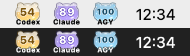

# Tokenly

macOS 메뉴 막대에서 **Codex · Claude Code · Google Antigravity(AGY)** 의 남은 사용 한도를 한눈에 확인하는 SwiftUI 앱입니다.

> **v0.1.0 개발자 미리보기(Pre-release)**
> Apple Developer ID 서명과 공증(notarization)을 받지 않은 **ad-hoc 서명** 빌드입니다. 첫 실행 때 macOS가 확인을 요구하며, 아래 [설치](#설치) 절차로 이 앱만 허용하면 됩니다. 개발자 Mac 밖에서의 동작은 아직 충분히 검증되지 않았습니다([알려진 제한](#알려진-제한)).
>
> **현재 GitHub Release는 아직 발행하지 않았습니다.** 지금은 [소스에서 빌드](#빌드와-테스트)해 실행할 수 있고, 아래 ZIP 설치 절차는 Release 발행 후 기준입니다.

## 요구 사항

- macOS 14 Sonoma 이상
- Apple silicon(arm64) 또는 Intel(x86_64) Mac — 하나의 universal 앱
- 표시하려는 서비스의 CLI(아래 [사전 준비](#사전-준비)). Python은 필요 없습니다.

## 설치

Release ZIP 기준입니다(발행 전에는 `scripts/release.sh`가 만드는 같은 형식의 ZIP으로 확인할 수 있습니다).

1. [Releases](https://github.com/jbbdyee/Tokenly/releases)에서 `Tokenly-0.1.0-macOS-universal.zip`과 `Tokenly-0.1.0-macOS-universal.zip.sha256`을 받습니다.
2. (권장) 무결성 확인: 두 파일이 있는 폴더에서 `shasum -a 256 -c Tokenly-0.1.0-macOS-universal.zip.sha256` → `OK`가 나와야 합니다.
3. ZIP을 열어 나온 `Tokenly.app`을 **응용 프로그램(`/Applications`) 폴더로 옮깁니다.** 다운로드 폴더에서 바로 실행하면 macOS가 임시 위치에서 실행해 자동 실행·CLI 연결이 동작하지 않습니다.
4. `Tokenly.app`을 엽니다. 처음에는 "확인되지 않은 개발자" 또는 "Apple이 악성 소프트웨어가 없음을 확인할 수 없음" 경고가 나오고 열리지 않습니다. **완료**(또는 취소)를 누릅니다.
5. **시스템 설정 → 개인정보 보호 및 보안**의 아래쪽 **보안** 항목에 Tokenly가 차단되었다는 안내와 함께 나타나는 **그래도 열기**를 누르고, 암호(또는 Touch ID)로 확인한 뒤 한 번 더 **열기**를 누릅니다. macOS 14에서는 Finder에서 앱을 Control-클릭 → **열기**로도 허용할 수 있습니다.
6. 메뉴 막대에 Tokenly가 나타납니다. Dock에는 나타나지 않는 메뉴 막대 전용 앱입니다.

허용은 이 앱 하나에만 적용됩니다. Gatekeeper를 끄거나(`spctl --master-disable`) 격리 속성을 일괄 제거하는 등 시스템 보안 설정을 바꿀 필요는 없으며, 권장하지 않습니다. 새 버전으로 교체하면 다시 허용해야 할 수 있습니다.

## 사전 준비

| 서비스 | 필요한 것 |
|---|---|
| Codex | [Codex CLI](https://github.com/openai/codex) 설치와 로그인(`codex login`). Tokenly는 `PATH`, `/opt/homebrew/bin`, `/usr/local/bin`, `~/.local/bin`, `~/.npm-global/bin`에서 `codex`를 찾습니다. 별도 연결 작업은 없습니다. |
| Claude Code | Claude Code 설치와 **Pro·Max 구독** 로그인. 한도 값은 Claude Code가 statusLine에 넘겨 줄 때만 오며, 세션의 첫 응답 이후부터 들어옵니다. 아래 CLI 연결이 필요합니다. |
| Google Antigravity | AGY CLI 설치와 로그인. 설정 파일 `~/.gemini/antigravity-cli/settings.json`을 씁니다. 아래 CLI 연결이 필요합니다. |

## Claude Code·AGY 연결

Claude·AGY는 각 CLI의 **statusLine 명령**으로 한도 값을 받습니다. 연결은 터미널에서 직접 실행하며, 앱의 설정 화면은 CLI 설정 파일을 바꾸지 않습니다(설정 → **AI 서비스**의 **연결 명령 복사**로 아래 명령을 복사할 수 있습니다).

```sh
T=/Applications/Tokenly.app/Contents/MacOS/Tokenly

"$T" --status                          # 연결 상태와 마지막 수신 시각(아무것도 바꾸지 않음)
"$T" --connect claude --dry-run        # 바뀔 내용만 미리 보기
"$T" --connect claude                  # 미리 보기 → 확인(y) → 백업 → 연결
"$T" --connect claude --yes            # 확인 질문 없이 연결(터미널이 아닌 곳에서 실행할 때, 내용 확인 후)
"$T" --connect agy
"$T" --disconnect claude               # Tokenly가 바꾼 부분만 원래대로
"$T" --disconnect agy
```

- 연결 대상은 Claude Code `~/.claude/settings.json`, AGY `~/.gemini/antigravity-cli/settings.json`의 최상위 `statusLine` 값 하나뿐입니다. 다른 설정은 바꾸지 않고, 바꾼 뒤 그대로인지 검사합니다.
- **기존 statusLine 보존:** 이미 쓰던 statusLine이 있으면 지우지 않습니다. Tokenly가 한도 값을 먼저 저장한 뒤 원래 명령을 같은 입력으로 실행해 그 출력을 그대로 보여 줍니다(원래 명령 시간 제한 10초).
- **백업:** 바꾸기 전에 원본 파일을 `~/Library/Application Support/Tokenly/backups/`에 권한 0600으로 복사하고, 연결 기록(원래 값과 원문)을 `…/Tokenly/statusline/`에 남깁니다. 명령이 끝나면 되돌리는 `cp -p` 명령을 출력합니다.
- **해제:** 현재 statusLine이 Tokenly가 넣은 값 그대로일 때만 원래 값(원문 서식 그대로)을 복원하거나, 원래 없었다면 제거합니다. 연결 후 직접 바꾼 statusLine은 건드리지 않습니다.
- 다른 statusLine 명령을 쓰던 경우에도 그 내용은 `--status`에 출력하지 않습니다.
- 프로젝트 폴더의 `.claude/settings.json`에 statusLine이 있으면 Claude Code는 그 값을 우선 사용하므로 그 프로젝트에서는 Tokenly가 값을 받지 못합니다.
- 연결은 `/Applications` 또는 `~/Applications`에 설치한 앱에서만 실행됩니다. 앱을 옮기면 `--connect`를 다시 실행하세요.
- 다음 경우에는 아무것도 바꾸지 않고 중단합니다: 설정 파일이 심볼릭 링크·일반 파일이 아님·올바른 JSON 객체가 아님·5MB 초과, `statusLine` 키가 여러 개, 미리 보기 후 쓰기 직전에 파일이 바뀜, 터미널이 아닌데 `--yes`가 없음. 종료 코드: 0 완료·취소·변경 없음, 2 설치 위치 아님, 3 계획 단계 중단, 4 확인 필요, 5 쓰기 실패, 64 잘못된 사용법.
- 0.1.0 개발 빌드의 Python 브리지(`…/Resources/ClaudeStatusLineBridge.py`, `AGYStatusLineBridge.py`)로 연결해 두었다면, `--connect`가 네이티브 명령으로 바꿉니다. 호환을 위해 Python 브리지는 앱 안에 남아 있습니다.

### 팝오버·메뉴 막대에 표시하기

처음 설치하면 **Codex만 표시**되고 Claude·AGY는 꺼져 있습니다. statusLine 연결(`--connect`)은 값을 **받아 오는** 설정이고, 아래 표시 설정은 받은 값을 **보여 줄지** 정하는 앱 설정이라 따로 켜야 합니다.

1. 메뉴 막대의 Tokenly를 눌러 팝오버를 열고 오른쪽 위 톱니바퀴(설정 열기)를 누릅니다.
2. **AI 서비스** 탭에서 **Claude를 팝오버에 표시**, **AGY를 팝오버에 표시**를 켭니다.
   - AGY는 수신 파일이 생긴 뒤에만 켤 수 있습니다. 연결 후 AGY CLI를 한 번 사용한 다음 **연결 확인**을 누르세요.
   - Claude는 언제든 켤 수 있지만, 값은 연결 후 Claude Code 세션의 첫 응답부터 들어옵니다. **수신 확인**으로 수신 파일이 있는지 볼 수 있습니다.
3. 숫자형·곰돌이형 메뉴 막대도 이 선택을 따릅니다. 최소형은 항상 Codex만 표시합니다. Codex를 숨겨도 5분 조회는 계속됩니다.

공개 전 개발 빌드(`com.tokenly.app`)에서 옮겨 온 경우에도 설정이 이어지지 않으므로 같은 방법으로 다시 켭니다.

## 자동 실행

팝오버의 설정(톱니바퀴) → **일반** → **로그인 시 자동 실행**을 켭니다. `/Applications` 또는 `~/Applications`에 설치한 앱에서만 켤 수 있고, macOS가 승인을 요구하면 **로그인 항목 설정 열기**에서 Tokenly를 허용합니다. 끄면 등록이 해제됩니다.

## 삭제와 설정 복원

1. Claude·AGY를 연결했다면 먼저 해제합니다: `/Applications/Tokenly.app/Contents/MacOS/Tokenly --disconnect claude`(AGY는 `agy`).
2. 설정 → **일반**에서 자동 실행을 끄고, 팝오버의 **종료**로 앱을 끕니다.
3. `/Applications/Tokenly.app`을 휴지통으로 옮깁니다.
4. (선택) 로컬 데이터 삭제: `~/Library/Application Support/Tokenly/`(수신 값·백업·연결 기록)와 앱 설정(`defaults delete io.github.jbbdyee.tokenly`).

앱을 먼저 지웠다면 CLI의 statusLine이 없는 실행 파일을 가리키게 됩니다. `~/Library/Application Support/Tokenly/backups/`의 가장 최근 `claude-settings-…json`(AGY는 `agy-settings-…json`)이 연결 직전 원본이므로 `cp -p <백업 파일> ~/.claude/settings.json`처럼 되돌리거나, 설정 파일의 `statusLine` 항목을 직접 고치세요. 백업은 연결 이후 다른 설정 변경을 담고 있지 않으니 덮어쓰기 전에 내용을 확인하세요.

## 알려진 제한

- **공증 없음:** ad-hoc 서명이라 첫 실행에 Gatekeeper 허용이 필요하고, 다운로드한 ZIP에서의 첫 실행·CLI가 앱 실행 파일을 호출하는 경로는 아직 다른 Mac에서 검증하지 않았습니다.
- **이벤트 기반 갱신:** Claude·AGY 값은 CLI가 상태줄을 그릴 때만 갱신됩니다. CLI를 쓰지 않으면 값이 멈추고, 수신 후 15분이 지나면 회색(이전 데이터)으로 표시합니다.
- **Codex app-server**는 Codex CLI에서 experimental로 표시된 기능이라 CLI 업데이트에 따라 바뀔 수 있습니다.
- **AGY**는 5시간·7일 창이 아니라 버킷별 잔여 비율을 제공합니다. IDE·Gemini API 사용량과는 다릅니다.
- **macOS 앱 목록:** 개발자 Mac(macOS 27)에서 앱 목록(Apps) 전체 보기에서 사라졌다가 다시 표시된 사례가 있었습니다. 테스트 앱으로는 같은 번들 ID의 다른 사본(빌드 결과물·백업 등)이 등록 해제될 때 빠지는 현상을 재현했지만, Tokenly가 언제 어떤 계기로 다시 표시됐는지는 확인되지 않았습니다. 보이지 않으면 Spotlight나 Finder의 응용 프로그램 폴더에서 실행하세요(`Doc/IMP-PLAN.md` 46·51–53절).
- 메뉴 막대에 아이콘이 보이지 않으면 메뉴 막대 공간이 부족하거나, macOS 버전에 따라 시스템 설정의 메뉴 막대 항목에서 허용이 필요할 수 있습니다(새 번들 ID 설치본에서는 아직 확인하지 않음).
- Gemini 자동 조회는 지원하지 않습니다. OpenAI API 사용량 연동 코드는 있으나 보류 상태입니다.
- 공개 전 개발 빌드(번들 ID `com.tokenly.app`)를 쓰던 경우, 그 설정과 로그인 항목은 새 앱으로 이어지지 않습니다. 옛 앱에서 자동 실행을 끈 뒤 교체하세요.

## 개발 동기

여러 AI 코딩 도구를 함께 쓰면 각 서비스의 5시간·주간 한도를 확인하려고 매번 다른 화면이나 CLI를 열어야 했습니다. Tokenly는 이 확인을 메뉴 막대 한 곳으로 모으고, **공식적으로 제공되는 데이터만** 읽어 숫자로 보여 주는 것을 목표로 합니다. 확인되지 않은 값은 0%나 임의 값으로 채우지 않고 "데이터 없음·이전 데이터"로 구분합니다.

## 주요 기능

- 메뉴 막대 스타일 3종: **숫자형(기본)**, **최소형**, **곰돌이형**
- 서비스별 표시 선택, 연결되지 않은 서비스 숨김, 오래된 데이터는 반투명/회색으로 구분
- 팝오버 상세: 서비스별 5시간·7일(AGY는 버킷별) 잔여율과 초기화 시각, 마지막 수신 시각
- Codex 상세에서 ChatGPT **사용 한도 재설정 권한**의 남은 횟수와 회차별 사용 기한 표시(읽기 전용)
- 라이트·다크·시스템 테마, 로그인 시 자동 실행(앱이 `/Applications`에 있을 때)

## 화면

> 아래 이미지는 **앱의 실제 렌더링 코드로 생성한 이미지**이며, 메뉴 막대를 화면 캡처한 스크린샷이 아닙니다. 실제 스크린샷은 추후 추가합니다.

| 숫자형 (기본) | 최소형 | 곰돌이형 |
|---|---|---|
|  |  |  |

- **숫자형:** 서비스마다 5시간 잔여율(크게·위)과 7일 잔여율(작게·아래), 그 아래 서비스 이름. AGY는 5시간/7일 창이 없어 가장 낮은 버킷 잔여율 하나만 표시합니다.
- **최소형:** Codex의 5시간·7일 잔여율을 한 줄로 표시합니다.
- **곰돌이형:** SceneKit으로 미리 렌더링한 3D 젤리 곰돌이가 잔여율만큼 차오르고, 안에 숫자, 아래 윤곽에 서비스 이름을 넣습니다.

## 사용 기술과 구조

- Swift 5 · SwiftUI `MenuBarExtra` · AppKit(`NSImage`, `NSStatusItem` 라벨) · Core Graphics · Core Text
- ServiceManagement(`SMAppService`, 로그인 항목) · Security(Keychain, 보류 중인 OpenAI API 연동용)
- SceneKit(3D 곰돌이 에셋 제작, **앱 런타임에는 사용하지 않음**) · POSIX(`posix_spawn`, 명령줄 statusLine 브리지)
- XCTest(호스트 앱 테스트)

```
Codex CLI ──(app-server JSON-RPC, 5분마다)──▶ CodexUsageProvider ─▶ UsageStore ─┐
Claude Code ─statusLine─▶ Tokenly --statusline claude ─▶ claude-quota.json ─┐    │
AGY CLI ─────statusLine─▶ Tokenly --statusline agy ────▶ agy-quota.json ────┴▶ ExternalProviderStore
                                                                                 │
                     HeartGauge / NumericGauge (표시·숨김·stale 규칙, 대표값) ◀──┘
                                  │
        MenuBarNumericRow · MenuBarGaugeRow(곰돌이) · 최소형 텍스트 ─▶ 메뉴 막대
        UsageMenuView ─▶ 팝오버 상세(Codex 재설정 권한 포함)
```

| 영역 | 주요 파일 |
|---|---|
| 앱 진입·메뉴 막대 라벨 | `src/Tokenly/TokenlyMain.swift`(명령줄 모드 분기), `TokenlyApp.swift` |
| Codex 조회 | `src/Tokenly/Providers/CodexUsageProvider.swift` |
| Claude·AGY 조회 | `src/Tokenly/Providers/ClaudeSubscriptionProvider.swift`, `AGYStatusLineProvider.swift`, `ExternalProviderStore.swift` |
| 상태줄 브리지·연결 | `src/Tokenly/BridgeCommand.swift`, `StatusLineBridge.swift`, `StatusLineConnector.swift`(호환용 0.1.0 Python 브리지 `ClaudeStatusLineBridge.py`, `AGYStatusLineBridge.py`) |
| 표시 규칙 | `src/Tokenly/Models/HeartGauge.swift`(이름은 초기 하트 시안에서 유래, 현재 숫자형·곰돌이형 공용), `NumericGauge.swift` |
| 렌더링 | `src/Tokenly/Views/MenuBarNumericRow.swift`, `MenuBarGaugeRow.swift`, `BearGaugeView.swift`, `UsageMenuView.swift` |
| 곰돌이 3D 에셋 제작 | `Preview/Heart3D/`(`HeartMesh.swift`, `BearModel.swift`, `BearExportB.swift`, `run-bear-b.sh`) → `src/Tokenly/Resources/BearGauge/` |
| 앱 아이콘 | `src/Tokenly/Assets.xcassets/AppIcon.appiconset/` ← 콘셉트 보드 D안에서 추출한 `Preview/AppIconConcepts/D-original-extracted/`(추출·검증 스크립트 `source/`) |

## 서비스별 연동 방식

| | Codex | Claude Code | Google Antigravity |
|---|---|---|---|
| 방식 | 공식 `codex app-server`의 읽기 전용 JSON-RPC `account/rateLimits/read` | Claude Code `statusLine` 명령이 넘기는 JSON | AGY CLI `statusLine` 명령이 넘기는 JSON |
| 갱신 | Tokenly가 **능동 조회**(5분 주기 + 새로고침) | CLI가 상태줄을 갱신할 때만(**이벤트 기반**) | CLI가 상태줄을 갱신할 때만(**이벤트 기반**) |
| 표시 값 | 5시간·7일 창, 재설정 권한 | 5시간·7일 한도 | 버킷별 잔여 비율(5시간/7일 아님) |
| 오래된 데이터 | 조회 실패 시 이전 값 표시 | 수신 후 15분 지나면 회색 | 수신 후 15분 지나면 회색 |

- **공식 조회 vs 이벤트 기반:** Codex는 앱이 언제든 공식 인터페이스에 물어볼 수 있습니다. Claude·AGY는 CLI가 실행되며 상태줄을 그릴 때만 새 값이 오므로, CLI를 쓰지 않는 동안에는 값이 멈춰 있고 Tokenly는 이를 "이전 데이터"로 표시합니다. Tokenly의 새로고침은 로컬 파일을 다시 읽을 뿐 서비스에 요청하지 않습니다.
- **Codex 재설정 권한:** Codex CLI가 생성하는 공식 프로토콜 스키마(`codex app-server generate-json-schema`)에 정의된 `rateLimitResetCredits`만 읽습니다. 권한을 소모하는 `account/rateLimitResetCredit/consume`은 호출하지 않습니다.
- 비공식 API, 웹 세션 쿠키, 인증 토큰 추출, 브라우저 자동화는 사용하지 않습니다.

## 개인정보와 로컬 데이터

- statusLine 브리지는 한도 수치·초기화 시각·수신 시각만 `~/Library/Application Support/Tokenly/`에 권한 0600으로 저장합니다. 세션·계정·경로·대화·인증정보와 원본 JSON은 저장하지 않습니다.
- Codex CLI 출력의 진단 메시지(stderr)는 버립니다. 수집한 데이터를 외부 서버로 보내지 않습니다.
- CLI 설정 백업과 연결 기록은 `~/Library/Application Support/Tokenly/backups/`, `…/statusline/`에 0600으로 저장됩니다.
- 저장소의 옛 설정 스크립트(`scripts/enable_claude_statusline.py`, 최상위 `enable_agy_statusline.py`)는 0.1.0 개발 빌드용으로 남겨 둔 것입니다. 새 설치에서는 `Tokenly --connect`를 쓰세요.

## 빌드와 테스트

```sh
open src/Tokenly.xcodeproj          # Tokenly 스킴 실행(⌘R), 테스트(⌘U)
xcodebuild -project src/Tokenly.xcodeproj -scheme Tokenly test
scripts/release.sh                  # 개발 확인: Release universal 빌드 → ad-hoc 서명 → 검증 → ZIP·SHA-256
scripts/release.sh --final 0.1.0    # 배포용: 깨끗한 작업 트리, Info.plist·CHANGELOG 버전 일치가 필요
```

`release.sh`는 저장소 밖 `~/Developer/TokenlyRelease.noindex/<버전>[-dev]/`(환경 변수 `TOKENLY_RELEASE_DIR`로 변경)에 ZIP, `.sha256`, 릴리스 노트 초안, `build-info.txt`(빌드 환경과 검증 결과)를 만듭니다. 아키텍처(arm64·x86_64), 번들 ID, Info.plist(LSUIElement·유틸리티 카테고리·macOS 14·AppIcon), 리소스, 코드 커버리지 계측이 없는지(arm64·x86_64 실행 파일에 LLVM 프로파일 섹션 `__llvm_prf`가 없어야 함)는 빌드 직후·서명 직후·ZIP을 푼 뒤 세 번, 서명 식별자와 무결성, 명령줄 모드(임시 홈)는 서명 직후와 ZIP을 푼 뒤 두 번 검사합니다. 파일 시각을 HEAD 커밋 시각으로 고정해 같은 소스에서 같은 ZIP이 나옵니다. 설치·커밋·태그·업로드는 하지 않으며, 만든 앱의 LaunchServices 등록만 해제합니다.

xcodebuild가 자동으로 만드는 스킴은 테스트 커버리지를 수집하도록 설정돼 있어 모든 빌드에 커버리지 계측(`CLANG_COVERAGE_MAPPING = YES`)이 들어갑니다. 계측된 실행 파일은 종료할 때 현재 폴더에 `default.profraw`를 쓰므로, Claude Code가 상태줄을 실행할 때마다 사용자의 프로젝트 폴더에 파일이 생깁니다. `release.sh`는 Release 빌드에 `CLANG_COVERAGE_MAPPING=NO ENABLE_CODE_COVERAGE=NO`를 지정해 계측을 끄고(`-enableCodeCoverage NO`는 `build`에서 쓸 수 없음), 위 검사로 확인합니다. Xcode·`xcodebuild`로 만드는 개발 빌드와 XCTest 커버리지 수집은 그대로입니다(`Doc/IMP-PLAN.md` 55절).

마지막 확인(개발자 Mac, macOS 27.0.1, Xcode 27.1, Swift 6.4):

| 항목 | 결과 |
|---|---|
| Debug·Release 빌드(arm64·x86_64, 2026-10-25) | 성공. 경고는 `BearGaugeView.swift:198`의 `let` 권고 1건 |
| XCTest(2026-10-26) | 91개 실행, 전부 통과(실패·건너뜀 0). 커버리지 수집 유지(앱 51.80%) |
| 명령줄 연결·해제(임시 홈, Release 빌드, 2026-10-25) | 기존 statusLine 보존 연결 → 브리지 실행 시 기존 출력 그대로 표시·한도 저장 → 재연결은 변경 없음 → 해제 후 설정 파일이 연결 전과 바이트 단위로 동일 |
| `release.sh` 개발 확인(2026-10-26, 계측 제거 후) | 모든 검사 통과(새 계측 검사 포함). 빌드 로그의 계측 플래그 0개, `__llvm_prf` 섹션 0개, 빈 폴더에서 명령줄 실행 후 `default.profraw` 생성 안 됨. ZIP 재현성(같은 소스 → 같은 SHA-256)은 2026-10-24에 세 번 실행으로 확인 |
| 메뉴 막대·팝오버 실제 화면 | 0.1.0 개발 빌드에서 개발자가 직접 확인. 새 번들 ID 릴리스 후보(`rc-20261026b`)는 2026-10-26에 설치하지 않고 실행해 확인: 기존 앱과 동시 실행 시 충돌 없음, Claude·AGY 기본 숨김(설정 → AI 서비스에서 켬), 설치 위치 밖에서는 자동 실행 토글 비활성. 자동화된 GUI 테스트는 없음 |
| 실제 Claude Code 세션(2026-10-26, 격리 환경) | 임시 프로젝트의 `.claude/settings.local.json`과 임시 `TOKENLY_HOME`으로 실제 설정을 바꾸지 않고 확인. 01:15(계측 제거 전 빌드): Swift 브리지 호출·한도 수신(0600, 허용 필드만)·기존 statusLine 출력 전달은 정상이었으나 프로젝트 폴더에 `default.profraw` 생성. **01:36(계측 제거 빌드 `rc-20261026b`): 같은 확인 모두 통과, `default.profraw` 생성 안 됨** |
| 실제 AGY CLI 세션(2026-10-26, 격리 환경) | 임시 HOME과 `sandbox-exec`로 실제 `~/.gemini` 읽기·쓰기를 막은 상태에서 계측 제거 빌드 `rc-20261026b`로 확인. 실제 AGY CLI가 Swift 브리지를 호출했고, quota 수신(0600, `remaining_fraction`·`reset_time`만 저장)·기존 statusLine 출력 전달 확인, `default.profraw` 생성 안 됨. 임시 HOME에서는 Keychain을 쓸 수 없어 AGY가 새 OAuth 인증을 진행했고, 임시 폴더에 저장된 토큰 파일은 삭제함(`Doc/IMP-PLAN.md` 56절) |
| 실제 전역 설정에서의 Swift 브리지(Claude·AGY), 새 번들 ID 앱의 `/Applications` 설치·전환(자동 실행, 앱 목록), 다운로드한 ZIP의 Gatekeeper 첫 실행 | 미검증 |

- 2026-10-26의 변경은 `scripts/release.sh`(커버리지 계측 끄기와 검사)뿐이고, `src/`의 코드는 2026-10-25 이후 바뀌지 않았습니다.
- 개발자 Mac에 설치된 앱은 공개 전 0.1.0 개발 빌드(`com.tokenly.app`)이고, 실제 Claude Code·AGY 설정은 지금도 그 앱의 **Python 브리지**를 씁니다. 새 Swift 브리지(`--statusline`)와 `--connect`/`--disconnect`는 XCTest, 임시 홈(`TOKENLY_HOME`), 격리된 실제 Claude Code·AGY 세션에서만 검증했고, 실제 설정에는 아직 적용하지 않았습니다.

테스트는 Codex 응답 파싱, Claude·AGY 수신 파일 파싱과 만료, 표시·숨김·stale 규칙, 재설정 권한 계산, 스타일 저장·이전, 숫자형·곰돌이형의 크기·정렬·잘림(픽셀 단위), statusLine 브리지·연결·해제(임시 홈) 등을 다룹니다(`src/TokenlyTests/`). 테스트용 설정 도메인은 임시 폴더에 만들어 `~/Library/Preferences`에 파일을 남기지 않습니다.

## 향후 계획

1. 실제 메뉴 막대 스크린샷 추가
2. 새 사용자 계정·다른 Mac에서 다운로드 설치 검증
3. Apple Developer Program 가입 후 Developer ID 서명·Hardened Runtime·공증

## 개발 기록

- `Doc/SPEC.md`(제품 사양), `Doc/IMP-PLAN.md`(구현 계획과 결정 기록), `Doc/TODO.md`(진행 상황)
- `Doc/BLOG-NOTES.md`: 기술 블로그용 정리(근거 파일 링크 포함)
- `Preview/`: 디자인 시안과 측정 스크립트·이미지(`Preview/README.md` 참고). 일부 과거 스크립트는 현재 코드로 실행되지 않으며 결과 이미지만 보존합니다.

## 개발 방식

설계·구현·테스트 작성과 디자인 시안 제작에 **Claude Code**와 **Codex**를 개발 보조 도구로 활용했습니다. 요구사항 결정, 시안 선택, 실제 메뉴 막대 확인은 개발자가 직접 했고, 각 결정과 검증 기록은 `Doc/IMP-PLAN.md`에 남겼습니다.

## 라이선스

[MIT](LICENSE) © 2026 jbbdyee
