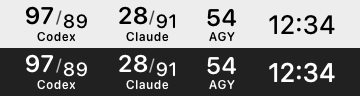
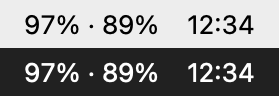

# Tokenly

> **개발 중인 팝오버 문구(2026-10-30, `feature/usage-popover-status-copy`):** 하단은 `Codex · AGY 자동 갱신 | Claude 사용 중 갱신`으로 표시합니다. 정보(i)에서 갱신 주기와 조회 방식을 확인할 수 있습니다. AGY 직접 성공값은 `마지막 갱신`, 상태줄 대체값은 `마지막 수신`으로 구분하고 Claude는 사용 중 수신한 데이터만 표시합니다. 새 UI는 전체 XCTest 406개와 Debug·Release 빌드를 통과했으며 실제 팝오버 화면 조작은 아직 확인하지 않았습니다. 기존 설치 앱에는 반영하지 않았습니다.

macOS 메뉴 막대에서 **Codex · Claude Code · Google Antigravity(AGY)** 의 남은 사용 한도를 한눈에 확인하는 SwiftUI 앱입니다. v0.2.0부터 **CPU·RAM·GPU·Disk·배터리** 상태도 메뉴 막대 위젯과 상세 팝오버로 보여 줍니다.

> **개발 소스와 공개 v0.2.0 설치본:** AGY 공식 CLI의 비대화형 `/usage`를 5분 조건부 자동 조회에 연결했고 기존 statusLine은 대체 경로로 유지합니다. 격리 개발 앱에서 첫 직접 조회의 주간 버킷·출처·성공 시각 화면 표시와 약 5분 간격의 CLI 시작 2회를 확인했습니다. 두 번째 응답 성공과 장기 안정성은 미검증입니다. 직접 조회에는 로그인된 AGY CLI가 필요하며 정상적인 인증 캐시·상태 파일 갱신이 발생할 수 있습니다. 5시간 버킷은 임의로 표시하지 않습니다. 이 변경과 위의 팝오버 문구는 기존 설치본에 적용하지 않았습니다.

## 다운로드

**[Tokenly v0.2.0 — System Monitor 내려받기](https://github.com/jbbdyee/Tokenly/releases/tag/v0.2.0)** (최신, GitHub Pre-release, 2026-10-29)

- macOS 14 Sonoma 이상, Apple silicon·Intel Mac 공용(universal) 앱입니다.
- Release 페이지의 **Assets**에서 `Tokenly-0.2.0-macOS-universal.zip`을 받습니다. 자동으로 붙는 **Source code (zip / tar.gz)** 는 실행할 수 있는 앱이 아닙니다.
- 이전 버전: [v0.1.0 — Developer Preview](https://github.com/jbbdyee/Tokenly/releases/tag/v0.1.0)(2026-10-26, AI 사용량 표시만 포함). 변경 내용은 [CHANGELOG](CHANGELOG.md)에 있습니다.
- Apple Developer ID 서명과 공증(notarization)을 받지 않은 **ad-hoc 서명** 앱이라, 첫 실행 때 macOS 보안 경고가 나타나고 실행이 막힐 수 있습니다. 시스템 설정에서 이 앱만 허용하면 됩니다.
- 상세 설치 방법은 [Release 페이지](https://github.com/jbbdyee/Tokenly/releases/tag/v0.2.0)와 아래 [설치](#설치)에 있습니다.

> **개발자 미리보기입니다.** 개발자 Mac 밖에서의 동작, 특히 내려받은 ZIP을 새 사용자 계정이나 다른 Mac에서 처음 여는 절차는 아직 확인하지 않았습니다([알려진 제한](#알려진-제한)).

## 요구 사항

- macOS 14 Sonoma 이상
- Apple silicon(arm64) 또는 Intel(x86_64) Mac — 하나의 universal 앱
- 표시하려는 서비스의 CLI(아래 [사전 준비](#사전-준비)). Python은 필요 없습니다.

## 설치

[v0.2.0 Pre-release](https://github.com/jbbdyee/Tokenly/releases/tag/v0.2.0)의 ZIP 기준입니다. 소스에서 직접 만들려면 [빌드와 테스트](#빌드와-테스트)를 참고하세요.

1. [v0.2.0 Release 페이지](https://github.com/jbbdyee/Tokenly/releases/tag/v0.2.0)의 **Assets**에서 `Tokenly-0.2.0-macOS-universal.zip`과 `Tokenly-0.2.0-macOS-universal.zip.sha256`을 받습니다.
2. (권장) 무결성 확인: 두 파일이 있는 폴더에서 `shasum -a 256 -c Tokenly-0.2.0-macOS-universal.zip.sha256` → `OK`가 나와야 합니다.
3. ZIP을 열어 나온 `Tokenly.app`을 **응용 프로그램(`/Applications`) 폴더로 옮깁니다.** 다운로드 폴더에서 바로 실행하면 macOS가 임시 위치에서 실행해 자동 실행·CLI 연결이 동작하지 않습니다.
4. `Tokenly.app`을 엽니다. 처음에는 "확인되지 않은 개발자" 또는 "Apple이 악성 소프트웨어가 없음을 확인할 수 없음" 경고가 나오고 열리지 않습니다. **완료**(또는 취소)를 누릅니다.
5. **시스템 설정 → 개인정보 보호 및 보안**의 아래쪽 **보안** 항목에 Tokenly가 차단되었다는 안내와 함께 나타나는 **그래도 열기**를 누르고, 암호(또는 Touch ID)로 확인한 뒤 한 번 더 **열기**를 누릅니다. macOS 14에서는 Finder에서 앱을 Control-클릭 → **열기**로도 허용할 수 있습니다.
6. 메뉴 막대에 Tokenly가 나타납니다. Dock에는 나타나지 않는 메뉴 막대 전용 앱입니다.

**0.1.0에서 업데이트:** Tokenly를 종료한 뒤 `/Applications/Tokenly.app`을 새 앱으로 교체합니다. 같은 위치에 교체하면 설정과 Claude Code·AGY 연결이 그대로 유지됩니다(개발자 Mac에서 확인). 시스템 위젯은 처음에 CPU·RAM·Disk·배터리가 켜진 상태로 나타납니다.

이 경고는 Tokenly가 Apple Developer ID로 서명·공증되지 않아 Apple이 앱을 확인할 수 없기 때문에 나옵니다. 위 4–5단계는 macOS의 일반적인 개별 허용 절차이며, 내려받은 이 ZIP으로 새 사용자 계정·다른 Mac에서 직접 확인하지는 않았습니다. macOS 버전과 계정 종류(표준·관리자)에 따라 문구와 인증 단계가 다를 수 있습니다.

허용은 이 앱 하나에만 적용됩니다. Gatekeeper를 끄거나(`spctl --master-disable`) 격리 속성을 일괄 제거하는 등 시스템 보안 설정을 바꿀 필요는 없으며, 권장하지 않습니다. 새 버전으로 교체하면 다시 허용해야 할 수 있습니다.

## 사전 준비

| 서비스 | 필요한 것 |
|---|---|
| Codex | [Codex CLI](https://github.com/openai/codex) 설치와 로그인(`codex login`). Tokenly는 `PATH`, `/opt/homebrew/bin`, `/usr/local/bin`, `~/.local/bin`, `~/.npm-global/bin`에서 `codex`를 찾습니다. 별도 연결 작업은 없습니다. |
| Claude Code | Claude Code 설치와 **Pro·Max 구독** 로그인. 한도 값은 Claude Code가 statusLine에 넘겨 줄 때만 오며, 세션의 첫 응답 이후부터 들어옵니다. 아래 CLI 연결이 필요합니다. |
| Google Antigravity | AGY CLI 설치와 로그인. 설정 파일 `~/.gemini/antigravity-cli/settings.json`을 씁니다. 공개 v0.2.0은 아래 statusLine 연결이 필요하고, 개발 브랜치는 직접 조회 시 연결 없이도 AGY 표시를 켤 수 있습니다. |

## Claude Code·AGY 연결

Claude·AGY는 각 CLI의 **statusLine 명령**으로 한도 값을 받습니다. 연결은 터미널에서 직접 실행하며, 앱의 설정 화면은 CLI 설정 파일을 바꾸지 않습니다(설정 → **AI 서비스**의 **연결 명령 복사**로 아래 명령을 복사할 수 있습니다).

```sh
T=/Applications/Tokenly.app/Contents/MacOS/Tokenly

"$T" --status                          # 연결 상태와 마지막 수신 시각(아무것도 바꾸지 않음)
"$T" --connect claude --dry-run        # 바뀔 내용만 미리 보기
"$T" --connect claude                  # 미리 보기 → 확인(y) → 백업 → 연결
"$T" --connect claude --yes            # 확인 질문 없이 연결(터미널이 아닌 곳에서 실행할 때, 내용 확인 후)
"$T" --connect agy
"$T" --disconnect claude               # Tokenly가 바꾼 부분만 원래대로
"$T" --disconnect agy
```

- 연결 대상은 Claude Code `~/.claude/settings.json`, AGY `~/.gemini/antigravity-cli/settings.json`의 최상위 `statusLine` 값 하나뿐입니다. 다른 설정은 바꾸지 않고, 바꾼 뒤 그대로인지 검사합니다.
- **기존 statusLine 보존:** 이미 쓰던 statusLine이 있으면 지우지 않습니다. Tokenly가 한도 값을 먼저 저장한 뒤 원래 명령을 같은 입력으로 실행해 그 출력을 그대로 보여 줍니다(원래 명령 시간 제한 10초).
- **백업:** 바꾸기 전에 원본 파일을 `~/Library/Application Support/Tokenly/backups/`에 권한 0600으로 복사하고, 연결 기록(연결 직전 statusLine과 원문, 백업 위치)을 `…/Tokenly/statusline/`에 남깁니다. 명령이 끝나면 되돌리는 `cp -p` 명령을 출력합니다.
- **해제:** 현재 statusLine이 Tokenly가 넣은 값 그대로일 때만 **연결 직전 상태**로 되돌립니다. 없었으면 제거하고, 직접 쓰던 명령이나 0.1.0 Python 브리지 명령이었으면 원문 서식 그대로 복원합니다. 연결 후 직접 바꾼 statusLine은 건드리지 않습니다. `--status`가 해제 시 동작을 미리 알려 줍니다.
  - 0.1.0 (2) 이하로 연결한 기록에는 연결 직전 값이 없어, 연결할 때 만든 백업에서 판정합니다. 맞는 백업이 정확히 하나가 아니거나 내용이 맞지 않으면 **아무것도 지우지 않고 중단**합니다.
  - 복원할 Python 브리지 파일이 없으면(앱을 옮기거나 지운 경우) 복원하지 않고 중단합니다.
- 다른 statusLine 명령을 쓰던 경우에도 그 내용은 `--status`에 출력하지 않습니다.
- 프로젝트 폴더의 `.claude/settings.json`에 statusLine이 있으면 Claude Code는 그 값을 우선 사용하므로 그 프로젝트에서는 Tokenly가 값을 받지 못합니다.
- 연결은 `/Applications` 또는 `~/Applications`에 설치한 앱에서만 실행됩니다. 앱을 옮기면 `--connect`를 다시 실행하세요.
- 다음 경우에는 아무것도 바꾸지 않고 중단합니다: 설정 파일이 심볼릭 링크·일반 파일이 아님·올바른 JSON 객체가 아님·5MB 초과, `statusLine` 키가 여러 개, 미리 보기 후 쓰기 직전에 파일이 바뀜, 터미널이 아닌데 `--yes`가 없음. 종료 코드: 0 완료·취소·변경 없음, 2 설치 위치 아님, 3 계획 단계 중단, 4 확인 필요, 5 쓰기 실패, 64 잘못된 사용법.
- 0.1.0 개발 빌드의 Python 브리지(`…/Resources/ClaudeStatusLineBridge.py`, `AGYStatusLineBridge.py`)로 연결해 두었다면, `--connect`가 네이티브 명령으로 바꾸고 `--disconnect`는 그 Python 명령으로 되돌립니다. 호환을 위해 Python 브리지는 앱 안에 남아 있습니다.

### 팝오버·메뉴 막대에 표시하기

처음 설치하면 **Codex만 표시**되고 Claude·AGY는 꺼져 있습니다. statusLine 연결(`--connect`)은 값을 **받아 오는** 설정이고, 아래 표시 설정은 받은 값을 **보여 줄지** 정하는 앱 설정이라 따로 켜야 합니다.

1. 메뉴 막대의 Tokenly를 눌러 팝오버를 열고 오른쪽 위 톱니바퀴(설정 열기)를 누릅니다.
2. **AI 서비스** 탭에서 **Claude를 팝오버에 표시**, **AGY를 팝오버에 표시**를 켭니다.
   - 공개 v0.2.0은 AGY 수신 파일이 생긴 뒤에만 켤 수 있습니다. 연결 후 AGY CLI를 한 번 사용한 다음 **연결 확인**을 누르세요. 개발 브랜치에서는 AGY CLI 로그인만으로 표시를 켤 수 있습니다.
   - Claude는 언제든 켤 수 있지만, 값은 연결 후 Claude Code 세션의 첫 응답부터 들어옵니다. **수신 확인**으로 수신 파일이 있는지 볼 수 있습니다.
3. 숫자형 메뉴 막대도 이 선택을 따릅니다. 최소형은 항상 Codex만 표시합니다. Codex를 숨겨도 5분 조회는 계속됩니다.

공개 전 개발 빌드(`com.tokenly.app`)에서 옮겨 온 경우에도 설정이 이어지지 않으므로 같은 방법으로 다시 켭니다.

## 자동 실행

팝오버의 설정(톱니바퀴) → **일반** → **로그인 시 자동 실행**을 켭니다. `/Applications` 또는 `~/Applications`에 설치한 앱에서만 켤 수 있고, macOS가 승인을 요구하면 **로그인 항목 설정 열기**에서 Tokenly를 허용합니다. 끄면 등록이 해제됩니다.

- 처음 설치한 직후에는 "시스템이 로그인 항목 상태를 확인하지 못했습니다…"가 표시될 수 있습니다. 아직 등록하지 않은 경우에도 macOS가 이렇게 보고할 수 있으므로, 그대로 토글을 켜서 등록을 시도하면 됩니다.
- 토글은 macOS가 실제로 보고한 상태만 보여 줍니다. 등록이 거부되면 "자동 실행 등록에 실패했습니다(…)", 요청 후에도 켜짐이 확인되지 않으면 "등록을 요청했지만 시스템에서 켜짐 상태가 확인되지 않았습니다"가 표시되고 토글은 꺼진 상태로 돌아갑니다.
- 이런 오류가 계속될 때만 대안으로 **시스템 설정 → 일반 → 로그인 항목**의 "로그인 시 열기"에 `/Applications/Tokenly.app`을 직접 추가할 수 있습니다.

## 삭제와 설정 복원

1. Claude·AGY를 연결했다면 먼저 해제합니다: `/Applications/Tokenly.app/Contents/MacOS/Tokenly --disconnect claude`(AGY는 `agy`).
   - 해제 결과가 "Python 브리지 명령을 복원합니다"였다면, 복원된 statusLine은 **앱 안의** `…/Tokenly.app/Contents/Resources/*StatusLineBridge.py`를 가리킵니다. 앱을 지우면 이 경로가 사라져 상태줄 명령이 실패하므로, 설정 파일(`~/.claude/settings.json`, `~/.gemini/antigravity-cli/settings.json`)에서 `statusLine` 항목을 직접 지우거나 원하는 명령으로 바꾸세요.
2. 설정 → **일반**에서 자동 실행을 끄고, 팝오버의 **종료**로 앱을 끕니다.
3. `/Applications/Tokenly.app`을 휴지통으로 옮깁니다.
4. (선택) 로컬 데이터 삭제: `~/Library/Application Support/Tokenly/`(수신 값·백업·연결 기록)와 앱 설정(`defaults delete io.github.jbbdyee.tokenly`).

앱을 먼저 지웠다면 CLI의 statusLine이 없는 실행 파일을 가리키게 됩니다. `~/Library/Application Support/Tokenly/backups/`의 가장 최근 `claude-settings-…json`(AGY는 `agy-settings-…json`)이 연결 직전 원본이므로 `cp -p <백업 파일> ~/.claude/settings.json`처럼 되돌리거나, 설정 파일의 `statusLine` 항목을 직접 고치세요. 백업은 연결 이후 다른 설정 변경을 담고 있지 않으니 덮어쓰기 전에 내용을 확인하세요.

## 알려진 제한

**개발 브랜치의 차기 버전 변경:** Codex는 1분마다 조건부 조회를 확인합니다. AI 사용량 팝오버 열림·절전 복귀에도 마지막 성공 조회와 최근 조회 시도가 각각 60초 이상 전일 때 새 조회를 시작합니다. 진행 중 요청은 중복하지 않고, 자동 조회 실패 뒤 타이머 재시도는 5분을 기다립니다. 수동 새로고침은 계속 즉시 시도합니다. 기존 성공값은 조회 중·실패 후에도 유지됩니다. 이 변경은 현재 내려받을 수 있는 v0.2.0 설치본에 포함되지 않으며 실제 앱 조작 검증은 별도입니다.

**격리 앱 확인(2026-10-30):** 별도 번들 ID의 Debug 앱과 실패 전용 임시 CLI로 초기 실행과 실패 후 300초 재시도를 실제 macOS 프로세스에서 관찰했습니다. 실제 Codex 계정의 성공 조회, 60초 후 성공 데이터 갱신, 팝오버·절전 복귀 화면 동작은 아직 확인하지 않았습니다. 세부 측정과 격리 조건은 `Doc/HANDOFF.md`에 있습니다.

실제 Codex 인증을 읽기 전용으로 재사용하는 후속 시도에서는 홈 쓰기를 차단한 app-server가 초기 응답 전에 권한 오류로 종료했습니다. 따라서 성공 조회와 60초 자동 갱신의 실제 앱 검증은 아직 완료되지 않았습니다.

이후 별도 번들 ID의 개발 앱을 정상 사용자 환경에서 실행해 공식 Codex CLI 자식 프로세스의 재실행을 120초 간격으로 두 번 관찰했습니다. 60초마다 조건을 검사하더라도 직전 조회 시각과 타이머 위상에 따라 CLI는 그보다 늦게 실행될 수 있습니다. 실제 팝오버의 성공값·갱신 시각은 화면 도구 연결 실패로 확인하지 못했습니다.

이후 사용자가 개발 앱 팝오버에서 5시간·7일 사용량과 `마지막 갱신 시간`이 10:24에서 10:25로 바뀐 것을 직접 확인했습니다. 코드상 이 시각은 새 Codex 응답의 성공적인 파싱에서만 바뀝니다. 분 단위 관찰만으로 정확한 조회 간격은 측정할 수 없습니다.

메뉴 막대 잔여량 반영과 수동 새로고침도 사용자가 추가 확인했습니다. 실패 전용 CLI의 300초 자동 재시도는 별도 실험에서 확인했습니다. 이 시점에는 팝오버를 닫은 상태의 성공 자동 갱신이 미검증이었고, 정확한 초 단위 자동 조회 간격과 절전 복귀도 확인하지 않았습니다.

추가로 사용자는 팝오버를 닫은 동안 메뉴 막대 Codex 값이 바뀌고, 사용량이 같아도 초 단위 마지막 갱신 시각이 새로 갱신되는 것을 확인했습니다. 이는 백그라운드 성공 스냅샷 반영의 화면 증거입니다. 초 단위 조회 **간격**은 측정하지 않았으며 절전 복귀와 재열기 순간 조건 적용은 남아 있습니다.

이후 Codex 앱의 사용량 팝오버를 열기 전에는 Tokenly 값이 멈춘 듯하다가, 연 뒤 변경값이 반영됐다는 관찰이 나왔습니다. 당시에는 **Codex 앱과 독립적인 서버 최신 사용량 조회는 미검증**으로 재분류하고 이 브랜치의 `main` 병합을 보류했습니다.

추가로 Codex 앱의 팝오버를 전혀 열지 않았는데도 Tokenly 메뉴 막대 값이 자동으로 바뀐 것이 확인됐습니다. 따라서 앞선 의존성 의심을 재현 결함으로 확정하지 않았고 조사는 중단했습니다. 조회 시점 차이는 가능한 설명이며, 정확한 자동 조회 간격과 서버 캐시 정책은 여전히 미확인입니다.

차기 버전에서 Codex의 `마지막 갱신 시간`은 **Tokenly의 마지막 성공 조회 시각**입니다. Claude·AGY의 `마지막 수신`은 CLI 상태줄 이벤트 시각입니다. 두 서비스의 5분 타이머와 수동 버튼은 저장된 상태줄 파일을 다시 읽으며, CLI가 새 이벤트를 보내지 않으면 서버의 새 사용량을 가져오지 않습니다.

- **공증 없음:** ad-hoc 서명이라 첫 실행에 Gatekeeper 허용이 필요합니다. 내려받은 ZIP(격리 속성 있음)을 새 사용자 계정·다른 Mac에서 처음 여는 절차와, 그 상태에서 CLI가 앱 실행 파일을 호출하는 경로는 0.1.0·0.2.0 모두 검증하지 않았습니다.
- **시스템 모니터의 비공개 값:** GPU 사용률(실험적, 기본 꺼짐)과 배터리 온도는 문서화되지 않은 시스템 값을 읽습니다. macOS 업데이트나 다른 기종(Intel Mac 포함)에서 표시되지 않거나 다를 수 있으며, 개발자 Mac(Apple M4) 밖에서는 확인하지 않았습니다.
- **이벤트 기반 갱신:** Claude·AGY 값은 CLI가 상태줄을 그릴 때만 갱신됩니다. CLI를 쓰지 않으면 값이 멈추고, 수신 후 15분이 지나면 회색(이전 데이터)으로 표시합니다.
- **Codex app-server**는 Codex CLI에서 experimental로 표시된 기능이라 CLI 업데이트에 따라 바뀔 수 있습니다.
- **AGY**는 AGY CLI가 statusLine으로 보내는 `quota`의 **버킷별** 잔여 비율과 초기화 시각을 그대로 보여 주며, 5시간·7일 창으로 바꾸지 않습니다. 개발자 계정에서는 버킷 2개(`3p-weekly`, `gemini-weekly`)가 들어왔지만, 버킷의 수·이름·주기는 계정·요금제·AGY 버전에 따라 다를 수 있습니다. IDE·Gemini API 사용량과는 다릅니다.
- **macOS 앱 목록:** 같은 번들 ID의 **다른 사본**(빌드 결과물·백업 등)이 LaunchServices에서 등록 해제되면, `/Applications`의 설치본이 그대로 있어도 앱 목록(Apps)에서 빠집니다(macOS 27, 테스트 앱과 Tokenly에서 재현). 일반 사용자의 한 번 설치에서는 생기지 않는 경로로 보이며, 개발 Mac에서 빌드할 때 생깁니다. 이 경우 `/System/Library/Frameworks/CoreServices.framework/Frameworks/LaunchServices.framework/Support/lsregister -f /Applications/Tokenly.app`로 설치본 경로만 다시 등록하면 돌아옵니다(2026-10-26 확인). 그때까지는 Spotlight나 Finder에서 실행할 수 있습니다(`Doc/IMP-PLAN.md` 51–53·62절).
- 메뉴 막대에 아이콘이 보이지 않으면 메뉴 막대 공간이 부족하거나, macOS 버전에 따라 시스템 설정의 메뉴 막대 항목에서 허용이 필요할 수 있습니다.
- Gemini 자동 조회는 지원하지 않습니다. OpenAI API 사용량 연동 코드는 있으나 보류 상태입니다.
- 공개 전 개발 빌드(번들 ID `com.tokenly.app`)를 쓰던 경우, 그 설정과 로그인 항목은 새 앱으로 이어지지 않습니다. 옛 앱에서 자동 실행을 끈 뒤 교체하세요.

## 개발 동기

여러 AI 코딩 도구를 함께 쓰면 각 서비스의 5시간·주간 한도를 확인하려고 매번 다른 화면이나 CLI를 열어야 했습니다. Tokenly는 이 확인을 메뉴 막대 한 곳으로 모으고, **공식적으로 제공되는 데이터만** 읽어 숫자로 보여 주는 것을 목표로 합니다. 확인되지 않은 값은 0%나 임의 값으로 채우지 않고 "데이터 없음·이전 데이터"로 구분합니다.

## 주요 기능

- AI 메뉴 막대 스타일 2종: **숫자형(기본)**, **최소형**. 이전 곰돌이형 저장값은 숫자형으로 전환됩니다.
- 아래 시스템 모니터 기능은 v0.2.0부터 들어 있습니다(v0.1.0에는 없음).
- 독립적인 시스템 메뉴 막대 위젯 5개(CPU·RAM·Disk·GPU·배터리). 설정 → 시스템에서 각각 스위치로 켜고 끌 수 있습니다. 처음 실행하면 CPU·RAM·Disk·배터리는 켜져 있고, 실험적 측정인 GPU는 꺼져 있습니다. 직접 바꾼 설정은 그대로 유지됩니다.
- CPU·RAM·Disk·GPU·Battery 상세 팝오버. 배터리 온도는 문서화되지 않은 레지스트리 값을 이용하므로 정확도에 한계가 있습니다.
- 활성화된 Tokenly에서 ⌘Q 종료, AI 팝오버의 기존 종료 버튼, 메뉴 막대 항목 우클릭 `Tokenly 종료`. 최신 Debug 앱에서 사용자가 세 종료 경로를 직접 확인했습니다.
- 서비스별 표시 선택, 연결되지 않은 서비스 숨김, 오래된 데이터는 반투명/회색으로 구분
- 팝오버 상세: 서비스별 5시간·7일(AGY는 버킷별) 잔여율과 초기화 시각, 마지막 수신 시각
- Codex 상세에서 ChatGPT **사용 한도 재설정 권한**의 남은 횟수와 회차별 사용 기한 표시(읽기 전용)
- 라이트·다크·시스템 테마, 로그인 시 자동 실행(앱이 `/Applications` 또는 `~/Applications`에 있을 때)

## 화면

> 아래 이미지는 **앱의 실제 렌더링 코드로 생성한 이미지**이며, 메뉴 막대를 화면 캡처한 스크린샷이 아닙니다. 실제 스크린샷은 추후 추가합니다.

| 숫자형 (기본) | 최소형 |
|---|---|
|  |  |

- **숫자형:** 서비스마다 5시간 잔여율(크게·위)과 7일 잔여율(작게·아래), 그 아래 서비스 이름. AGY는 5시간/7일 창으로 나뉘어 오지 않으므로, 받은 버킷 중 가장 낮은 잔여율 하나만 표시합니다.
- **최소형:** Codex의 5시간·7일 잔여율을 한 줄로 표시합니다.

## 사용 기술과 구조

- Swift 5 · SwiftUI `MenuBarExtra` · AppKit(`NSImage`, `NSStatusItem` 라벨) · Core Graphics · Core Text
- ServiceManagement(`SMAppService`, 로그인 항목) · Security(Keychain, 보류 중인 OpenAI API 연동용)
- POSIX(`posix_spawn`, 명령줄 statusLine 브리지)
- XCTest(호스트 앱 테스트)

```
Codex CLI ──(app-server JSON-RPC, 1분 조건)──▶ CodexUsageProvider ─▶ UsageStore ─┐
Claude Code ─statusLine─▶ Tokenly --statusline claude ─▶ claude-quota.json ─┐    │
AGY CLI ─────statusLine─▶ Tokenly --statusline agy ────▶ agy-quota.json ────┴▶ ExternalProviderStore
AGY CLI ──(print /usage, 5분 조건; 개발 브랜치)──▶ AGYDirectUsageProvider ───────┘
                                                                                 │
                     HeartGauge / NumericGauge (표시·숨김·stale 규칙, 대표값) ◀──┘
                                  │
        MenuBarNumericRow · 최소형 텍스트 ─▶ AI 메뉴 막대
        SystemMonitorStore ─▶ 시스템 위젯 5개 ─▶ 각 상세 팝오버
        UsageMenuView ─▶ 팝오버 상세(Codex 재설정 권한 포함)
```

| 영역 | 주요 파일 |
|---|---|
| 앱 진입·메뉴 막대 라벨 | `src/Tokenly/TokenlyMain.swift`(명령줄 모드 분기), `TokenlyApp.swift` |
| Codex 조회 | `src/Tokenly/Providers/CodexUsageProvider.swift` |
| Claude·AGY 조회 | `src/Tokenly/Providers/ClaudeSubscriptionProvider.swift`, `AGYStatusLineProvider.swift`, `AGYDirectUsageProvider.swift`, `ExternalProviderStore.swift` |
| 상태줄 브리지·연결 | `src/Tokenly/BridgeCommand.swift`, `StatusLineBridge.swift`, `StatusLineConnector.swift`(호환용 0.1.0 Python 브리지 `ClaudeStatusLineBridge.py`, `AGYStatusLineBridge.py`) |
| 표시 규칙 | `src/Tokenly/Models/HeartGauge.swift`(이름은 초기 하트 시안에서 유래, 숫자형의 표시·숨김 규칙에서 사용), `NumericGauge.swift` |
| 렌더링 | `src/Tokenly/Views/MenuBarNumericRow.swift`, `UsageMenuView.swift`, `src/Tokenly/SystemMonitor/UI/`의 메뉴 막대·팝오버 뷰 |
| 과거 곰돌이 시안 | `Preview/Heart3D/`에 제작·비교 자료 보존. 전용 앱 코드·에셋은 Stage 6-6B에서 삭제 |
| 앱 아이콘 | `src/Tokenly/Assets.xcassets/AppIcon.appiconset/` ← 콘셉트 보드 D안에서 추출한 `Preview/AppIconConcepts/D-original-extracted/`(추출·검증 스크립트 `source/`) |

## 서비스별 연동 방식

| | Codex | Claude Code | Google Antigravity |
|---|---|---|---|
| 방식 | 공식 `codex app-server`의 읽기 전용 JSON-RPC `account/rateLimits/read` | Claude Code `statusLine` 명령이 넘기는 JSON | 기존 `statusLine` JSON + 개발 브랜치의 공식 CLI print `/usage` |
| 갱신 | Tokenly가 **능동 조회**(1분 조건 검사 + 새로고침) | CLI가 상태줄을 갱신할 때만(**이벤트 기반**) | 개발 브랜치에서 5분 조건부 직접 조회, 실패 시 기존 statusLine 재읽기 |
| 표시 값 | 5시간·7일 창, 재설정 권한 | 5시간·7일 한도 | `quota`의 버킷별 잔여 비율·초기화 시각(버킷 구성은 계정·버전에 따라 다를 수 있음) |
| 오래된 데이터 | 조회 실패 시 이전 값 표시 | 수신 후 15분 지나면 회색 | 수신 후 15분 지나면 회색 |

- **개발 소스의 AGY:** AGY 표시가 켜져 있으면 공식 CLI를 5분 조건으로 비동기 실행합니다. 직접 조회 오류 때 기존 상태줄 파일을 대체 데이터로 읽습니다. 일반 팝오버에서는 출처에 따라 `마지막 갱신` 또는 `마지막 수신`을 표시하고 자세한 출처별 시각은 정보(i)에서 확인합니다. 격리 앱에서 첫 직접 성공 표시와 CLI 시작 간격을 확인했으나 두 번째 응답 성공은 미검증입니다. 공개 v0.2.0 설치본은 기존 statusLine 방식이며 Claude도 계속 상태줄 이벤트 기반입니다.
- **Codex 재설정 권한:** Codex CLI가 생성하는 공식 프로토콜 스키마(`codex app-server generate-json-schema`)에 정의된 `rateLimitResetCredits`만 읽습니다. 권한을 소모하는 `account/rateLimitResetCredit/consume`은 호출하지 않습니다.
- 비공식 API, 웹 세션 쿠키, 인증 토큰 추출, 브라우저 자동화는 사용하지 않습니다.

## 개인정보와 로컬 데이터

- statusLine 브리지는 한도 수치·초기화 시각·수신 시각만 `~/Library/Application Support/Tokenly/`에 권한 0600으로 저장합니다. 세션·계정·경로·대화·인증정보와 원본 JSON은 저장하지 않습니다.
- Codex CLI 출력의 진단 메시지(stderr)는 버립니다. 수집한 데이터를 외부 서버로 보내지 않습니다.
- CLI 설정 백업과 연결 기록은 `~/Library/Application Support/Tokenly/backups/`, `…/statusline/`에 0600으로 저장됩니다.
- 저장소의 옛 설정 스크립트(`scripts/enable_claude_statusline.py`, 최상위 `enable_agy_statusline.py`)는 0.1.0 개발 빌드용으로 남겨 둔 것입니다. 새 설치에서는 `Tokenly --connect`를 쓰세요.

## 빌드와 테스트

```sh
open src/Tokenly.xcodeproj          # Tokenly 스킴 실행(⌘R), 테스트(⌘U)
xcodebuild -project src/Tokenly.xcodeproj -scheme Tokenly test
scripts/release.sh                  # 개발 확인: Release universal 빌드 → ad-hoc 서명 → 검증 → ZIP·SHA-256
scripts/release.sh --final 0.2.0    # 배포용: 깨끗한 작업 트리, Info.plist·CHANGELOG 버전 일치가 필요
```

**Stage 6-8B 개발 기록:** 곰돌이 제품 에셋 제거 후 남았던 `release.sh`의 옛 필수 리소스 검사는 Stage 6-8B에서 수정했습니다. 저장소 밖 임시 위치에서 개발용 universal Release ZIP의 빌드·서명·리소스·명령줄 스모크·압축 해제 후 내용 동일성·체크섬 검증이 통과했습니다. 실제 게시·설치 검증은 아닙니다. 아래 표의 배포 결과는 이전 버전의 기록입니다.

`release.sh`는 저장소 밖 `$HOME/Developer/Tokenly-Workspace/TokenlyRelease.noindex/<버전>[-dev]/`(환경 변수 `TOKENLY_RELEASE_DIR`로 변경)에 ZIP, `.sha256`, 릴리스 노트 초안, `build-info.txt`(빌드 환경과 검증 결과)를 만듭니다. `TOKENLY_RELEASE_DIR`의 `~`·상대 경로·`..`·심볼릭 링크는 실제 절대 경로로 바꾼 뒤 저장소 안이면 거부합니다(`--print-output`은 결정된 경로만 보여 주고 아무것도 바꾸지 않음). 출력 폴더가 이미 있으면 빌드를 중단하므로 새 출력 위치가 필요하면 `TOKENLY_RELEASE_DIR`로 지정할 수 있습니다. `--replace`는 안전을 위해 비활성화되어 있으며 지정하면 오류로 중단합니다. 아키텍처(arm64·x86_64), 번들 ID, Info.plist(LSUIElement·유틸리티 카테고리·macOS 14·AppIcon), 리소스, 코드 커버리지 계측이 없는지(arm64·x86_64 실행 파일에 LLVM 프로파일 섹션 `__llvm_prf`가 없어야 함)는 빌드 직후·서명 직후·ZIP을 푼 뒤 세 번, 서명 식별자와 무결성, 명령줄 모드(임시 홈)는 서명 직후와 ZIP을 푼 뒤 두 번 검사합니다. 파일 시각은 HEAD 커밋 시각으로 고정합니다. 설치·커밋·태그·업로드는 하지 않습니다.

정리·검증 작업에서 임시 홈과 DerivedData를 남기려면 `TOKENLY_KEEP_INTERMEDIATES=1`을 지정할 수 있습니다. 기본 배포 절차의 임시 파일 처리는 그대로입니다.

- **설치본 앱 목록 보호:** Xcode는 빌드한 앱을 LaunchServices에 등록하고, 그 사본이 해제·삭제되면 같은 번들 ID의 설치본이 앱 목록에서 빠집니다. 그래서 Xcode 산출물은 임시 번들 ID(`io.github.jbbdyee.tokenly.release-build`)로 빌드하고, 배포할 사본의 Info.plist에서 그 문자열 하나만 정식 ID로 바꾼 뒤 서명합니다. 스크립트가 해제하는 등록은 출력 폴더 안의 임시 ID 레코드뿐이며, 정식 ID 레코드는 해제하지 않고 보고만 합니다.
- **개인 경로 제거:** Release 실행 파일의 디버그 맵에는 개발자 홈 아래의 소스 경로와 DerivedData 경로가 들어 있습니다. 서명 전에 `strip -S`로 디버그 기호만 지우고(함수 기호는 유지), 실행 파일에 홈·저장소·DerivedData 경로가 없는지 검사합니다. 출력 폴더가 다르면 실행 파일의 UUID(와 서명)만 다르고 나머지는 같습니다.

xcodebuild가 자동으로 만드는 스킴은 테스트 커버리지를 수집하도록 설정돼 있어 모든 빌드에 커버리지 계측(`CLANG_COVERAGE_MAPPING = YES`)이 들어갑니다. 계측된 실행 파일은 종료할 때 현재 폴더에 `default.profraw`를 쓰므로, Claude Code가 상태줄을 실행할 때마다 사용자의 프로젝트 폴더에 파일이 생깁니다. `release.sh`는 Release 빌드에 `CLANG_COVERAGE_MAPPING=NO ENABLE_CODE_COVERAGE=NO`를 지정해 계측을 끄고(`-enableCodeCoverage NO`는 `build`에서 쓸 수 없음), 위 검사로 확인합니다. Xcode·`xcodebuild`로 만드는 개발 빌드와 XCTest 커버리지 수집은 그대로입니다(`Doc/IMP-PLAN.md` 55절).

개발 기록의 이전 배포 확인(개발자 Mac, macOS 27.0.1, Xcode 27.1, Swift 6.4)은 아래와 같습니다. **Stage 6-6B 소스**는 2026-10-28에 곰돌이 전용 파일 정리 후 전체 379개 자동 테스트와 Debug·Release 빌드가 통과했습니다. 이후 해당 Debug 앱에서 사용자는 CPU·RAM·Disk·Battery 좌클릭 팝오버, AI 좌·우클릭, 시스템 우클릭 종료 메뉴, 시스템 스위치 5개, Battery `최대 용량`·ⓘ, 숫자형·최소형, 다크·라이트·시스템 테마, 설정 재실행 복원, 기존 종료 버튼·우클릭 종료·⌘Q 종료를 직접 확인했습니다. 최신 Stage 6-7 디자인·0.85배 스위치가 반영된 Debug 앱에서는 시스템 팝오버 5개와 스위치의 **다크 계열 화면 디자인**을 사용자 시각 확인·승인했습니다. 이 빌드의 스위치 조작·VoiceOver·키보드·재실행 복원·라이트 테마는 별도 검증이 필요합니다. 전체 자동 테스트 380개와 Debug·Release 빌드는 Stage 6-8C에서 다시 통과했습니다. 과거 미커밋 상태는 당시의 기록이며 현재 GitHub 반영 여부는 원격 커밋 기록으로 확인해야 합니다. 자세한 범위는 `Doc/HANDOFF.md`를 참조하세요.

| 항목 | 결과 |
|---|---|
| Debug·Release 빌드(arm64·x86_64, 2026-10-25) | 당시 성공. 곰돌이 렌더러는 Stage 6-6에서 타깃에서 제외 |
| XCTest(2026-10-26) | 112개, 3회 반복 모두 통과(실패·건너뜀 0) |
| 명령줄 연결·해제(임시 홈, Release 빌드, 2026-10-25) | 기존 statusLine 보존 연결 → 브리지 실행 시 기존 출력 그대로 표시·한도 저장 → 재연결은 변경 없음 → 해제 후 설정 파일이 연결 전과 바이트 단위로 동일 |
| `release.sh` 개발 확인(2026-10-26, 계측 제거 후) | 모든 검사 통과(새 계측 검사 포함). 빌드 로그의 계측 플래그 0개, `__llvm_prf` 섹션 0개, 빈 폴더에서 명령줄 실행 후 `default.profraw` 생성 안 됨. ZIP 재현성은 2026-10-24에 **같은 출력 경로**에서 세 번 실행해 같은 SHA-256으로 확인. 출력 경로가 다르면 실행 파일 UUID(와 서명)가 달라져 SHA-256도 달라집니다(2026-10-26 확인) |
| 메뉴 막대·팝오버 실제 화면 | 0.1.0 개발 빌드에서 개발자가 직접 확인. 새 번들 ID 릴리스 후보(`rc-20261026b`)는 2026-10-26에 설치하지 않고 실행해 확인: 기존 앱과 동시 실행 시 충돌 없음, Claude·AGY 기본 숨김(설정 → AI 서비스에서 켬), 설치 위치 밖에서는 자동 실행 토글 비활성. 자동화된 GUI 테스트는 없음 |
| 실제 Claude Code 세션(2026-10-26, 격리 환경) | 임시 프로젝트의 `.claude/settings.local.json`과 임시 `TOKENLY_HOME`으로 실제 설정을 바꾸지 않고 확인. 01:15(계측 제거 전 빌드): Swift 브리지 호출·한도 수신(0600, 허용 필드만)·기존 statusLine 출력 전달은 정상이었으나 프로젝트 폴더에 `default.profraw` 생성. **01:36(계측 제거 빌드 `rc-20261026b`): 같은 확인 모두 통과, `default.profraw` 생성 안 됨** |
| 실제 AGY CLI 세션(2026-10-26, 격리 환경) | 임시 HOME과 `sandbox-exec`로 실제 `~/.gemini` 읽기·쓰기를 막은 상태에서 계측 제거 빌드 `rc-20261026b`로 확인. 실제 AGY CLI가 Swift 브리지를 호출했고, quota 수신(0600, `remaining_fraction`·`reset_time`만 저장)·기존 statusLine 출력 전달 확인, `default.profraw` 생성 안 됨. 임시 HOME에서는 Keychain을 쓸 수 없어 AGY가 새 OAuth 인증을 진행했고, 임시 폴더에 저장된 토큰 파일은 삭제함(`Doc/IMP-PLAN.md` 56절) |
| 개발자 Mac 실제 환경(2026-10-26) | `/Applications`에 새 번들 ID 설치(개발 빌드 0.1.0 (3)), 앱 안에서 로그인 항목 등록 성공(`enabled, allowed`, 옛 항목 중복 없음). 실제 Claude Code·AGY 전역 설정을 `--connect`로 Swift 브리지로 전환하고, 실제 세션에서 호출·수신(0600)·`stack_with_default` 유지·`default.profraw` 없음 확인. 빌드 3 설치 후 Codex·Claude·AGY 표시를 다시 확인. `--disconnect --dry-run`은 두 소스 모두 Python 브리지 복원을 안내(실제 해제는 복사본에서만 실행) |
| 앱 목록(2026-10-26) | `release.sh`의 산출물 등록 해제 뒤 설치본이 빠짐 → 설치본 경로 재등록으로 복구. `release.sh`는 임시 번들 ID 빌드로 바꿔, 개발 빌드 3회에서 정식 ID 등록·해제 알림 0건 |
| 최종 빌드 0.1.0 (3)(`release.sh --final 0.1.0`, 2026-10-26) | 최종 ZIP(SHA-256 `b2890dd1…0d124`)의 앱을 `/Applications`에 설치(설치본 내용 해시가 ZIP의 앱과 같음). 메뉴 막대·팝오버·설정 화면, Codex·Claude·AGY 실사용 표시를 개발자가 직접 확인. 기존 설정·연결 기록·백업 유지 |
| 재로그인 후 자동 실행(2026-10-26) | 최종 빌드에서 앱 안 로그인 항목을 켠 상태(`enabled, allowed`)로 재로그인 → Tokenly가 자동으로 실행되는 것을 개발자가 직접 확인 |
| 최종 빌드 0.2.0 (4)(`release.sh --final 0.2.0`, 2026-10-29) | 깨끗한 `b9089c8` 복제본에서 생성, 전체 자동 테스트 386개 통과, ZIP SHA-256 `8b4c2c27…b34a1`, 해제본 = 서명본. 같은 소스의 0.2.0 (4)로 설치된 0.1.0 (3)을 교체해 설정 유지·Claude 수신·Codex 조회 확인, 설치본 UI는 개발자가 직접 조작해 이상 없음을 확인. 키보드·VoiceOver는 미검증 |
| 다운로드한 ZIP의 Gatekeeper 첫 실행(새 사용자 계정·다른 Mac, G2) | **미검증**(0.1.0·0.2.0 모두) |
| 재부팅 후 자동 실행 | 미검증 |

테스트는 Codex 응답 파싱, Claude·AGY 수신 파일 파싱과 만료, 표시·숨김·stale 규칙, 재설정 권한 계산, 스타일 저장·이전, 숫자형의 크기·정렬·잘림(픽셀 단위), System Monitor의 측정·표시, statusLine 브리지·연결·해제(임시 홈) 등을 다룹니다(`src/TokenlyTests/`). 테스트용 설정 도메인은 임시 폴더에 만들어 `~/Library/Preferences`에 파일을 남기지 않습니다.

## 향후 계획

1. 실제 메뉴 막대 스크린샷 추가
2. 새 사용자 계정·다른 Mac에서 다운로드 설치 검증
3. Apple Developer Program 가입 후 Developer ID 서명·Hardened Runtime·공증

## 개발 기록

- `Doc/SPEC.md`(제품 사양), `Doc/IMP-PLAN.md`(구현 계획과 결정 기록), `Doc/TODO.md`(진행 상황), `Doc/SYSTEM-MONITOR.md`(시스템 모니터 사양·검증)
- [`Doc/BRANCHING.md`](Doc/BRANCHING.md): 브랜치 운영 규칙(`feature/*` → `test` → `main`)과 릴리즈 태그 규칙
- `Doc/BLOG-NOTES.md`: 기술 블로그용 정리(근거 파일 링크 포함)
- `Preview/`: 디자인 시안과 측정 스크립트·이미지(`Preview/README.md` 참고). 일부 과거 스크립트는 현재 코드로 실행되지 않으며 결과 이미지만 보존합니다.

## 개발 방식

설계·구현·테스트 작성과 디자인 시안 제작에 **Claude Code**와 **Codex**를 개발 보조 도구로 활용했습니다. 요구사항 결정, 시안 선택, 실제 메뉴 막대 확인은 개발자가 직접 했고, 각 결정과 검증 기록은 `Doc/IMP-PLAN.md`에 남겼습니다.

## 라이선스

[MIT](LICENSE) © 2026 jbbdyee
